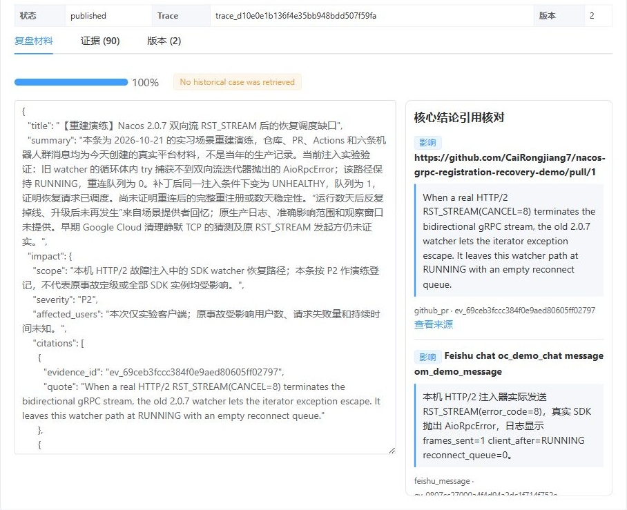
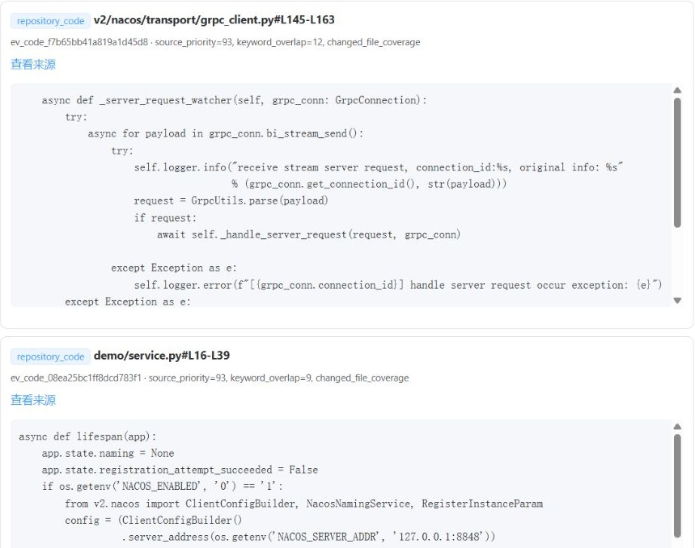
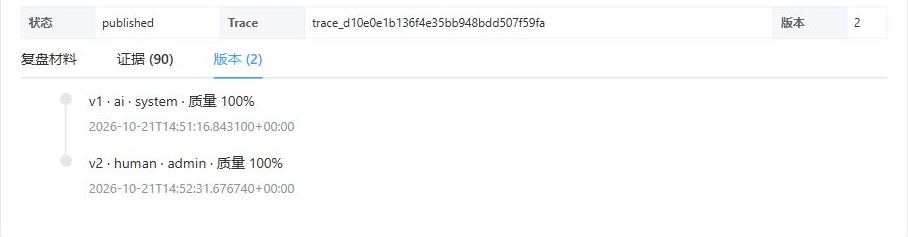
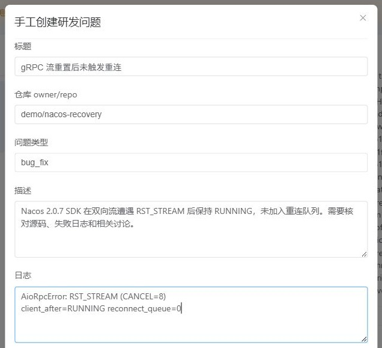

# 研发问题复盘 Agent（小组/部门核心版）

面向合并 PR 和手工问题的证据化复盘工作流：自动汇聚 GitHub、飞书和历史知识上下文，生成带原文引用的结构化复盘，经人工审核后发布到飞书 Wiki，并回流 PostgreSQL/pgvector 供后续问题召回。

## 界面预览

主要入口是 `/retrospective`：围绕一个研发问题，收集材料、核对结论、人工审核，再把复盘沉淀为可检索的历史案例。

以下为当前 Vue 前端的实际界面，截图于 2026-10-27，使用 [2026-10-21 Nacos 场景重建演练](docs/real-walkthrough-2026-10-21.md)保存的 API 响应进行只读回放；飞书群与消息标识已脱敏，图片截取页面重点区域。演练的人工介入与验证范围见记录，截图不表示当前外部服务在线。

### 复盘材料与引用核对

左侧查看结构化复盘中的摘要、影响范围、根因和修复方案，右侧逐条核对结论引用的原文与来源。待审核时可编辑 JSON、保存人工版本，并通过或驳回；下图展示已审核的人工版本。质量分与引用匹配不能代替事实审核。



### 原始证据与源码定位

“证据”页签保留 PR、diff、飞书消息与固定版本源码，并显示材料是否进入模型上下文。下图为源码区域，可查看文件、行号、选择依据及原始来源。



### AI 初稿与人工版本留痕

“版本”页签记录 AI 初稿和人工修订的版本、操作者、时间与质量分。下图任务已发布，保留了 AI v1 与人工 v2；审核后的版本用于飞书发布及知识回流。



### 手工创建研发问题

除合并 PR 自动触发外，也可以手工填写问题、所属仓库、描述和日志，补充需要检索的飞书范围，再运行复盘链路。下图为表单局部，使用示例输入，未提交。



## 当前实现与演练记录

2026-10-23 已落地轻量代码发现：固定 SHA 上按 Python 方法、导入别名、直接继承和任务入口补齐两跳候选，默认不增加模型调用。可选 `CODE_CONTEXT_PLANNER_ENABLED=1` 仅在存在未解析方法线索时追加一次规划（15 秒、700 输出 Token、最多 6 个唯一符号），失败回退静态结果。文件、区域和字符预算继续生效。方案与限制见[实施设计](docs/incident-context-discovery-design.md)。

业务仓库可放置 `.insight/context.json`，按服务路径关联同仓库文档与显式依赖，格式见[示例](backend/examples/incident-context-map.json)；依赖只表示候选，不自动证明业务受影响，也不会自动抓取其他仓库。生成请求在调用模型前保存到新增的 `generation_contexts` 表，包括重试、失败请求和驳回重生；现有 HTTP 接口不返回完整快照。升级现有环境须先用 `docker compose build api` 构建新后端镜像，再运行 `docker compose run --rm migrate`，最后更新 API/Worker 容器；旧输入不能回填复原。默认 Compose 现已转发四项 RAG/扩展文件配置。当前为工作区实现与隔离测试结果，未更新原演练或生产部署。

项目整体组件、数据流、主链路与旧平台边界、部署配置和持续升级记录见[项目架构文档](docs/architecture.md)。后续架构升级须同步维护该文档，要求见 [AGENTS.md](AGENTS.md)。

真实平台演练的材料、部署、故障及验证边界见 [2026-10-21 Nacos 场景记录](docs/real-walkthrough-2026-10-21.md)。该次已完成真实 Wiki 发布、1 案例/5 个 1024 维知识片段入库与召回，包含生成和部分发布的人工恢复；公网 Webhook 改用真实 API 数据本地转投。生成中的引文匹配失败会阻止进入审核；同轮重试将收到具体校验错误，并按原文重新生成。

## 核心闭环

```text
GitHub merged PR Webhook / 手工创建
  -> GitHub PR、commit、diff、评论和 CI 日志
  -> 固定 PR 代码版本，按 diff/错误栈定位函数并扩展调用、导入和测试关联源码
  -> 飞书指定群消息、文档上下文
  -> 上下文去重、日志/差异裁剪和预算控制
  -> PostgreSQL 全文检索 + pgvector 历史案例召回与精排
  -> OpenAI Responses API 结构化复盘
  -> Evidence ID 与原文引用硬校验
  -> 人工编辑、通过或驳回
  -> 飞书 Wiki 发布
  -> 审核版本分块、向量化并回流知识库
```

核心页面位于 `/retrospective`。原有仓库自治和演示页面仍保留，但不作为本次复盘闭环的事实数据源。

## 技术实现

| 能力 | 实现 |
| --- | --- |
| API / 状态机 | FastAPI、Pydantic，固定状态迁移 |
| 异步任务 | Celery + Redis |
| 事实存储 | PostgreSQL |
| 语义检索 | pgvector + PostgreSQL 全文检索，按案例 RRF 融合与规则精排 |
| 模型生成 | 官方 OpenAI Python SDK、Responses API、Function Calling + Pydantic 校验 |
| 外部上下文 | GitHub REST API、指定 commit 的仓库源码、飞书开放平台 |
| 管理台 | Vue 3 + Element Plus |
| 部署 | Docker Compose |

生产核心链路不会静默回退到 JSON、SQLite、FAISS 或内存存储；内存适配器仅供单元测试显式注入。

代码上下文会从 PR 的 head commit（缺失时使用记录的 commit）下载同仓库的只读 ZIP 归档到临时目录，并非读取 Agent 工作区的本地文件。它将改动函数、未改动的调用方/被调用方、导入模块及相关测试转为带 commit、文件和行号的 Evidence；对能唯一定位目标文件的调用和导入边，还会查找距改动文件两跳的候选。基础候选上限为 10 个文件；多个 diff 文件时按改动文件数自适应扩展，最多 40 个，每文件最多取 2 个不同改动区域。进入模型的片段仍受总上下文预算限制。静态图关系只用于寻找候选，复盘结论仍需引用源码或其他原始证据。仓库归档不可用时，任务继续使用已收集的 PR、CI 和飞书证据，并在问题元数据记录 `code_context_warning`。

审核并发布后的结构化复盘会进入 RAG 知识库：保存完整版本，以案例主卡片、故障症状、根因、修复方案、预防措施五类语义片段建立索引；长字段分段，并保留原始 Evidence ID。全文和向量检索各取候选，使用 RRF 合并，按案例去重后根据模块、关键词和标题精排，默认返回 5 个历史案例。历史案例只作类比，当前问题的结论仍须引用当前 Evidence。切片、候选池和排序参数可通过 `RAG_CHANNEL_POOL=40`、`RAG_RRF_K=60`、`RAG_RERANK_POOL=20`、`RAG_TOP_K=5` 调整；设置依据和限制见[证据与上下文管理台账](docs/evidence-context-ledger.md)。

## Docker 一键启动

前置条件只有 Docker Engine、Docker Compose v2，以及可用的 OpenAI、GitHub、飞书测试凭据。

```powershell
Copy-Item .env.example .env
# 编辑 .env，填写所有必填凭据和检索范围
docker compose config --quiet
docker compose up -d --build
docker compose ps
```

启动后：

- 管理台：`http://localhost/retrospective`
- API 前缀：`http://localhost/api`
- 健康检查：`http://localhost/api/health`
- 连接器状态：`http://localhost/api/connectors/status`
- 历史案例检索：`GET http://localhost/api/retrospective/knowledge/search?q=关键词&repo_id=仓库ID`
- GitHub Webhook：`http://<可访问地址>/webhooks/github`

当前 Compose 将 Nginx 暴露在主机 80 端口，并将 API 8000 保留在容器网络中；本地 Vite 开发端口为 5173。`migrate` 容器创建 vector 扩展和业务表；`/api/health` 与 `/api/connectors/status` 用于检查业务依赖配置及存储就绪，Compose 的 API 探针使用 `/api/liveness`，真实外部权限与 Worker 消费能力仍需联调。

## 必填配置

| 变量 | 用途 |
| --- | --- |
| `POSTGRES_PASSWORD` | 本地 PostgreSQL 密码 |
| `OPENAI_API_KEY` / `OPENAI_MODEL` | 结构化复盘生成 |
| `EMBEDDING_MODEL` | Evidence 和知识条目向量化 |
| `GITHUB_TOKEN` | 拉取 PR、diff、commit、评论和 Actions 日志 |
| `GITHUB_WEBHOOK_SECRET` | GitHub Webhook HMAC-SHA256 验签 |
| `FEISHU_APP_ID` / `FEISHU_APP_SECRET` | 飞书 tenant token |
| `FEISHU_WIKI_SPACE_ID` | 发布目标 Wiki 空间 |
| `FEISHU_WIKI_PARENT_NODE_TOKEN` | 发布父节点 |
| `FEISHU_CHAT_IDS` | 默认检索群，逗号分隔 |
| `FEISHU_DOC_TOKENS` | 默认检索文档，逗号分隔 |

Webhook 创建的问题会自动继承默认飞书范围；手工创建时可以覆盖群和文档列表。向量适配器按每批最多 20 条调用兼容接口，并校验返回索引；此行为无需新增环境变量，适用于取证、发布和检索查询。单段长度、配额和模型维度仍须与所用服务核对。

可选 `OPENAI_ENABLE_THINKING` 默认留空，表示不向生成服务发送此扩展参数；支持 `enable_thinking` 的兼容提供商可设为 `0` 或 `1`。本机百炼演练使用 `0`，仅控制生成模式，不影响向量化与引用校验。该参数不是通用 OpenAI 参数，其他提供商应保持留空；Compose 的 API/Worker 均转发此项。

### 千问配置

项目已针对百炼 OpenAI 兼容接口做过真实调用验证。推荐配置如下：

```dotenv
OPENAI_API_KEY=你的百炼_API_Key
OPENAI_MODEL=qwen3.7-flash
OPENAI_BASE_URL=https://dashscope.aliyuncs.com/compatible-mode/v1
EMBEDDING_MODEL=qwen3.7-text-embedding-flash
```

也可以把 `OPENAI_BASE_URL` 换成百炼控制台提供的业务空间专属 `.../compatible-mode/v1` 地址。生成链路使用 Responses Function Calling，避免千问把 JSON 包在 Markdown 代码块中造成 SDK 严格解析失败；最终结果仍会经过完整 Pydantic 与 Evidence 引用校验。当前向量模型默认返回 1024 维，与 pgvector 表结构兼容。

### GitHub Webhook 配置

1. 先生成高熵 Secret，并将结果填入 `.env` 的 `GITHUB_WEBHOOK_SECRET`：

   ```powershell
   $bytes = New-Object byte[] 32
   [Security.Cryptography.RandomNumberGenerator]::Fill($bytes)
   [Convert]::ToHexString($bytes).ToLower()
   ```

2. GitHub 仓库进入 `Settings -> Webhooks -> Add webhook`，填写：

   | 配置项 | 值 |
   | --- | --- |
   | Payload URL | `https://你的公网域名/webhooks/github` |
   | Content type | `application/json` |
   | Secret | 与 `.env` 中 `GITHUB_WEBHOOK_SECRET` 完全相同 |
   | SSL verification | Enable SSL verification |
   | Events | Let me select individual events，只勾选 Pull requests |
   | Active | 勾选 |

   GitHub 无法访问 `localhost`。按默认 Compose 启动时，用 HTTPS 隧道将 Nginx 的 `localhost:80` 暴露出去，再把隧道地址拼成 `https://<隧道域名>/webhooks/github`，Nginx 会把 `/webhooks/` 转发给 API。直接运行本地 API 时也可将 `localhost:8000` 暴露出去；Vite 开发服务当前只代理 `/api`。

3. `GITHUB_TOKEN` 推荐使用 Fine-grained personal access token，只授权目标仓库，并开启 `Pull requests: Read`、`Actions: Read` 和 `Contents: Read`；分别用于 PR 取证、失败的 Actions 运行及日志，以及按 commit SHA 下载[仓库 ZIP 归档](https://docs.github.com/en/rest/repos/contents?apiVersion=2022-11-28#download-a-repository-archive-zip)以读取 diff 之外的源码。
4. 保存 Webhook 后，GitHub 会先发送 `ping`。真正触发复盘的事件必须是 `pull_request` 且 payload 同时满足 `action=closed`、`pull_request.merged=true`。在 Webhook 的 `Recent Deliveries` 中应看到接口返回 `202`；签名错误会返回 `401`。

修改 `.env` 后执行：

```powershell
docker compose --env-file .env up -d --force-recreate api worker
```

### 飞书变量配置

当前项目只主动调用飞书 OpenAPI，不接收飞书事件，所以不需要配置飞书事件订阅地址。

1. 在飞书开放平台创建“企业自建应用”，开启机器人能力。在“凭证与基础信息”复制 App ID 和 App Secret：

   ```dotenv
   FEISHU_BASE_URL=https://open.feishu.cn
   FEISHU_APP_ID=cli_xxx
   FEISHU_APP_SECRET=xxx
   ```

2. 在“权限管理”中为应用申请下列接口需要的权限，然后创建版本并发布：

   - 获取会话历史消息：`GET /open-apis/im/v1/messages`
   - 获取新版文档纯文本：`GET /open-apis/docx/v1/documents/{document_id}/raw_content`
   - 在知识库创建节点：`POST /open-apis/wiki/v2/spaces/{space_id}/nodes`
   - 创建新版文档块：`POST /open-apis/docx/v1/documents/{document_id}/blocks/{block_id}/children`

   飞书控制台会按接口显示并申请当前准确的权限名称；至少需要消息只读、文档只读、文档编辑和知识库节点创建/编辑能力。

   2026-10-21 真实接口核对：群消息需要 `im:message.group_msg`；文档回读接受 `docx:document` 或 `docx:document:readonly`，写块接受 `docx:document` 或 `docx:document:write_only`。只有 Wiki 建节点权限仍可能建出空页后写正文失败。权限须以应用身份开通并发布版本，且目标节点的资源访问权限仍需单独满足。发布失败后应先检查是否已经创建节点，避免直接重试造成重复页面。

3. 把机器人加入需要检索的群。通过飞书 API 调试台调用“获取用户或机器人所在的群列表”取得以 `oc_` 开头的 `chat_id`，多个群用英文逗号分隔：

   ```dotenv
   FEISHU_CHAT_IDS=oc_xxx,oc_yyy
   ```

4. `FEISHU_DOC_TOKENS` 填新版文档 URL 中 `/docx/` 后面的 `document_id`，多个文档用英文逗号分隔。若来源是 `/wiki/<node_token>` 链接，要先通过 Wiki 节点接口取得节点的 `obj_token`，不能直接填 Wiki node token：

   ```dotenv
   FEISHU_DOC_TOKENS=doxcn_xxx,doxcn_yyy
   ```

5. 在飞书知识库中创建或选定发布父节点：

   - `FEISHU_WIKI_SPACE_ID`：通过“获取知识空间列表”API 取得目标空间的 `space_id`。
   - `FEISHU_WIKI_PARENT_NODE_TOKEN`：目标父页面 URL 中 `/wiki/` 后面的 node token。

   ```dotenv
   FEISHU_WIKI_SPACE_ID=7xxxxxxxxxxxxxxx
   FEISHU_WIKI_PARENT_NODE_TOKEN=wikcn_xxx
   ```

6. 把应用/机器人加入目标知识空间并授予编辑权限，同时确保应用有权访问 `FEISHU_DOC_TOKENS` 指定的文档。完成后重建 `api`、`worker`，再检查 `http://localhost/api/health` 和 `http://localhost/api/connectors/status`。

## 使用流程

1. 在 GitHub 仓库配置 `pull_request` Webhook 和相同的 Secret；只有 `closed + merged=true` 会创建任务。
2. 或在“核心复盘”页面手工创建问题，然后点击“运行链路”。
3. Worker 收集并保存原始 Evidence，只把经过选择和裁剪的片段送入模型。
4. 在复盘页面查看质量分、风险提示和引用证据，必要时编辑 JSON 并保存人工版本。
5. 执行“通过”；驳回时必须填写原因。
6. 只有 `approved` 版本可以发布。发布成功后保存飞书 URL，并创建可检索知识条目。
7. 使用 `GET /api/retrospective/knowledge/search?q=...` 验证新案例召回。

## 核心 API

| 方法与路径 | 说明 |
| --- | --- |
| `POST /webhooks/github` | GitHub merged PR 入口、验签与 delivery 幂等 |
| `POST /api/retrospective/incidents` | 手工创建问题 |
| `POST /api/retrospective/incidents/{id}/run` | 投递 Celery 主流程 |
| `POST /api/retrospective/incidents/{id}/regenerate` | 驳回后基于已保存 Evidence 重新生成 |
| `GET /api/retrospective/incidents/{id}` | 问题、Evidence、版本和审核历史 |
| `PATCH /api/retrospective/incidents/{id}/document` | 保存人工修改版本 |
| `POST .../{id}/approve` / `reject` | 审核操作 |
| `POST .../{id}/publish` | 发布飞书并回流知识库 |
| `GET /api/retrospective/knowledge/search` | 混合检索已发布知识 |

## 本地验证

完整 Docker 闭环可使用独立的模拟外部平台环境验证，不使用正式 `.env` 中的凭据，也不会污染正式 PostgreSQL 或飞书空间：

```bash
sh e2e/run.sh
```

测试覆盖 GitHub Webhook 验签与幂等、PR/Commit/Diff/CI 取证、飞书聊天与文档取证、Celery 异步生成、人工审核、飞书 Wiki 发布、PostgreSQL/pgvector 知识入库及 RAG 二次召回。详细说明见 [`docs/e2e-testing.md`](docs/e2e-testing.md)。

```powershell
$env:PYTHONPATH = "$PWD\backend\src"
backend\.venv\Scripts\python.exe -m pytest backend\tests\test_retrospective_pipeline.py -q
backend\.venv\Scripts\python.exe -m pytest backend\tests -q

Set-Location frontend
npm run build
```

核心单元测试使用显式 Fake/内存适配器，覆盖 Webhook 验签与幂等、完整审核发布回流、虚假引用拦截和上下文预算。2026-10-21 另完成 GitHub、飞书、百炼和 PostgreSQL 的单案例真实联调，人工介入及限制见执行记录；仍需真实问题集、生产权限与部署条件下的正式验收。

## 关键目录

```text
backend/src/repo_maintainer/
  retrospective_models.py       # 核心数据契约与状态机
  retrospective_connectors.py   # GitHub、飞书、OpenAI、Redis
  retrospective_pipeline.py     # 固定工作流、质量校验和闭环
  retrospective_store.py        # PostgreSQL/pgvector 与测试适配器
  retrospective_schema.sql      # vector 扩展和业务表
  retrospective_api.py          # 核心 API
  retrospective_tasks.py        # Celery Worker
frontend/src/views/RetrospectiveView.vue
compose.yaml
docs/
```

需求范围、实施顺序和验收方法分别见 [product-requirements.md](docs/product-requirements.md)、[implementation-plan.md](docs/implementation-plan.md) 和 [acceptance-criteria.md](docs/acceptance-criteria.md)。证据来源、上下文管理和后续方案变更统一记录在 [智能复盘证据与上下文台账](docs/evidence-context-ledger.md)。当前完成度与待真实联调项见 [implementation-status.md](docs/implementation-status.md)，旧方案取舍见 [legacy-solution-review.md](docs/legacy-solution-review.md)。
