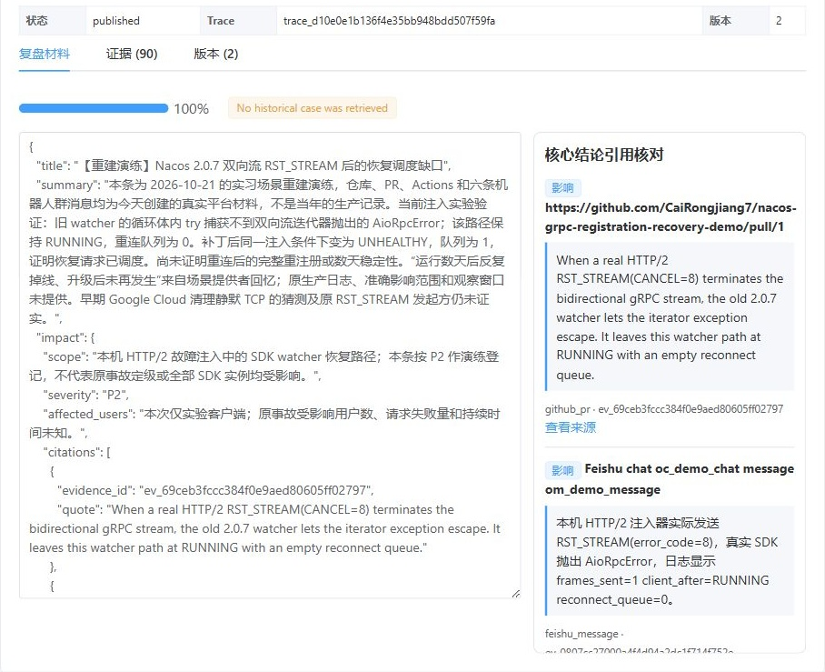
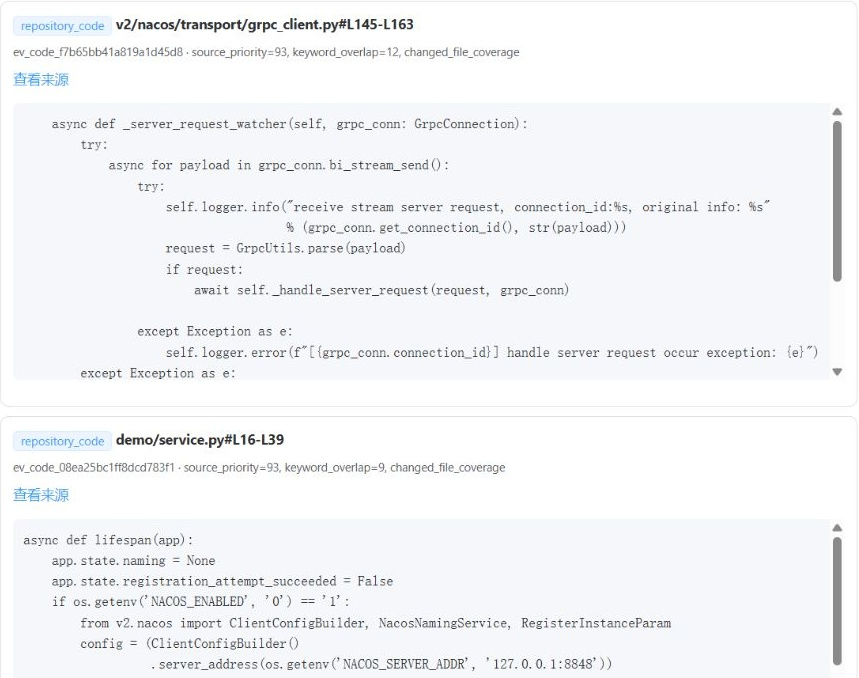
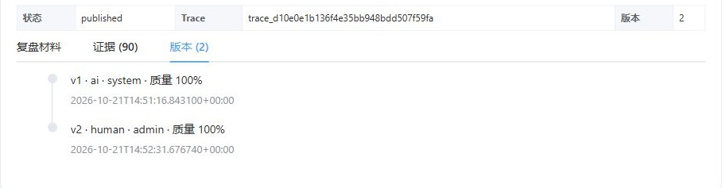
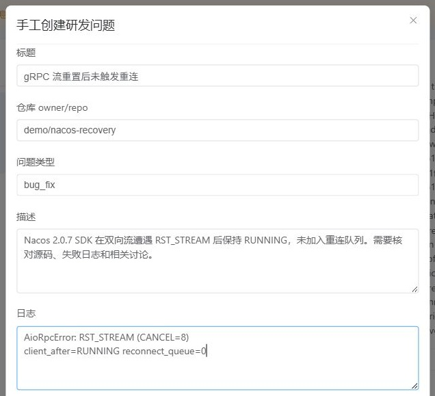

# 研发问题复盘 Agent（小组/部门核心版）

面向合并 PR、手工问题和飞书群 @机器人命令的证据化复盘工作流：自动汇聚 GitHub、飞书和历史知识上下文，生成带原文引用的结构化复盘，经人工审核后发布到飞书 Wiki，并回流 PostgreSQL/pgvector 供后续问题召回。

## 界面预览

主要入口是 `/retrospective`：围绕一个研发问题，收集材料、核对结论、人工审核，再把复盘沉淀为可检索的历史案例。

以下为当前 Vue 前端的实际界面，截图于 2026-10-27，使用 [2026-10-21 Nacos 场景重建演练](docs/real-walkthrough-2026-10-21.md)保存的 API 响应进行只读回放；飞书群与消息标识已脱敏，图片截取页面重点区域。演练的人工介入与验证范围见记录，截图不表示当前外部服务在线。

### 复盘材料与引用核对

左侧查看结构化复盘中的摘要、影响范围、根因和修复方案，右侧逐条核对结论引用的原文与来源。待审核时可编辑 JSON、保存人工版本，并通过或驳回；也可填写审核意见交给 Agent 重新取证修订，新版仍须人工审核；下图展示已审核的人工版本。质量分与引用匹配不能代替事实审核。



### 原始证据与源码定位

“证据”页签保留 PR、diff、飞书消息与固定版本源码，并显示材料是否进入模型上下文。下图为源码区域，可查看文件、行号、选择依据及原始来源。



### AI 初稿与人工版本留痕

“版本”页签记录 AI 初稿和人工修订的版本、操作者、时间与质量分。下图任务已发布，保留了 AI v1 与人工 v2；审核后的版本用于飞书发布及知识回流。



### 手工创建研发问题

除合并 PR 自动触发外，也可以手工填写问题、所属仓库、描述和日志，补充需要检索的飞书范围，再运行复盘链路。下图为表单局部，使用示例输入，未提交。



## 当前实现与演练记录

2026-11-01 最新升级：调查/摘要/独立 Writer 已切换百炼 `deepseek-v4.1-flash-1017`，上下文声明 1M，探索最多40请求/80工具，摘要16K Token；同步扩大初始/工具/Writer选材、代理字节和等待预算。275项回归及实际部署通过；真实模型完成12探索/11工具/一次3,374Token摘要，长材料合成稿停在待审核，未发通知或入历史库。参数、兼容及未测满窗口的边界见[长上下文升级](docs/long-context-model-upgrade.md)与[实测](docs/validation/long-context-live-2026-11-01.md)。以下保留各阶段当时的配置与结果。

2026-11-01 继续接入 [DSH 原生会话压缩](docs/harness-native-compaction.md)：原生插件负责压力/选区/摘要/替换，业务侧校验来源索引、保存原文与审核边界；探索默认 6 次请求，压缩另至多 2 次/每次 2,048 Token。仅 deepseek + Chat Completions 默认开启，`REVIEW_HARNESS_COMPACTION_ENABLED=0` 可回退。后续已按用户要求[真实部署并验收](docs/validation/harness-compaction-live-2026-11-01.md)：当前本机显式 deepseek，实际 API 容器的真实 qwen3.7-flash 完成 6 次探索/1 次压缩/5 次工具，实际 Celery/Writer 生成合成待审核稿，历史库未写入。真实失败还促成原生失败/用量追踪、零素材范围说明和 Writer 结构错误有界反馈修复；267 项回归通过。后续所有升级须按 AGENTS.md 完成真实模型与部署测试。

2026-10-31 在 `codex/deepseek-harness-upgrade` 接入可选 DeepSeek Harness 调查运行器：默认仍为 `builtin`，显式 `deepseek` 通过本机 MCP 调用原三工具；后续[搜索与影响策略](docs/repository-search-impact-strategy.md)增加快照找文件、字面量搜索和按行读取，共六工具，默认 6 次模型请求/12 次工具执行/12,000 返回字符/60 秒；复盘单列观测/报告、覆盖缺口和带验证方式的未验证候选，并在模型代理处先保存请求、再按轮次/输出额度转发。Writer、引文校验、审核发布保持原链路。用户授权后，百炼 `qwen3.7-flash` 的两轮真实合成请求与一次 MCP 补证通过；实际轨迹发现的调用 ID 字段映射已修复并离线回放验证，未追加云端请求。可选依赖、镜像、回退、验证边界和待实现的恢复能力见[接入与验收说明](docs/deepseek-harness-upgrade.md)。本次没有更新已运行的服务。

2026-10-30 默认窗口调整：省略“时间：”时取当前群消息发送前 **24 小时**；可另起一行指定同日或跨日范围，最长 72 小时。55 项相关回归通过，示例见[时间窗口输入](docs/feishu-bot-setup.md#指定时间窗口)。

2026-10-29 新增飞书显式触发入口：配置群内发送 `@机器人 复盘 <标题>`，可附服务、环境和时间。官方 SDK 长连接接收，不需要公网入口；Worker 异步生成、回复状态，最终仍需人工审核。默认仅取当前群前 24 小时，最长 72 小时；无需 PR，消息级去重并共享执行锁。可选 `feishu-bot` Compose profile 启动，新增 SDK 依赖；审核群提醒须配置 `REVIEW_PUBLIC_BASE_URL`。权限、订阅、部署及验收见[飞书入口说明](docs/feishu-bot-setup.md)；工作区实现与真实平台联通分别验收。

2026-10-30：151 项相关回归（含隔离 PostgreSQL）全部通过，前端构建通过。本机服务和 Listener 已部署，飞书长连接验证成功、消息订阅版本 1.0.3 已发布；用户真实 @“复盘帮助”收到回复。完整生成目前通过 Mock 集成验证，本次没有真实调用百炼生成或发布 Wiki。

2026-10-27 在 `codex/standard-tools-upgrade` 分支实现标准只读取证 Tools：`get_related_code`、`search_feishu_context`、`search_historical_cases`。通过 JSON Schema / Function Calling 请求、校验执行和 call_id 结果回传形成最多两轮/累计四次执行的补证循环；共享 8,000 字符工具正文预算，最终仍受既有证据预算和原文引用校验。统一缓存避免重复查询/重复正文，模型与工具轨迹存入现有 generation_contexts。方案、契约和测试入口见[标准 Tool 升级方案](docs/standard-tools-upgrade.md)。

2026-10-29 起 `REVIEW_TOOLS_ENABLED` 默认开启（未配置或留空均启用，设为 `0` 可关闭），且不叠加旧的一次符号规划。代码工具复用同一只读固定 SHA 会话；飞书工具仅检索本次已采集窗口，历史内容仅供类比。无新增 HTTP 快照入口、数据库表或外部依赖。2026-10-27 的 77 项针对性测试（含隔离 PostgreSQL）通过；10-29 默认值调整复跑时 75 项通过、2 项数据库测试跳过。真实兼容服务的多轮协议与生产部署仍待验证。

适用业务包括代码缺陷、无 PR 的配置/发布变更、容量与依赖故障、数据问题及模型服务质量退化；当前支持范围、证据要求和公开真实案例见[业务场景回顾](docs/incident-business-scenarios.md)。告警、Nacos、K8s、监控和业务数据源的自动连接器仍未接入。

2026-10-23 已落地轻量代码发现：固定 SHA 上按 Python 方法、导入别名、直接继承和任务入口补齐两跳候选。该静态扩展本身不增加模型调用；当前默认另运行上述工具决策。关闭标准工具后，可选 `CODE_CONTEXT_PLANNER_ENABLED=1` 仅在存在未解析方法线索时追加一次规划（15 秒、700 输出 Token、最多 6 个唯一符号），失败回退静态结果。文件、区域和字符预算继续生效。方案与限制见[实施设计](docs/incident-context-discovery-design.md)。

业务仓库可放置 `.insight/context.json`，按服务路径关联同仓库文档与显式依赖，格式见[示例](backend/examples/incident-context-map.json)；依赖只表示候选，不自动证明业务受影响，也不会自动抓取其他仓库。生成请求在调用模型前保存到新增的 `generation_contexts` 表，包括重试、失败请求和驳回重生；现有 HTTP 接口不返回完整快照。升级现有环境须先用 `docker compose build api` 构建新后端镜像，再运行 `docker compose run --rm migrate`，最后更新 API/Worker 容器；旧输入不能回填复原。默认 Compose 现已转发四项 RAG/扩展文件配置。当前为工作区实现与隔离测试结果，未更新原演练或生产部署。

项目整体组件、数据流、主链路与旧平台边界、部署配置和持续升级记录见[项目架构文档](docs/architecture.md)。后续架构升级须同步维护该文档，要求见 [AGENTS.md](AGENTS.md)。

真实平台演练的材料、部署、故障及验证边界见 [2026-10-21 Nacos 场景记录](docs/real-walkthrough-2026-10-21.md)。该次已完成真实 Wiki 发布、1 案例/5 个 1024 维知识片段入库与召回，包含生成和部分发布的人工恢复；公网 Webhook 改用真实 API 数据本地转投。生成中的引文匹配失败会阻止进入审核；同轮重试将收到具体校验错误，并按原文重新生成。

## 核心闭环

```text
GitHub merged PR Webhook / 手工创建
  -> GitHub PR、commit、diff、评论和 CI 日志
  -> 固定 PR 代码版本，按 diff/错误栈定位函数并扩展调用、导入和测试关联源码
  -> 飞书指定群消息、文档上下文
  -> 上下文去重、日志/差异裁剪和预算控制
  -> PostgreSQL 全文检索 + pgvector 历史案例召回与精排
  -> 可选：模型请求只读 Tool 补证、回送结果、重新筛选
  -> OpenAI Responses API 结构化复盘
  -> Evidence ID 与原文引用硬校验
  -> 人工编辑、通过或驳回
  -> 飞书 Wiki 发布
  -> 审核版本分块、向量化并回流知识库
```

核心页面位于 `/retrospective`。原有仓库自治和演示页面仍保留，但不作为本次复盘闭环的事实数据源。

## 技术实现

| 能力 | 实现 |
| --- | --- |
| API / 状态机 | FastAPI、Pydantic，固定状态迁移 |
| 异步任务 | Celery + Redis |
| 事实存储 | PostgreSQL |
| 语义检索 | pgvector + PostgreSQL 全文检索，按案例 RRF 融合与规则精排 |
| 模型生成 | 官方 OpenAI Python SDK、Responses API、Function Calling + Pydantic 校验 |
| 外部上下文 | GitHub REST API、指定 commit 的仓库源码、飞书开放平台 |
| 管理台 | Vue 3 + Element Plus |
| 部署 | Docker Compose |

生产核心链路不会静默回退到 JSON、SQLite、FAISS 或内存存储；内存适配器仅供单元测试显式注入。

代码上下文会从 PR 的 head commit（缺失时使用记录的 commit）下载同仓库的只读 ZIP 归档到临时目录，并非读取 Agent 工作区的本地文件。它将改动函数、未改动的调用方/被调用方、导入模块及相关测试转为带 commit、文件和行号的 Evidence；对能唯一定位目标文件的调用和导入边，还会查找距改动文件两跳的候选。基础候选上限为 10 个文件；多个 diff 文件时按改动文件数自适应扩展，最多 40 个，每文件最多取 2 个不同改动区域。进入模型的片段仍受总上下文预算限制。静态图关系只用于寻找候选，复盘结论仍需引用源码或其他原始证据。仓库归档不可用时，任务继续使用已收集的 PR、CI 和飞书证据，并在问题元数据记录 `code_context_warning`。

审核并发布后的结构化复盘会进入 RAG 知识库：保存完整版本，以案例主卡片、故障症状、根因、修复方案、预防措施五类语义片段建立索引；长字段分段，并保留原始 Evidence ID。全文和向量检索各取候选，使用 RRF 合并，按案例去重后根据模块、关键词和标题精排，默认返回 5 个历史案例。历史案例只作类比，当前问题的结论仍须引用当前 Evidence。切片、候选池和排序参数可通过 `RAG_CHANNEL_POOL=40`、`RAG_RRF_K=60`、`RAG_RERANK_POOL=20`、`RAG_TOP_K=5` 调整；设置依据和限制见[证据与上下文管理台账](docs/evidence-context-ledger.md)。

## Docker 一键启动

前置条件只有 Docker Engine、Docker Compose v2，以及可用的 OpenAI、GitHub、飞书测试凭据。

```powershell
Copy-Item .env.example .env
# 编辑 .env，填写所有必填凭据和检索范围
docker compose config --quiet
docker compose up -d --build
docker compose ps
```

启动后：

- 管理台：`http://localhost/retrospective`
- API 前缀：`http://localhost/api`
- 健康检查：`http://localhost/api/health`
- 连接器状态：`http://localhost/api/connectors/status`
- 历史案例检索：`GET http://localhost/api/retrospective/knowledge/search?q=关键词&repo_id=仓库ID`
- GitHub Webhook：`http://<可访问地址>/webhooks/github`

当前 Compose 将 Nginx 暴露在主机 80 端口，并将 API 8000 保留在容器网络中；本地 Vite 开发端口为 5173。`migrate` 容器创建 vector 扩展和业务表；`/api/health` 与 `/api/connectors/status` 用于检查业务依赖配置及存储就绪，Compose 的 API 探针使用 `/api/liveness`，真实外部权限与 Worker 消费能力仍需联调。

## 必填配置

| 变量 | 用途 |
| --- | --- |
| `POSTGRES_PASSWORD` | 本地 PostgreSQL 密码 |
| `OPENAI_API_KEY` / `OPENAI_MODEL` | 结构化复盘生成 |
| `EMBEDDING_MODEL` | Evidence 和知识条目向量化 |
| `GITHUB_TOKEN` | 拉取 PR、diff、commit、评论和 Actions 日志 |
| `GITHUB_WEBHOOK_SECRET` | GitHub Webhook HMAC-SHA256 验签 |
| `FEISHU_APP_ID` / `FEISHU_APP_SECRET` | 飞书 tenant token |
| `FEISHU_WIKI_SPACE_ID` | 发布目标 Wiki 空间 |
| `FEISHU_WIKI_PARENT_NODE_TOKEN` | 发布父节点 |
| `FEISHU_CHAT_IDS` | 默认检索群，逗号分隔 |
| `FEISHU_DOC_TOKENS` | 默认检索文档，逗号分隔 |

Webhook 创建的问题会自动继承默认飞书范围；手工创建时可以覆盖群和文档列表。向量适配器按每批最多 20 条调用兼容接口，并校验返回索引；此行为无需新增环境变量，适用于取证、发布和检索查询。单段长度、配额和模型维度仍须与所用服务核对。

可选 `OPENAI_ENABLE_THINKING` 默认留空，表示不向生成服务发送此扩展参数；支持 `enable_thinking` 的兼容提供商可设为 `0` 或 `1`。本机百炼演练使用 `0`，仅控制生成模式，不影响向量化与引用校验。该参数不是通用 OpenAI 参数，其他提供商应保持留空；Compose 的 API/Worker 均转发此项。

### 千问配置

项目已针对百炼 OpenAI 兼容接口做过真实调用验证。推荐配置如下：

```dotenv
OPENAI_API_KEY=你的百炼_API_Key
OPENAI_MODEL=qwen3.7-flash
OPENAI_BASE_URL=https://dashscope.aliyuncs.com/compatible-mode/v1
EMBEDDING_MODEL=qwen3.7-text-embedding-flash
```

也可以把 `OPENAI_BASE_URL` 换成百炼控制台提供的业务空间专属 `.../compatible-mode/v1` 地址。生成链路使用 Responses Function Calling，避免千问把 JSON 包在 Markdown 代码块中造成 SDK 严格解析失败；最终结果仍会经过完整 Pydantic 与 Evidence 引用校验。当前向量模型默认返回 1024 维，与 pgvector 表结构兼容。

### GitHub Webhook 配置

1. 先生成高熵 Secret，并将结果填入 `.env` 的 `GITHUB_WEBHOOK_SECRET`：

   ```powershell
   $bytes = New-Object byte[] 32
   [Security.Cryptography.RandomNumberGenerator]::Fill($bytes)
   [Convert]::ToHexString($bytes).ToLower()
   ```

2. GitHub 仓库进入 `Settings -> Webhooks -> Add webhook`，填写：

   | 配置项 | 值 |
   | --- | --- |
   | Payload URL | `https://你的公网域名/webhooks/github` |
   | Content type | `application/json` |
   | Secret | 与 `.env` 中 `GITHUB_WEBHOOK_SECRET` 完全相同 |
   | SSL verification | Enable SSL verification |
   | Events | Let me select individual events，只勾选 Pull requests |
   | Active | 勾选 |

   GitHub 无法访问 `localhost`。按默认 Compose 启动时，用 HTTPS 隧道将 Nginx 的 `localhost:80` 暴露出去，再把隧道地址拼成 `https://<隧道域名>/webhooks/github`，Nginx 会把 `/webhooks/` 转发给 API。直接运行本地 API 时也可将 `localhost:8000` 暴露出去；Vite 开发服务当前只代理 `/api`。

3. `GITHUB_TOKEN` 推荐使用 Fine-grained personal access token，只授权目标仓库，并开启 `Pull requests: Read`、`Actions: Read` 和 `Contents: Read`；分别用于 PR 取证、失败的 Actions 运行及日志，以及按 commit SHA 下载[仓库 ZIP 归档](https://docs.github.com/en/rest/repos/contents?apiVersion=2022-11-28#download-a-repository-archive-zip)以读取 diff 之外的源码。
4. 保存 Webhook 后，GitHub 会先发送 `ping`。真正触发复盘的事件必须是 `pull_request` 且 payload 同时满足 `action=closed`、`pull_request.merged=true`。在 Webhook 的 `Recent Deliveries` 中应看到接口返回 `202`；签名错误会返回 `401`。

修改 `.env` 后执行：

```powershell
docker compose --env-file .env up -d --force-recreate api worker
```

### 飞书变量配置

当前项目只主动调用飞书 OpenAPI，不接收飞书事件，所以不需要配置飞书事件订阅地址。

1. 在飞书开放平台创建“企业自建应用”，开启机器人能力。在“凭证与基础信息”复制 App ID 和 App Secret：

   ```dotenv
   FEISHU_BASE_URL=https://open.feishu.cn
   FEISHU_APP_ID=cli_xxx
   FEISHU_APP_SECRET=xxx
   ```

2. 在“权限管理”中为应用申请下列接口需要的权限，然后创建版本并发布：

   - 获取会话历史消息：`GET /open-apis/im/v1/messages`
   - 获取新版文档纯文本：`GET /open-apis/docx/v1/documents/{document_id}/raw_content`
   - 在知识库创建节点：`POST /open-apis/wiki/v2/spaces/{space_id}/nodes`
   - 创建新版文档块：`POST /open-apis/docx/v1/documents/{document_id}/blocks/{block_id}/children`

   飞书控制台会按接口显示并申请当前准确的权限名称；至少需要消息只读、文档只读、文档编辑和知识库节点创建/编辑能力。

   2026-10-21 真实接口核对：群消息需要 `im:message.group_msg`；文档回读接受 `docx:document` 或 `docx:document:readonly`，写块接受 `docx:document` 或 `docx:document:write_only`。只有 Wiki 建节点权限仍可能建出空页后写正文失败。权限须以应用身份开通并发布版本，且目标节点的资源访问权限仍需单独满足。发布失败后应先检查是否已经创建节点，避免直接重试造成重复页面。

3. 把机器人加入需要检索的群。通过飞书 API 调试台调用“获取用户或机器人所在的群列表”取得以 `oc_` 开头的 `chat_id`，多个群用英文逗号分隔：

   ```dotenv
   FEISHU_CHAT_IDS=oc_xxx,oc_yyy
   ```

4. `FEISHU_DOC_TOKENS` 填新版文档 URL 中 `/docx/` 后面的 `document_id`，多个文档用英文逗号分隔。若来源是 `/wiki/<node_token>` 链接，要先通过 Wiki 节点接口取得节点的 `obj_token`，不能直接填 Wiki node token：

   ```dotenv
   FEISHU_DOC_TOKENS=doxcn_xxx,doxcn_yyy
   ```

5. 在飞书知识库中创建或选定发布父节点：

   - `FEISHU_WIKI_SPACE_ID`：通过“获取知识空间列表”API 取得目标空间的 `space_id`。
   - `FEISHU_WIKI_PARENT_NODE_TOKEN`：目标父页面 URL 中 `/wiki/` 后面的 node token。

   ```dotenv
   FEISHU_WIKI_SPACE_ID=7xxxxxxxxxxxxxxx
   FEISHU_WIKI_PARENT_NODE_TOKEN=wikcn_xxx
   ```

6. 把应用/机器人加入目标知识空间并授予编辑权限，同时确保应用有权访问 `FEISHU_DOC_TOKENS` 指定的文档。完成后重建 `api`、`worker`，再检查 `http://localhost/api/health` 和 `http://localhost/api/connectors/status`。

## 使用流程

1. 在 GitHub 仓库配置 `pull_request` Webhook 和相同的 Secret；只有 `closed + merged=true` 会创建任务。
2. 或在“核心复盘”页面手工创建问题，然后点击“运行链路”。
3. Worker 收集并保存原始 Evidence，只把经过选择和裁剪的片段送入模型。
4. 草稿生成及 Agent 修订完成后，向事故指定飞书群发送待审核通知，附直达该事故的网页链接；飞书发起的事故只通知原群。必须为 API/Worker 配置相同的 `REVIEW_PUBLIC_BASE_URL=https://review.example.com`（根地址，不含 `/retrospective`），群由问题 `feishu_chat_ids` 或默认 `FEISHU_CHAT_IDS` 指定。发送失败不影响草稿，后台独立重试，页面提示并提供手工重试。
5. 在复盘页面核对结论与引用，可直接编辑 JSON 并“保存人工版本”，也可填写审核意见后点“提交意见并交给 Agent 修订”。Agent 异步重新采集授权范围材料，使用现有只读工具核对争议引用，再生成新待审核版本；意见和旧稿不作为原始 Evidence。页面自动刷新进度，审核记录可回查。执行“审核通过”前须保存修改；驳回必须填写原因。
6. 只有人工审核通过的 `approved` 版本可以“发布并写入知识库”。原始证据、请求快照和草稿会先留存用于审核；待审核、驳回或修订中的复盘不会进入历史知识库，发布成功后才保存飞书 URL 并创建可检索案例。
7. 使用 `GET /api/retrospective/knowledge/search?q=...` 验证新案例召回。

2026-11-01 已更新本机 API、Worker、前端和 Listener，完成真实模型生成/意见修订、两条飞书待审核通知回读及用户局域网链接确认。保持 builtin，实配 OPENAI_ENABLE_THINKING=false；合成联调最终 v4 仍待审核、未发布或写入知识。详见[真实部署与联调](docs/validation/review-loop-live-2026-11-01.md)。升级须同步更新 API/Worker/前端，没有新表或依赖；真实模型输出的来源属性仍需人工校对，不能替代审核。

## 核心 API

| 方法与路径 | 说明 |
| --- | --- |
| `POST /webhooks/github` | GitHub merged PR 入口、验签与 delivery 幂等 |
| `POST /api/retrospective/incidents` | 手工创建问题 |
| `POST /api/retrospective/incidents/{id}/run` | 投递 Celery 主流程 |
| `POST /api/retrospective/incidents/{id}/regenerate` | 同步兼容接口：携带驳回意见、重取证后生成 |
| `POST /api/retrospective/incidents/{id}/revise` | 异步 Agent 修订；必填 reason、version_id，可传 actor，返回 202/job_id |
| `POST /api/retrospective/incidents/{id}/notify-review` | 重试当前版本待审核群通知 |
| `GET /api/retrospective/incidents/{id}` | 问题、Evidence、版本和审核历史 |
| `PATCH /api/retrospective/incidents/{id}/document` | 保存人工版本，页面传 version_id 防止覆盖新稿 |
| `POST .../{id}/approve` / `reject` | 审核操作 |
| `POST .../{id}/publish` | 发布飞书并回流知识库 |
| `GET /api/retrospective/knowledge/search` | 混合检索已发布知识 |

## 本地验证

完整 Docker 闭环可使用独立的模拟外部平台环境验证，不使用正式 `.env` 中的凭据，也不会污染正式 PostgreSQL 或飞书空间：

```bash
sh e2e/run.sh
```

测试覆盖 GitHub Webhook 验签与幂等、PR/Commit/Diff/CI 取证、飞书聊天与文档取证、Celery 异步生成、人工审核、飞书 Wiki 发布、PostgreSQL/pgvector 知识入库及 RAG 二次召回。详细说明见 [`docs/e2e-testing.md`](docs/e2e-testing.md)。

```powershell
$env:PYTHONPATH = "$PWD\backend\src"
backend\.venv\Scripts\python.exe -m pytest backend\tests\test_retrospective_pipeline.py -q
backend\.venv\Scripts\python.exe -m pytest backend\tests -q

Set-Location frontend
npm run build
```

核心单元测试使用显式 Fake/内存适配器，覆盖 Webhook 验签与幂等、完整审核发布回流、虚假引用拦截和上下文预算。2026-10-21 另完成 GitHub、飞书、百炼和 PostgreSQL 的单案例真实联调，人工介入及限制见执行记录；仍需真实问题集、生产权限与部署条件下的正式验收。

## 关键目录

```text
backend/src/repo_maintainer/
  retrospective_models.py       # 核心数据契约与状态机
  retrospective_connectors.py   # GitHub、飞书、OpenAI、Redis
  retrospective_pipeline.py     # 流程编排、可选工具补证与质量闭环
  retrospective_store.py        # PostgreSQL/pgvector 与测试适配器
  retrospective_schema.sql      # vector 扩展和业务表
  retrospective_api.py          # 核心 API
  retrospective_tasks.py        # Celery Worker
frontend/src/views/RetrospectiveView.vue
compose.yaml
docs/
```

需求范围、实施顺序和验收方法分别见 [product-requirements.md](docs/product-requirements.md)、[implementation-plan.md](docs/implementation-plan.md) 和 [acceptance-criteria.md](docs/acceptance-criteria.md)。证据来源、上下文管理和后续方案变更统一记录在 [智能复盘证据与上下文台账](docs/evidence-context-ledger.md)。当前完成度与待真实联调项见 [implementation-status.md](docs/implementation-status.md)，旧方案取舍见 [legacy-solution-review.md](docs/legacy-solution-review.md)。
