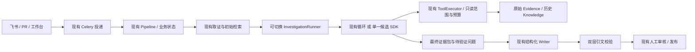

# Agent Runtime / SDK 对智能复盘助手的增益调研

调研日期：2026-10-30（Asia/Shanghai）。本地核对基线：`codex/standard-tools-upgrade`，`3af8ea8`，调研开始时工作区干净。

本文是选型研究与待验证建议，不是已实施架构。核对了仓库代码、现有架构与证据台账，以及下列项目的官方文档/源码；没有安装候选 SDK、执行真实模型对照、修改运行配置或验证线上部署。文中的收益、适配度和优先级是基于这些材料的工程判断，不是测得的提升比例。外部资料跟随主分支，实施时仍须固定版本重新核对。

## 判断与推荐

值得引入运行时能力，但现阶段不宜整体替换 `RetrospectivePipeline`。这个助手已经有自研的有界调查循环；通用 SDK 的主要增益是减少循环、会话、事件、供应商适配和恢复机制的维护工作，并为复杂事故提供更长的受控调查过程。根因准确率能否提高，要另外验证证据覆盖和结论支持关系。

推荐顺序：

1. 先保留现有生产路径，以相同模型、工具、材料和预算建立质量/成本基线。
2. 如果要做 SDK PoC，先试 Python 内的 **PydanticAI 薄适配**，只替换调查循环，复用原取证、存储、引文校验和审核。
3. **DeepSeek Harness** 作为完整 Harness 的对照候选；**Pi** 适合愿意维护 TypeScript 执行服务、需要较细控制循环与模型适配的方向。两者都需要桥接现有 Python 领域工具。
4. 当真实需求变成“多阶段任务跨重启恢复、等待补材料后继续、复杂分支”时，再引入 **LangGraph checkpoint/interrupt**，并明确它与 Celery、业务状态机各自的职责。Deep Agents 是建立在其上的更完整 Harness，应单独评估其默认能力。

## 1. 当前系统已有的能力与缺口

核对入口：[架构总览](architecture.md)、[证据与上下文台账](evidence-context-ledger.md)、[标准工具方案](standard-tools-upgrade.md)、[Pipeline](../backend/src/repo_maintainer/retrospective_pipeline.py)、[模型适配器](../backend/src/repo_maintainer/retrospective_connectors.py)、[工具执行器](../backend/src/repo_maintainer/retrospective_tools.py)、[Celery 任务](../backend/src/repo_maintainer/retrospective_tasks.py)。旧代码修复平台的多 Agent 与记忆不属于本复盘链路。

| 方面 | 当前实际实现 | SDK 的潜在增量 |
| --- | --- | --- |
| 主动补证 | 默认开启三个只读工具：源码、已采集飞书上下文、历史案例；最多两轮模型决策、四次实际执行 | 复杂事故可增加自适应追问和终止逻辑；简单事故的现有循环已足够 |
| 上下文 | 证据正文 24,000 字符，单项配置上限 6,000；工具新正文共享 8,000 字符；最终写作独立选材 | 会话级压缩、用量记账和长任务工作记忆；不能自动保证原文引文保留 |
| 取证范围 | 仓库/SHA、群与时间窗口由服务端绑定；飞书工具只搜已采集材料 | SDK 可编排新增连接器，但不会自己接通未配置的数据源 |
| 轨迹 | `generation_contexts` 保存逻辑请求、模型工具输出、执行结果与最终选择，以 run_id/call_id 关联 | 标准事件、Trace 和 UI 更方便定位失败；现有记录不能直接当完整可重放运行 |
| 恢复 | Celery 投递与有限重试、数据库事故锁、业务状态；普通 retry 从采集重跑 | 细粒度 checkpoint、保存后继续和故障注入验证；不能把保存聊天当作业务恢复 |
| 输出与审核 | Pydantic 结构校验，影响/根因/修复的引文核对模型片段和库中原文，人工审核后发布 | 框架可减少协议和结构重试代码；业务引用与因果判断仍需保留 |

当前更直接影响复盘质量的缺口：飞书触发事故没有仓库/SHA 绑定，因此不会自动下载源码；代码主路径使用修复后 head SHA，缺少完整前后源码对照；没有自动接入生产监控、配置发布和部署审计；引文字符串存在不等于能支持根因；尚无真实事故集的稳定成功率或审核通过率基线。更换 Runtime 不会自动填上这些缺口。

## 2. 市场候选与本项目适配

下表“成本”指相对接入和维护复杂度，不是报价或已验证工期。

| 候选 | 官方提供的能力 | 对本项目的价值判断 | 相对成本与主要约束 |
| --- | --- | --- | --- |
| DeepSeek Harness | Cordis 插件体系、会话、压缩、执行环境及可选工具/子 Agent；Python 子进程 SDK | 较完整的调查执行环境，适合测试从线索到补证的长任务 | 中高；领域工具桥接、独立进程与会话存储；官方仍为 developer preview |
| Pi Agent Core / Coding Agent SDK | Core 提供工具循环与流式事件；完整 SDK 增加会话、持久化、压缩和扩展 | 可控、可裁剪的执行内核；适合定制调查服务 | 中高；原生 TypeScript，Python 后端需要进程/RPC 桥接；不能把完整 SDK 能力归给 Core |
| PydanticAI | 类型化工具/输出、请求和工具用量限制、观测集成；持久化与 durable execution 有独立机制 | 与现有 Python/Pydantic 最贴近，适合小范围替换自研循环 | 低中；仍需保留领域预算、引用规则和状态；耐久执行需要额外机制 |
| LangGraph / Deep Agents | LangGraph 提供 checkpoint 和 interrupt；Deep Agents 增加规划、文件系统上下文、委派与摘要 | 流程恢复、分支和人工补证等待价值较高 | 中高；需要处理图状态与现有 PostgreSQL 业务状态的一致性 |
| OpenAI Agents SDK | Python/TypeScript Agent loop、编排、审核控制、会话/状态和内建 Trace | 通用 SDK 对照候选，特别适合简化循环和观测接线 | 低中；非 OpenAI 模型走适配器，百炼现有协议仍需实测 |
| Claude Agent SDK | 在自管进程运行 Claude Code 的工具循环、上下文管理、会话、权限、Hooks、MCP 和子 Agent | 代码深查、读取仓库和执行隔离验证的候选 | 中高；引入 Claude Code binary 与 Claude 生态运行方式，现有模型路径不能按原配置直接平移 |

能力依据：[DeepSeek README](https://github.com/deepseek-ai/deepseek-harness)、[Pi SDK](https://github.com/earendil-works/pi/blob/main/packages/coding-agent/docs/sdk.md)、[PydanticAI Agents](https://pydantic.dev/docs/ai/core-concepts/agent/)、[LangGraph 持久化](https://docs.langchain.com/oss/python/langgraph/persistence)、[Deep Agents](https://docs.langchain.com/oss/python/deepagents/overview)、[OpenAI Agents SDK](https://developers.openai.com/api/docs/guides/agents/sdk)、[Claude Agent SDK](https://code.claude.com/docs/en/agent-sdk/overview)。

## 3. DeepSeek Harness：完整环境，但必须按复盘业务裁剪

它是官方开源 Harness，强调能力均由插件组合；不是更换一个 DeepSeek 模型名称。当前 README 明确标注 developer preview，并预告破坏兼容性的变化。因此适合作为隔离 PoC 的候选，暂不宜未经回归就成为唯一生产运行路径。[官方说明](https://github.com/deepseek-ai/deepseek-harness)

Python 接口已经存在：`deepseek-harness-sdk` 通过 stdio JSON-RPC 启动配套运行时；发布包包含原生 runtime wheel，普通启动无需系统安装 Node.js。它不是纯 Python 内嵌循环，部署仍须管理子进程、超时、会话目录和资源释放。[Python SDK](https://github.com/deepseek-ai/deepseek-harness/blob/master/python/sdk/README.md)

对复盘有价值的是持久会话、自动压缩、可组合的工具与可选调查能力。例如围绕“连接恢复后为什么没有重新注册”持续追踪初始化、重连、异步任务与日志线索。但是 profile 决定实际能力：`sdk-minimal` 并不默认拥有完整 Web、Skills 和子 Agent；不能从项目总能力表推断某个部署全部可用。[最小 profile](https://github.com/deepseek-ai/deepseek-harness/blob/master/packages/bundle/sdk-minimal/README.md)、[能力包地图](https://github.com/deepseek-ai/deepseek-harness/blob/master/packages/README.md)

必须处理的具体默认值：官方最小示例使用全权限 shell，工作目录不构成文件访问边界。Session-log 插件默认启用，向官方 DeepSeek 请求贡献增量会话日志元数据。复盘接入应构造只读工具 profile，隔离工作目录与 Harness home，并根据事故资料的实际发送范围关闭不需要的日志贡献；只关闭 OTel 不等于关闭该字段。[Python 教程](https://github.com/deepseek-ai/deepseek-harness/blob/master/docs/user/guide/python-sdk.md)、[Session-log 配置](https://github.com/deepseek-ai/deepseek-harness/blob/master/packages/session/session-log-deepseek/README.md)

模型也并非只能使用 DeepSeek：有 `llm-pi-ai` 适配层。这里复用的是 Pi 的模型协议/目录能力，不等于 DSH 与 Pi 的 Agent loop 和会话实现相同；也不能据此宣称本机百炼的 Responses、多轮 reasoning 和结构化输出已经兼容。[模型层](https://github.com/deepseek-ai/deepseek-harness/blob/master/packages/llm/README.md)

## 4. Pi：先区分执行内核与完整会话层

原 `badlogic/pi-mono` 入口现重定向到 `earendil-works/pi`；当前文档中的包名为 `@earendil-works/*`。实施时应固定实际包版本，不能直接复制旧命名空间教程。[当前官方仓库](https://github.com/earendil-works/pi)

`pi-agent-core` 提供有状态工具循环、事件和上下文转换钩子，适合自行决定哪些领域消息可以进模型。完整 `pi-coding-agent` SDK 才提供 SessionManager、持久会话树、压缩、资源与扩展管理。单独引入 Core，不应承诺获得完整会话恢复和自动摘要。[Core](https://github.com/earendil-works/pi/blob/main/packages/agent/README.md)、[SDK](https://github.com/earendil-works/pi/blob/main/packages/coding-agent/docs/sdk.md)

对本项目，它可以成为工具受限的调查执行服务，让工作台展示实际工具进度，并在有新材料时继续同一调查。主要代价是原生 TypeScript/Node 运行方式：需要显式桥接 Python `ToolExecutor`、映射事故与会话 ID，并统一取消、超时、身份范围和日志落库。官方还提供 RPC 集成入口，不能因此把跨进程运维成本忽略。[SDK 集成方式](https://github.com/earendil-works/pi/blob/main/packages/coding-agent/docs/sdk.md)

自动压缩会用摘要替换较早的模型可见历史，原始会话仍可保留。这有利于长调查，但并不保证 Evidence ID、原文短引、SHA、冲突陈述和时间顺序都保留。建议压缩推理过程与待查事项，最终 Writer 仍从受限证据包读取原文。Pi 当前 README 还明确表示不默认提供子 Agent，应把此类能力当作扩展工作。[压缩机制](https://github.com/earendil-works/pi/blob/main/packages/coding-agent/docs/compaction.md)、[Coding Agent README](https://github.com/earendil-works/pi/blob/main/packages/coding-agent/README.md)

## 5. 更贴近当前后端的两条路线

**PydanticAI：先降低循环维护负担。** 它与现有 Pydantic 契约相近，可包装原有三个工具，并用类型化输出减少协议处理。其 `UsageLimits` 可限制请求、工具执行和记录 Token/费用，但 Token/费用阈值通常是在响应到达且已计费后检查，不能代替请求前的整体预算估计和输出上限。现有 SDK 重试、框架重试、Pipeline 校验重试必须统一核算，避免嵌套放大。[Agents 与 Usage Limits](https://pydantic.dev/docs/ai/core-concepts/agent/)

观测可以发往自己的 OpenTelemetry 后端，使用 Logfire 云服务不是必要条件。会话落库与跨崩溃耐久执行也要分开：官方列出 Temporal、DBOS 等引擎集成，安装基础 SDK 不等于现有 Celery 任务自动获得恢复能力。[OTel](https://pydantic.dev/docs/ai/integrations/logfire/)、[耐久执行边界](https://pydantic.dev/docs/ai/capabilities/durable_execution/overview/)

**LangGraph：当流程恢复成为实际需求时使用。** 持久化 checkpoint 可保存图状态；`interrupt` 可暂停等待补材料再恢复。恢复会重新进入发生 interrupt 的节点，节点内此前的代码可能再次执行。因此，Wiki 创建、消息发送和知识入库仍需业务幂等与远端核对，不能将 checkpoint 描述成跨系统“恰好一次”。已经完成的并行节点可通过 pending writes 避免再次运行，节点粒度需要有意设计。[Checkpointers](https://docs.langchain.com/oss/python/langgraph/checkpointers)、[Interrupts](https://docs.langchain.com/oss/python/langgraph/interrupts)

Deep Agents 提供更完整的规划、上下文卸载和委派，适合确有长任务需求后再比较；本项目当前只有三种只读工具，直接装入整个通用 Harness 未必比现有有界循环更划算。[Deep Agents](https://docs.langchain.com/oss/python/deepagents/overview)

OpenAI Agents SDK 可以在应用自身部署中运行，并支持非 OpenAI 模型的适配路径，不能把它等同于托管 Agents API。内建 Trace 默认开启，接入时需要明确内容采集与导出配置；它也不会替代本项目的证据账本。[SDK](https://developers.openai.com/api/docs/guides/agents/sdk)、[Models](https://developers.openai.com/api/docs/guides/agents/models)、[Tracing](https://developers.openai.com/api/docs/guides/agents/integrations-observability)

## 6. 建议的接入边界

以下都是拟议设计，尚未实现：

优先替换点是 `RetrospectivePipeline._explore_tools()` 的循环实现。调查输入包含事故 ID、固定仓库/SHA、授权素材范围、初始证据和预算；输出是 Evidence/Knowledge 的引用、未解问题和轨迹。最终 Writer 继续独立选材，不能直接把整个 SDK 会话作为报告依据。

接入必须显式处理以下业务约束：

- 当前事故、仓库/SHA、群窗口和历史过滤仍由服务端绑定，模型不能自行扩大范围；禁止把运行环境的仓库 HEAD 当作事故部署版本。
- 原始证据、参与者陈述、静态推断、历史类比和人工确认保留类别；子任务摘要与历史案例都不能升级为当前原始证据。
- Runtime 事件映射到现有 run_id/call_id 与 generation_contexts；会话 ID 不代替版本、审核和发布记录。
- 请求、工具调用、辅助摘要、重试、总时长和费用统一计量；有终止条件和可回退路径。
- 默认只挂载领域只读工具。若未来需要运行复现实验，再单独设计固定版本、隔离依赖、网络限制与产物证据规则。
- Celery 负责投递和执行进程；领域状态机负责审核发布；若再增加图 checkpoint，必须定义唯一恢复入口，避免多套重试互相触发。

## 7. 怎样验证值不值得引入

建议先选取 20–30 个具备人工核对材料的历史事故，按源码链复杂、飞书讨论量大、材料缺失/冲突等情况分层。保留其事故时刻可得材料与版本，避免把事后根因或后续 PR 当作当时已知输入。

第一组对照固定同一模型、采样参数、工具范围、事故输入和预算，比较现有循环与候选 SDK；它衡量接入本身的工程收益。第二组再独立放宽调查轮次或启用压缩，测量新增能力收益及其额外成本，避免把模型变更和预算增加误记为 Runtime 提升。

| 维度 | 建议测量 |
| --- | --- |
| 质量 | 人工盲审根因支持度、无依据结论比例、首次审核通过率、未知事项是否如实保留 |
| 取证 | 根因关键片段覆盖、无关片段比例、引用可回查率、跨范围读取次数 |
| 成本与时延 | 整次调查全部模型/压缩/重试的 Token 与费用、P50/P95 时延、工具调用数 |
| 可靠性 | Worker 中断、模型超时、工具失败、等待补料、发布中途失败后的恢复结果与重复副作用 |
| 维护成本 | 适配代码量、协议兼容问题、运行进程/存储/依赖数量、升级回归负担 |

在完成这些对照前，不承诺具体准确率提升，不将外部 Coding/Terminal Benchmark 直接迁移为复盘效果。若现有三工具循环在质量和恢复需求上足够，保留自研实现同样是合理结果。

如后续实际接入，将按仓库约定在同一次实施改动中同步更新 architecture 与 evidence-context-ledger、配置/部署说明、验证记录及本地链接检查；本调研没有将任何候选能力登记为已实现。
