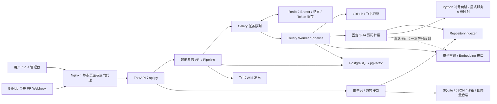

# 项目架构与持续维护记录

| 文档属性 | 当前值 |
| --- | --- |
| 最近核对日期 | 2026-10-23（Asia/Shanghai；局部核对轻量源码发现、输入快照与配置转发；真实平台演练沿用 2026-10-21，其余章节沿用原核对） |
| 核对基线 | 当前工作区实现与隔离测试容器；新增快照表已在隔离 PostgreSQL 验证，未更新原演练或生产部署；此前未提交改动保留 |
| 文档职责 | 记录整个项目当前架构、组件边界、数据流、部署、已知缺口及后续升级 |
| 维护规则 | 架构相关改动必须在同一次改动中更新本文，规则见 [AGENTS.md](../AGENTS.md) |
| 专项台账 | [证据与上下文管理台账](evidence-context-ledger.md)记录取证、上下文和 RAG 的详细方法及依据 |

本文以实际连接起来的代码为依据。组件“已实现”表示存在对应实现；单元测试、模拟端到端测试和真实平台验证分别记录，不能相互替代。依赖版本范围来自包声明，实际安装版本须查看部署环境。

## 1. 项目定位与系统边界

当前核心产品是研发问题的智能复盘：从已合并 PR 或手工问题出发，采集代码、CI 和协作材料，生成带引文的结构化复盘，经人工审核后发布到飞书 Wiki，并加入历史案例知识库。

仓库同时保留早期代码修复平台及兼容接口。两套流程由同一个 FastAPI 应用承载，但使用不同的领域模型、状态机、知识存储和任务执行方式。智能复盘复用旧平台的仓库索引能力；旧修复平台的多 Agent 调度、自动补丁、技能学习和分层记忆没有接入 `RetrospectivePipeline` 主链路。

| 流程 | 主要入口 | 编排与存储 | 当前关系 |
| --- | --- | --- | --- |
| 智能复盘主链路 | `/retrospective`、`/api/retrospective/*`、`/webhooks/github` | `RetrospectivePipeline`；PostgreSQL/pgvector；Celery/Redis | 当前核心闭环 |
| 旧修复与分析平台 | `/api/incidents/*`、`/api/repairs/*`、CLI `repo-agent` | `RepoAutonomyPlatform`；本地 SQLite、JSON、运行目录及可选向量后端 | 保留实现与兼容能力 |
| 兼容 Bug 抽取、审核与知识接口 | `/api/bug-reports`、`/api/extractions`、`/api/reviews/*`、`/api/knowledge`、`/webhooks/git` | `FrontendDataService`、旧平台、`ReviewWorkflowEngine` 和本地 Wiki 输出 | 与主链路独立；部分接口仍映射旧修复或技能操作 |

## 2. 总体组件关系

生成由 Worker 执行；审核、编辑、发布和人工知识检索由 API 调用 Pipeline。当前 `/retry` 和 `/regenerate` 也在 API 请求内同步执行，尚未统一进入 Celery。API 和 Worker 分别创建自己的 Pipeline 实例，通过 PostgreSQL 共享业务状态。

## 3. 目录与模块职责

| 目录 / 模块 | 职责与一手依据 |
| --- | --- |
| `frontend/` | Vue 3、TypeScript、Vite、Element Plus；路由、页面、Axios 请求；依赖见 [package.json](../frontend/package.json) |
| [api.py](../backend/src/repo_maintainer/api.py) | FastAPI 应用组装；挂载复盘 API；同时创建旧平台、管理台数据服务、旧审核及本地 Wiki 服务 |
| [retrospective_api.py](../backend/src/repo_maintainer/retrospective_api.py) | 问题创建、异步 run、详情、编辑、审核、发布、知识检索和 GitHub Webhook |
| [retrospective_runtime.py](../backend/src/repo_maintainer/retrospective_runtime.py) | 环境配置、生产连接器和存储注入；显式 inline 开发模式与 Celery 队列适配 |
| [retrospective_tasks.py](../backend/src/repo_maintainer/retrospective_tasks.py) | Celery Worker 入口，执行生成并更新 `jobs` |
| [retrospective_pipeline.py](../backend/src/repo_maintainer/retrospective_pipeline.py) | 主流程、状态迁移、上下文选择、引用校验、复盘版本、审核发布、知识切片和精排 |
| [retrospective_models.py](../backend/src/repo_maintainer/retrospective_models.py) | Pydantic 领域契约：问题、证据、引用、复盘、质量、版本、审核、发布、知识命中 |
| [retrospective_connectors.py](../backend/src/repo_maintainer/retrospective_connectors.py) | GitHub/飞书取证、Token 缓存、Wiki 发布、结构化模型生成与向量化 |
| [retrospective_code_context.py](../backend/src/repo_maintainer/retrospective_code_context.py) | 固定版本 ZIP 归档、源码候选、AST 区域和两跳关系扩展；复用 [repo_indexer.py](../backend/src/repo_maintainer/repo_indexer.py) |
| [retrospective_discovery.py](../backend/src/repo_maintainer/retrospective_discovery.py) | Python 方法、导入别名、直接继承、有界邻居与同仓库服务文档映射 |
| [retrospective_store.py](../backend/src/repo_maintainer/retrospective_store.py) / [retrospective_schema.sql](../backend/src/repo_maintainer/retrospective_schema.sql) | 存储接口、PostgreSQL 业务持久化与检索、显式测试内存适配器、数据库建表 |
| [retrospective_migrate.py](../backend/src/repo_maintainer/retrospective_migrate.py) | 执行现有建表 SQL；当前没有版本化增量迁移框架 |
| [platform.py](../backend/src/repo_maintainer/platform.py) / [frontend_service.py](../backend/src/repo_maintainer/frontend_service.py) | 旧修复平台与兼容管理台数据组装，详见第 8 节 |
| `backend/tests/`、`e2e/` | 单元测试、旧平台测试及模拟外部服务的容器闭环验收 |
| `compose.yaml`、`postgres/`、各 Dockerfile | 默认部署编排、PostgreSQL vector 扩展及前后端镜像 |
| `docs/` | 当前架构、证据台账、需求、验收与历史方案；文档分工见第 11 节 |

后端声明 Python >= 3.12、FastAPI、Uvicorn、psycopg、pgvector、OpenAI SDK、Redis 和 Celery；旧向量检索的 FAISS、hnswlib、sentence-transformers、Milvus 依赖放在 `legacy-retrieval` 可选依赖组。依据：[pyproject.toml](../backend/pyproject.toml)。

## 4. 智能复盘的数据与控制流程

### 4.1 采集、生成与审核

1. **创建问题。** 手工请求保存 `IncidentRecord`；GitHub 入口验证 HMAC-SHA256，只接收 `pull_request` 的 `closed + merged` 事件，以 delivery ID 去重，保存 PR 与 head/base/merge SHA。当前自动入口未筛选 PR 是否确为 Bug 修复，统一赋予 `bug_fix` 类型。
2. **提交生成任务。** Webhook 和 `/run` 将问题 ID 送入 Celery，API 返回 job ID；Worker 读取 PostgreSQL 的问题并执行 Pipeline。手工创建本身不自动运行。
3. **采集材料。** GitHub 获取 PR、commit、diff、评论及关联 SHA 的失败 CI run；飞书获取配置群的时间窗口消息和配置文档。手工描述与日志也转为 Evidence。
4. **扩展源码。** 同仓库固定 head SHA 归档保留原静态检索，增加 Python 限定方法、导入别名、直接继承及后台任务引用的两跳候选（最多 24 个种子/邻居）；方法起点参与选区，原文件/区域上限继续生效。`.insight/context.json` 可关联同仓库服务文档和一跳依赖；显式启用规划后，有未解析方法时最多追加一次符号补取。
5. **保存与筛选。** 全部 Evidence 原文先入库，再在副本上去重、排序、裁剪和执行字符预算。重复写同一 Evidence ID 时保留原文，只更新是否选中及选择原因。
6. **检索历史。** 构造查询，对查询和所选证据向量化；`OpenAIEmbedder` 按最多 20 条顺序分批请求，并校验每批返回的索引覆盖全部输入，防止向量与原文错位。所选证据片段写入 `evidence_chunks`，历史检索读取已发布的 `knowledge_entries/knowledge_chunks`。知识发布和检索查询复用同一适配器；没有新增配置或表迁移。
7. **生成与校验。** 通过 Responses Function Calling 输出 `RetrospectiveDocument`；Pydantic 校验结构，`QualityValidator` 校验核心字段的 Evidence ID 与引文。AI 引文同时核对本次模型片段和入库原文。默认最多生成 2 次；第二次通过临时问题副本中的 `generation_validation_errors` 将上一轮硬校验错误传给生成器，模型输入键为 `previous_validation_errors`，不把错误当作事故原始证据。提示优先复制不超过 160 字的单行引文，并保留 diff 的 +/- 前缀；160 字是提示要求，不是新增校验阈值。硬校验通过后才保存 AI 版本并进入待审核，驳回重生复用同样反馈方式。
8. **人工处理。** 编辑生成新的人工作品版本；通过进入 `approved`，驳回记录理由。驳回后可基于已入库且先前选中的原文重新选择上下文并生成。

结构化输出包含标题、摘要、影响、根因、修复、预防措施、关联模块和关键词。影响、根因与修复必须包含引用。原文是当前问题的材料；静态图边是候选线索；协作消息是参与者陈述；历史案例是类比。引文存在性校验不能自动证明根因判断正确，审核人仍需核对支持关系。

### 4.2 状态机与失败恢复

常规路径为：`received → collecting → retrieving → generating → validating → pending_review → approved → publishing → published`。

校验不通过可回到生成；待审核可驳回，驳回后可编辑或重新生成；采集与生成流程异常记录 `failed_stage/error` 并进入 `failed`，`retry()` 当前从采集开始重跑。发布失败回到 `approved`，便于重新发布。合法状态迁移以 [ALLOWED_STATUS_TRANSITIONS](../backend/src/repo_maintainer/retrospective_models.py) 为准。

代码归档失败时记录 `code_context_warning`，继续使用其他材料。Celery 对 `TimeoutError/ConnectionError` 配置最多 2 次自动重试、延迟确认及预取数 1；业务失败不等于均可自动恢复。当前没有问题级分布式锁、数据库与队列的事务发件箱，delivery 去重也不能保证外部请求到任务完成全程只执行一次。

### 4.3 发布与知识回流

审核通过后，API 同步调用飞书创建 Wiki/文档并写入复盘，保存 `publications`，随后切片、向量化并写入知识库，完成后进入 `published`。若已经保存发布记录但知识索引失败，重试复用该发布记录并补做索引；同一版本重建索引替换原有片段。

这个恢复能力依赖发布记录已经保存。飞书写入与 PostgreSQL 写入跨系统，当前没有跨系统事务；远端创建成功但本地记录尚未保存时发生异常，仍可能需要人工核对重复发布。

2026-10-21 真实演练证实一个具体窗口：Wiki 节点创建成功，随后正文因缺少 `docx:document` / `docx:document:write_only` 被拒绝，因而没有本地 publication，普通重试可能再建页。本次人工恢复脚本只续写已核对的节点，验证正文后登记发布，再由原 publish 流程补做知识索引；不是产品已实现的自动孤立节点恢复。当前写入器将 Markdown 行作为普通文本块发送，尚未转换原生标题、代码块或 Evidence 超链接。

生成器现在将实际逻辑请求（模型、提示词、工具 Schema、输入和选项）在调用前写入 `generation_contexts`，附内容哈希、用途和目标版本；包括硬校验重试与驳回重生，失败调用也保留。自定义生成器仅保存 `generator_arguments`，不冒充提供商请求。可选规划也保存请求；快照不通过 HTTP 暴露，旧版本不可回填。AI 提示词标记为 `v2-symbol-context`，提示区分未解析关系、服务候选与事实，并说明源码裁剪。

## 5. 上下文管理与历史 RAG

| 环节 | 当前默认行为 | 详细依据 |
| --- | --- | --- |
| 源码扩展 | 基础 10 个候选文件；按改动文件数最多扩至 40 个；每文件最多 2 个区域，每段约 2,400 字符；唯一目标文件的调用/导入边可扩两跳 | [源码收集器](../backend/src/repo_maintainer/retrospective_code_context.py) |
| 证据筛选 | 内容指纹去重、来源与相关性排序、来源覆盖、多改动文件覆盖；日志取错误附近行，diff 选相关 hunk | [ContextSelector](../backend/src/repo_maintainer/retrospective_pipeline.py) |
| 模型证据预算 | 24,000 字符总预算，单条配置上限 6,000 字符；属于字符计量，未覆盖整个请求的精确 Token 预算 | [运行配置](../backend/src/repo_maintainer/retrospective_runtime.py) |
| 知识切片 | 五类：完整案例卡、症状、根因、修复、预防；长字段约 1,200 字符一段、重叠约 100；保存格式版本与来源 ID | [切片实现](../backend/src/repo_maintainer/retrospective_pipeline.py) |
| 历史召回 | 仓库与类型过滤；全文和向量各按案例取最佳片段，再各取 40 个案例，RRF 常数 60 | [存储检索](../backend/src/repo_maintainer/retrospective_store.py) |
| 精排与最终输入 | 候选 20；规则精排；默认 Top 5，配置上限 20；每张案例卡输入前 1,500 字符 | [Pipeline](../backend/src/repo_maintainer/retrospective_pipeline.py)、[生成器](../backend/src/repo_maintainer/retrospective_connectors.py) |

向量化时每个知识片段最多输入前 4,000 字符，完整正文仍入库。历史案例供类比，当前引文只接受当前 Evidence。知识参数尚未用真实事故集调优；现有中文全文切词和 SQL 执行计划也需要实测。

详细权重、参数、事实保留方法与测试依据统一维护在[证据与上下文管理台账](evidence-context-ledger.md)，本文登记组件关系与默认架构。两份文档中的流程和阈值必须保持一致。

## 6. 数据模型与持久化

主链路以 PostgreSQL 为业务事实存储；Redis 用于 Celery Broker、任务结果和飞书 tenant token 缓存。Redis 任务结果不代替 PostgreSQL 的复盘版本。

| PostgreSQL 表 | 持久化内容与关系 |
| --- | --- |
| `source_events` | Webhook delivery 主键、事件类型与最小事件 metadata；当前未保存完整 Webhook 请求正文 |
| `incidents` | 问题、状态、trace ID、PR/SHA、飞书范围、版本计数、失败信息 |
| `evidence_documents` | Evidence 原文、来源、定位、SHA、时间、选中标记与原因；关联问题 |
| `evidence_chunks` | 所选证据正文及向量；关联原始 Evidence 与问题；当前不作为历史案例检索源 |
| `generation_contexts` | 模型调用前保存逻辑请求 JSONB、内容哈希、用途、目标版本和时间；关联事故，无新增 HTTP 读取入口 |
| `retrospective_versions` | 完整结构化 JSONB、质量、证据 ID、模型、提示词版本、Token、耗时与作者；问题内版本号唯一 |
| `review_actions` | 编辑、提交、审核与发布操作记录、操作者、理由与前后状态 |
| `publications` | 复盘版本对应的远端文档 ID/URL，用于已记录发布的幂等恢复 |
| `knowledge_entries` | 已发布案例条目、原始问题/版本、仓库、类型、Wiki URL 与 metadata |
| `knowledge_chunks` | 案例片段全文、向量、字段类型、格式版本和历史来源 ID |
| `jobs` | job ID、问题、阶段、状态、trace ID 与错误 |

关系主干为 `incident → Evidence / versions / review_actions / jobs`，`version → publication / knowledge_entry → knowledge_chunks`。表结构与外键以 [retrospective_schema.sql](../backend/src/repo_maintainer/retrospective_schema.sql) 为准。

SQL 使用未固定维数的 `vector` 列，存在全文 GIN 索引，当前未创建 ANN 向量索引。变更 embedding 模型仍需确保查询与历史向量的维度和语义兼容，并规划重建索引。建表脚本采用 `CREATE ... IF NOT EXISTS`，对已有表结构的后续演进需要显式迁移方案。

## 7. 前端与 API 边界

| 页面 / 接口 | 数据来源与职责 |
| --- | --- |
| `/retrospective` | [RetrospectiveView.vue](../frontend/src/views/RetrospectiveView.vue) 与 [retrospective.ts](../frontend/src/api/retrospective.ts)；主链路问题、原始证据、版本、质量、审核与发布 |
| `/dashboard`、`/repo-management`、`/task-scheduling` | 旧平台管理台接口；不表示主链路的 PostgreSQL 问题与 jobs 已在这些页面统一展示 |
| `/ci-autofix`、`/skill-library`、`/context-management`、`/observability` | 兼容 Bug 工作台、旧技能库、旧分层上下文和旧指标；以各页面请求和 [api.py](../backend/src/repo_maintainer/api.py) 的映射为准 |
| `/api/retrospective/incidents` | POST 创建、GET 列表；详情返回问题、证据、最新复盘、所有版本与审核记录 |
| `/api/retrospective/incidents/{id}/run` | Celery 提交生成，返回 202 和 job ID |
| `/api/retrospective/incidents/{id}/retry`、`/regenerate` | 同步执行失败重跑、驳回后重新生成 |
| `/api/retrospective/incidents/{id}/document` | PATCH 人工编辑并创建新版本 |
| `/api/retrospective/incidents/{id}/approve`、`/reject`、`/publish` | 审核与发布操作 |
| `/api/retrospective/knowledge/search` | 已发布案例检索，limit 1–20 |
| `/webhooks/github` | 主链路 GitHub 签名验证与合并 PR 接收 |
| `/api/liveness`、`/api/health`、`/api/connectors/status` | 分别提供进程探针、业务依赖就绪摘要及连接器配置/存储状态 |

主链路未就绪时业务接口返回 503，旧平台接口仍可能可用。就绪检查包含 PostgreSQL、Redis 和连接器配置，但没有逐项验证真实 GitHub/飞书/模型权限，也没有覆盖 Worker 可消费性。当前审核的 `actor` 来自请求参数，尚未接入统一登录身份与 RBAC。

Axios 默认请求 `/api`，默认超时 15 秒。同步重新生成、发布和检索可能受这个超时限制。依据：[http.ts](../frontend/src/api/http.ts)、[retrospective_api.py](../backend/src/repo_maintainer/retrospective_api.py)。

## 8. 旧平台与可复用组件

旧平台当前仍由 `create_app()` 初始化，保留以下组件与入口。架构升级时需要同时评估兼容影响。

| 组件组 | 主要文件 | 作用 |
| --- | --- | --- |
| 仓库、语言与图分析 | [repo_indexer.py](../backend/src/repo_maintainer/repo_indexer.py)、[language_analysis.py](../backend/src/repo_maintainer/language_analysis.py)、[repo_checkout.py](../backend/src/repo_maintainer/repo_checkout.py) | 索引符号与依赖、语言分析和本地 checkout；索引器已被主链路源码扩展复用 |
| 日志、上下文、记忆 | [error_semantics.py](../backend/src/repo_maintainer/error_semantics.py)、[context.py](../backend/src/repo_maintainer/context.py)、[memory.py](../backend/src/repo_maintainer/memory.py)、[map_reduce_summary.py](../backend/src/repo_maintainer/map_reduce_summary.py) | 错误语义、分层上下文、历史轨迹；独立长文本摘要模块未接入复盘主链路 |
| 调度与 Agent 执行 | [scheduler.py](../backend/src/repo_maintainer/scheduler.py)、[runtime.py](../backend/src/repo_maintainer/runtime.py)、[agents.py](../backend/src/repo_maintainer/agents.py)、[agent_tools.py](../backend/src/repo_maintainer/agent_tools.py) | 旧平台调度、并发执行与工具能力 |
| 修复、验证和交付 | [llm_executor.py](../backend/src/repo_maintainer/llm_executor.py)、[sandbox.py](../backend/src/repo_maintainer/sandbox.py)、[validator.py](../backend/src/repo_maintainer/validator.py)、[remote_delivery.py](../backend/src/repo_maintainer/remote_delivery.py) | 生成补丁、沙箱执行、验证回滚及远端交付 |
| 旧检索与技能学习 | [knowledge_base.py](../backend/src/repo_maintainer/knowledge_base.py)、[retrieval.py](../backend/src/repo_maintainer/retrieval.py)、[vector_store.py](../backend/src/repo_maintainer/vector_store.py)、[reranker.py](../backend/src/repo_maintainer/reranker.py)、[learning.py](../backend/src/repo_maintainer/learning.py) | 技能/旧知识、可选向量后端、旧精排和 Dream/Learn |
| CI 与治理 | [github_actions.py](../backend/src/repo_maintainer/github_actions.py)、[gitlab_ci.py](../backend/src/repo_maintainer/gitlab_ci.py)、[jenkins_ci.py](../backend/src/repo_maintainer/jenkins_ci.py)、[security.py](../backend/src/repo_maintainer/security.py)、[observability.py](../backend/src/repo_maintainer/observability.py) | 旧 CI 同步、审批、审计与指标 |
| 兼容审核与发布 | [review_workflow.py](../backend/src/repo_maintainer/review_workflow.py)、[wiki_publisher.py](../backend/src/repo_maintainer/wiki_publisher.py)、[pr_listener.py](../backend/src/repo_maintainer/pr_listener.py) | 独立旧审核状态机、本地 Wiki 输出、事件解析 |

旧平台路径由 [PlatformConfig](../backend/src/repo_maintainer/config.py) 设置，默认位于后端 `runtime/`：SQLite 记忆、JSON 技能/API 数据、JSONL 指标/审计、沙箱和任务目录。旧审核与本地 Wiki 另写 `.review_logs/`、`.wiki_output/`。默认 Compose 没有为这些目录声明持久卷，容器重建时需单独考虑其保留需求。

`/api/extractions` 当前调用旧重试/修复流程；`/api/knowledge` 主要映射旧技能数据；旧 `/api/reviews/*` 使用本地审核与本地 Wiki 服务。升级这些兼容接口时，应明确迁移到主链路的模型、审核和 PostgreSQL 存储的方式。

## 9. 部署与配置

默认 [compose.yaml](../compose.yaml) 包含六个服务：`postgres`、`redis`、`migrate`、`api`、`worker`、`frontend`。PostgreSQL 镜像构建自 PostgreSQL 16 并安装 vector 扩展；Redis 镜像使用 7-alpine 并开启 AOF；API/Worker 使用 Python 3.12 后端镜像；前端构建 Vue 产物后由 Nginx 提供页面。

启动依赖为 `postgres 健康 → migrate 成功 → api/worker`，同时 API/Worker 等待 Redis 健康；frontend 等待 API 的 **liveness** 探针，不能据此认定全部业务依赖已验证。Worker 默认并发数为 2。

| 运行方式 | 当前访问与持久化 |
| --- | --- |
| 默认 Compose | 主机端口 **80** 映射前端 Nginx；`http://localhost/retrospective`、`/api/*`、`/webhooks/*`；API 8000 仅在容器网络中，主机映射已注释 |
| 本地前端开发 | Vite 5173，`/api` 转发至本地 8000；当前 Vite 配置没有 `/webhooks` 代理 |
| 默认数据卷 | `postgres_data` 保存主链路业务数据，`redis_data` 保存 Redis AOF |
| 模拟 E2E | [compose.e2e.yaml](../compose.e2e.yaml) 的独立项目与数据卷，入口 18080；只模拟 GitHub、飞书和模型服务 |

配置声明入口为 [.env.example](../.env.example)，运行时装配见 [retrospective_runtime.py](../backend/src/repo_maintainer/retrospective_runtime.py)。核心生产模式必须配置 PostgreSQL、Redis、模型/embedding、GitHub 和飞书；依赖缺失时记录初始化错误，不自动改用本地业务存储。直接启动 API 时 `REVIEW_PIPELINE_ENABLED` 默认关闭；Compose 显式开启。

可选 `OPENAI_ENABLE_THINKING` 默认空，生成器不发送提供商扩展；非空时严格解析 `0/false/no` 或 `1/true/yes`，通过 Responses `extra_body.enable_thinking` 控制支持该参数的服务。环境模板、运行时和 Compose API/Worker 已同步；不作用于 embedding。2026-10-21 本机百炼演练设为 `0`；仅小型结构化探针通过不代表整次生成已经完成。其他服务商须确认兼容性或保持空值。

**配置转发：** 默认 Compose 的 API/Worker 现已转发 `RAG_CHANNEL_POOL`、`RAG_RRF_K`、`RAG_RERANK_POOL`、`CODE_CONTEXT_MAX_EXPANDED_FILES`。新增 `CODE_CONTEXT_PLANNER_ENABLED=0`，运行时也要求显式真值才启用。规划禁用 SDK 自动重试，15 秒、最多 700 输出 Token、6 个符号/4 个问题，只接受本地唯一符号，失败保留静态结果。升级前先以新镜像执行 migrate 创建 generation_contexts，再更新 API/Worker；不回填旧请求。

密钥值由运行环境提供，本文只登记变量名；部署还需要根据环境补齐身份认证、访问控制、TLS、备份恢复和发布管理。以上属于当前待建设能力，不能从开发 Compose 推断已经具备。

## 10. 验证证据与当前待解决项

| 证据 | 能证明的范围 | 当前记录 |
| --- | --- | --- |
| [test_retrospective_pipeline.py](../backend/tests/test_retrospective_pipeline.py) | 模拟闭环、签名/去重、引用校验、源码扩展、预算、切片、双路召回、规则精排与发布补索引 | 台账记录 2026-09-28 本机相关 21 项通过；不代表真实 RAG 成功率 |
| [e2e/run_e2e.py](../e2e/run_e2e.py) 与 [E2E 说明](e2e-testing.md) | 容器中运行实际数据库/队列/代理，外部服务模拟 | 存在验收脚本；本文建立时未重跑，不登记为本次通过 |
| `backend/tests/test_platform.py`、`test_repair_pipeline.py`、`test_remote_delivery.py` 等 | 旧平台分析、修复、交付及兼容 API | 与智能复盘生产验证分开核对 |
| 2026-10-01 架构文档核对 | 源码入口、路由、表、配置与本地链接的一致性 | 该次仅静态核对 |
| [2026-10-21 真实演练](real-walkthrough-2026-10-21.md) | 私有仓库合并 PR、当前注入实验、真实群消息、百炼生成/1024 维向量、AI v1 与 UI 人工 v2、真实 Wiki 发布及检索 | 27 项相关回归通过；最终 published，1 案例/5 知识片段，全部 1024 维；正文回读和浏览器展示确认，单条案例召回与仓库排除通过；公网入口改本地转投，生成和部分发布含人工恢复，不是生产或全自动验收 |

持续追踪以下缺口；实施后更新相关章节、验证结果和变更记录：

2026-10-23 已按[设计稿](incident-context-discovery-design.md)实施低成本子集：Python 方法优先、显式同仓库服务文档映射、默认关闭的一次符号规划和数据库输入快照。完整工具循环、跨仓库取证、生产拓扑与运行证据连接器仍未实现。

- 请求级精确 Token 预算尚未实现；新生成已存逻辑输入快照，旧生成无法仅凭 Evidence ID 复原；未存失败响应全文，也未验证跨版本自动重放。
- 源码主要分析修复后的固定 head 版本；修复前后的双版本对照、动态调用与跨服务运行关系仍需增强。
- RAG 参数、中文切词、数据库查询与延迟缺少真实案例评估；模型或切片格式变更后的旧知识重建尚无统一任务入口。
- 发布、数据库与队列之间的可靠事务、并发运行控制及统一异步恢复尚需完善。
- 主链路尚未与旧管理台任务、知识、指标和身份体系统一；同步 API 与客户端超时需协调。
- 版本化数据库迁移、生产备份恢复和主链路质量评估需要补齐。已有验证范围与证据台账中的限制保持一致。

## 11. 文档维护与升级流程

本文是当前**全项目架构总览**，证据台账是复盘专项记录。[backend/docs/architecture.md](../backend/docs/architecture.md)保留旧代码维护平台的详细设计；需求、实施计划和历史评审中的规划能力不能直接当作当前已运行架构。使用冲突时先核对代码，再同步纠正文档。

| 改动类型 | 必须同步核对的章节 / 文件 |
| --- | --- |
| 新增/移除组件、调整编排或复用关系 | 本文第 1–4、8 节和架构图；README |
| 改 API、前端入口、队列或状态机 | 本文第 4、7 节；前端 API 映射；相关测试/验收说明 |
| 改证据、上下文、模型输入、RAG、引用或审核 | 本文第 4–6、10 节；证据台账及其追加记录 |
| 改表、字段、向量模型或索引 | 本文第 5–6、10 节；迁移/回填/重建方案；证据台账 |
| 改依赖、环境变量、端口、容器或部署 | 本文第 3、9 节；环境模板、Compose、README 与 E2E 配置 |
| 实现、验证或解决既有缺口 | 对应现状章节和第 10 节；记录实际验证范围 |

每次升级按以下顺序维护：

1. 对照最终代码更新受影响的正文、图、参数和源码链接，删除已失效的当前描述。
2. 核对改动是否影响专项台账、配置、部署、接口消费者与验收文档；在同一改动中同步更新。
3. 仅在完成实际核对后更新文首“最近核对日期”和基线说明；局部核对时说明所核对的章节与尚未核对部分。
4. 在下表追加升级记录，保留历史行；写明动机、涉及模块、架构影响、代码/测试依据、迁移或兼容要求及剩余限制。
5. 完成前检查 Markdown 链接、图和表述，保证“已实现 / 已验证 / 计划中”与证据一致。文档更新是升级完成条件之一。

### 持续升级记录

| 日期 | 变更与原因 | 影响模块 / 架构变化 | 依据与验证 | 迁移、兼容与剩余限制 |
| --- | --- | --- | --- | --- |
| 2026-10-01 | 建立整个项目的持续架构文档，避免当前主链路与旧平台设计混用；增加仓库维护约定和文档入口 | 登记前后端、主链路、兼容平台、数据库、队列、外部连接器、部署及配置缺口；业务实现未变化 | 对照本文链接的源码、SQL、路由和 Compose；静态核对本地文档链接 | 不迁移数据；真实 RAG/平台联调及列出的生产能力仍待验证 |
| 2026-10-21 | 真实演练中百炼拒绝 31 条输入的单批向量请求，补齐兼容分批 | `OpenAIEmbedder` 每批最多 20 条，按响应 index 还原次序并校验完整性；不改变 Pipeline 状态机和存储结构 | 真实 400 响应指出批量上限 20；新增批间映射、空输入、缺失/重复索引测试，3 项及原流程 21 项测试通过；真实闭环结果见后续演练报告 | 无数据迁移、无新环境参数；原任务保留失败记录后重试；不表示所有兼容模型均已验证 |
| 2026-10-21 | 真实模型的 diff 引文未匹配而被拦截，生成重试加入校验反馈和明确的逐行引用提示 | 初次生成和驳回重生在第二次请求传递前轮错误，原引用校验门槛保持；不改变表与状态机 | 新测试验证错误引文不能保存，收到反馈后有效引文才进入待审核，且反馈不写入事故 metadata；复盘 22 项、向量 3 项测试通过；[真实演练记录](real-walkthrough-2026-10-21.md) | 无迁移；被拦截草稿、完整请求和反馈快照仍未持久化；不代表引用支持因果自动成立 |
| 2026-10-21 | 默认思考模式的真实长请求断开，增加显式可选的兼容服务生成模式配置 | `OPENAI_ENABLE_THINKING` 留空不传扩展，0/1 显式选择；同步生成适配器、运行时、环境模板和 Compose | 百炼小型 Function Calling 非思考探针 1.34 秒成功；27 项相关测试通过，覆盖默认省略、false 保留、结构化输出及反馈输入 | 无表迁移；本机演练用 0，其他提供商默认留空；尚无质量/成本对照评估 |
| 2026-10-21 | 登记真实演练与生成/发布人工恢复边界，避免把部分成功当作自动闭环 | 真实模型输出经原双层引文校验后人工恢复待审核；UI 保存并通过 v2；Wiki 建节点后正文权限失败 | [执行记录](real-walkthrough-2026-10-21.md)、实际 PostgreSQL/Feishu 返回；当前知识条目为 0，正文与召回待完成 | 不改表；普通失败重试会重复取证、未自动保存中间草稿/孤立节点；Wiki 当前是普通文本块 |
| 2026-10-21 | 权限发布后完成本机真实演练，补记远程正文、数据库和召回实查 | 续写既有 Wiki 并回读后登记 publication，原 publish 流程完成知识索引；未改表或自动恢复逻辑 | 最终 published v2；1 publication、1 案例/5 知识片段均 1024 维；累计 59 证据向量，最终模型用 30 段；相似查询命中且错误仓库过滤为 0；[详细记录](real-walkthrough-2026-10-21.md) | 保留前述人工介入、重复取证及普通文本排版限制；单案例验证不等于生产质量、性能或公网 Webhook 验收 |
| 2026-10-23 | 调研 Codex、Claude Code、Pi，登记事故相关方法与跨服务上下文发现设计 | 仅新增[设计稿](incident-context-discovery-design.md)及架构、证据台账索引；拟议符号导航、服务/部署映射、有界探索与输入快照尚未接入 | 局部对照源码采集器、索引器、Pipeline、模型和连接器；查阅官方文档与 Pi 公开源码，检查本地链接；未运行新 Agent 或跨服务验收 | 本次无运行、参数、表或部署变更，无迁移；README、环境模板、Compose 和验收文档沿用现状；提案效果和成本待实施验证 |
| 2026-10-23 | 落地低成本上下文发现子集，优先补齐未修改的关键方法 | 新增 Python 符号模块、可选一次规划（默认关闭）、显式服务文档映射与 generation_contexts；转发四项既有配置；状态机、知识切片与引用门槛不变 | 针对性回归及隔离 PostgreSQL 重复建表/快照读写验证；本地链接与 Compose 配置核对，详见设计稿实施记录 | 加性建表，先 migrate 再更新 API/Worker；无新模型或图数据库，无新 HTTP 入口；未部署到原演练/生产，动态分派、双版本和跨仓库仍有缺口 |

后续追加记录使用上述列结构；不要用新行替代正文更新，也不要覆盖历史行。
