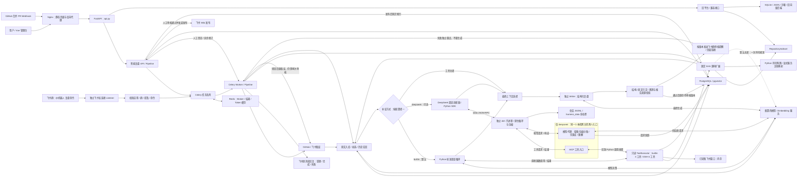

# 项目架构与持续维护记录

| 文档属性 | 当前值 |
| --- | --- |
| 最近核对日期 | 2026-11-01（Asia/Shanghai；本轮局部核对长上下文、模型路由、预算装配、原生压缩、实际 Nginx/API/Celery/Writer 与回滚；历史记录保留） |
| 核对基线 | codex/deepseek-harness-upgrade，3af8ea8 + 工作区；实际 API/Worker/Listener 镜像 926f61c12dca，deepseek 运行器、百炼 deepseek-v4.1-flash-1017（调查/摘要/Writer）、1M 容量、thinking=false；275 项回归、真实模型与部署通过；合成稿 v1 待审核，知识/发布 0；[最新实测](validation/long-context-live-2026-11-01.md)，此前阶段记录保留；不等于生产事故效果验收 |
| 文档职责 | 记录整个项目当前架构、组件边界、数据流、部署、已知缺口及后续升级 |
| 维护规则 | 架构相关改动必须在同一次改动中更新本文，规则见 [AGENTS.md](../AGENTS.md) |
| 专项台账 | [证据与上下文管理台账](evidence-context-ledger.md)记录取证、上下文和 RAG 的详细方法及依据 |

本文以实际连接起来的代码为依据。组件“已实现”表示存在对应实现；单元测试、模拟端到端测试和真实平台验证分别记录，不能相互替代。依赖版本范围来自包声明，实际安装版本须查看部署环境。

## 1. 项目定位与系统边界

当前核心产品是研发问题的智能复盘：从已合并 PR、手工问题或授权飞书群中显式 @机器人的复盘命令出发，采集可得的代码、CI 和协作材料，生成带引文的结构化复盘，经人工审核后发布到飞书 Wiki，并加入历史案例知识库。飞书入口已实现并部署到本机，官方后台确认长连接成功，用户真实 @复盘帮助已收到回复；本次事故建单、取证与模型生成仍待验收，不等于完整复盘闭环已通过。

仓库同时保留早期代码修复平台及兼容接口。两套流程由同一个 FastAPI 应用承载，但使用不同的领域模型、状态机、知识存储和任务执行方式。智能复盘复用旧平台的仓库索引能力；旧修复平台的多 Agent 调度、自动补丁、技能学习和分层记忆没有接入 `RetrospectivePipeline` 主链路。

| 流程 | 主要入口 | 编排与存储 | 当前关系 |
| --- | --- | --- | --- |
| 智能复盘主链路 | `/retrospective`、`/api/retrospective/*`、`/webhooks/github`、可选飞书长连接命令入口 | `RetrospectivePipeline`；PostgreSQL/pgvector；Celery/Redis | 当前核心闭环；飞书入口不新增 HTTP 路由 |
| 旧修复与分析平台 | `/api/incidents/*`、`/api/repairs/*`、CLI `repo-agent` | `RepoAutonomyPlatform`；本地 SQLite、JSON、运行目录及可选向量后端 | 保留实现与兼容能力 |
| 兼容 Bug 抽取、审核与知识接口 | `/api/bug-reports`、`/api/extractions`、`/api/reviews/*`、`/api/knowledge`、`/webhooks/git` | `FrontendDataService`、旧平台、`ReviewWorkflowEngine` 和本地 Wiki 输出 | 与主链路独立；部分接口仍映射旧修复或技能操作 |

## 2. 总体组件关系

生成由 Worker 执行；审核、编辑、发布和人工知识检索由 API 调用 Pipeline。新增 `/revise` 将人工意见和目标版本提交 Celery 异步修订；保留 `/retry`、`/regenerate` 的同步兼容接口。API 和 Worker 分别创建自己的 Pipeline 实例，通过 PostgreSQL 共享业务状态。

### 2.1 升级前后与部署状态

整体业务顺序继续为：入口受理 → 基础采集与固定版本源码扩展 → 原文保存、初选与历史召回 → 有界补证 → 最终上下文选择 → 独立 Writer → 引文校验 → 人工审核 → 发布与知识回流。调查循环发生在 retrieving 阶段，默认状态机没有新增阶段。

| 比较项 | 升级前 / builtin 默认路径 | 显式 deepseek 路径 |
| --- | --- | --- |
| 调查决策 | Python 自研两轮模型/工具循环 | Python 适配器启动真实 dsh，Harness 管理会话内模型/工具循环 |
| 工具执行 | Python 直接调用 ToolExecutor | dsh 通过本机 MCP 请求，仍由原 Python 调用线程执行同一个 ToolExecutor |
| 模型调用 | 原生成器直接发送调查模型请求 | dsh → 本机模型代理 → 百炼等已配置端点；转发前由应用保存实际逻辑请求并校验范围/额度 |
| 证据与历史 | 原文入库、受限片段、仓库/SHA/群窗口、历史仅类比 | 相同领域范围与索引；增加快照文件发现/字面量搜索/按行读取，原生事件与导航预览不升级为事故原文 |
| 会话与轨迹 | 已有 generation_contexts 请求/工具/选择记录 | 在原表增加运行、profile、原生事件和调用 ID 映射，并保留原生 JSONL 会话 |
| 最终写作与审核 | 独立 Writer、双层引文校验、人工审核发布 | 继续使用原流程；Harness 不负责审批、发布或修复 |
| 默认额度 | 两轮决策、四次实际工具执行、8,000 工具正文字符 | 40 次探索 + 4 次摘要准入、80 次工具、600,000 返回字符、600 秒；探索输出 4,096、摘要 16,384 Token；1M 容量，参数见[长上下文配置](long-context-model-upgrade.md) |

图中的两种调查运行器按配置择一使用；关闭工具时直接进入最终选材。MCP 和模型代理是同一个按次启动的 loopback 服务的两个逻辑入口，不是新增两个 Compose 常驻服务。dsh 是 SDK 管理的子进程；源码、飞书、历史和业务 PostgreSQL 仍由 Python 组件访问。

此图描述当前工作区实现。代码/模板默认仍为 builtin；本机显式 deepseek，API/Worker/Listener 同镜像 926f61c12dca，按次运行 dsh/网关。当前调查、摘要及独立 Writer 使用百炼 deepseek-v4.1-flash-1017，声明 1M 上下文；实际部署与合成长材料、原生压缩已验收，见[实测](validation/long-context-live-2026-11-01.md)。组件、队列和业务状态机不因增大预算改变；较大默认值与容量/字符/输出计量区别见[参数及数据流图](long-context-model-upgrade.md)。跨重启续跑、多 Agent 与生产事故质量仍未实现或验证。

## 3. 目录与模块职责

| 目录 / 模块 | 职责与一手依据 |
| --- | --- |
| `frontend/` | Vue 3、TypeScript、Vite、Element Plus；路由、页面、Axios 请求；依赖见 [package.json](../frontend/package.json) |
| [api.py](../backend/src/repo_maintainer/api.py) | FastAPI 应用组装；挂载复盘 API；同时创建旧平台、管理台数据服务、旧审核及本地 Wiki 服务 |
| [retrospective_api.py](../backend/src/repo_maintainer/retrospective_api.py) | 问题创建、异步 run、详情、编辑、审核、发布、知识检索和 GitHub Webhook |
| [retrospective_runtime.py](../backend/src/repo_maintainer/retrospective_runtime.py) | 环境配置、生产连接器和存储注入；显式 inline 开发模式与 Celery 队列适配 |
| [retrospective_tasks.py](../backend/src/repo_maintainer/retrospective_tasks.py) | Celery Worker 入口，执行常规生成或飞书命令任务并更新 `jobs` |
| [retrospective_feishu_listener.py](../backend/src/repo_maintainer/retrospective_feishu_listener.py) | 官方 SDK 独立长连接进程；取得自身 bot open ID，短回调验证后提交 Redis/Celery，不在回调生成复盘 |
| [retrospective_feishu_commands.py](../backend/src/repo_maintainer/retrospective_feishu_commands.py) | 不调用模型的显式命令解析；绑定应用、群白名单、用户文本消息和自身提及，校验时间窗与参数 |
| [retrospective_notifications.py](../backend/src/repo_maintainer/retrospective_notifications.py) | 所有入口 AI 待审核版本的群提醒、页面深链、按版本/群去重和独立重试；失败保留草稿并在页面提示 |
| [retrospective_feishu_bot.py](../backend/src/repo_maintainer/retrospective_feishu_bot.py) | 稳定事故 ID、当前群取证范围、事故执行锁、任务恢复与原消息回复；生成后交工作台审核 |
| [retrospective_pipeline.py](../backend/src/repo_maintainer/retrospective_pipeline.py) | 主流程、状态迁移、上下文选择、引用校验、复盘版本、审核发布、知识切片和精排 |
| [retrospective_models.py](../backend/src/repo_maintainer/retrospective_models.py) | Pydantic 领域契约：问题、证据、引用、复盘、质量、版本、审核、发布、知识命中 |
| [retrospective_connectors.py](../backend/src/repo_maintainer/retrospective_connectors.py) | GitHub/飞书取证、Token 缓存、Wiki 发布、结构化模型生成与向量化 |
| [retrospective_code_context.py](../backend/src/repo_maintainer/retrospective_code_context.py) | 固定版本 ZIP 归档、源码候选、AST 区域和两跳关系扩展；复用 [repo_indexer.py](../backend/src/repo_maintainer/repo_indexer.py) |
| [retrospective_discovery.py](../backend/src/repo_maintainer/retrospective_discovery.py) | Python 方法、导入别名、直接继承、有界邻居与同仓库服务文档映射 |
| [investigation_runner.py](../backend/src/repo_maintainer/investigation_runner.py) | 调查端口、共享执行会话和默认旧循环；与最终 Writer 分离 |
| [deepseek_runner.py](../backend/src/repo_maintainer/deepseek_runner.py) / [retrospective_mcp.py](../backend/src/repo_maintainer/retrospective_mcp.py) | 可选 dsh 子进程与本机鉴权网关；原工具在调用线程执行，模型请求先落库再转发 |
| [retrospective_harness_state.py](../backend/src/repo_maintainer/retrospective_harness_state.py) / [retrospective_harness_trace.py](../backend/src/repo_maintainer/retrospective_harness_trace.py) | 固定版本、只读 profile、环境隔离、会话目录与事件/调用关联 |
| [retrospective_tools.py](../backend/src/repo_maintainer/retrospective_tools.py) | 三个标准只读工具、Pydantic/JSON Schema、注册表、范围/预算校验、缓存与原文窗口 |
| [retrospective_store.py](../backend/src/repo_maintainer/retrospective_store.py) / [retrospective_schema.sql](../backend/src/repo_maintainer/retrospective_schema.sql) | 存储接口、PostgreSQL 业务持久化与检索、显式测试内存适配器、数据库建表 |
| [retrospective_migrate.py](../backend/src/repo_maintainer/retrospective_migrate.py) | 执行现有建表 SQL；当前没有版本化增量迁移框架 |
| [platform.py](../backend/src/repo_maintainer/platform.py) / [frontend_service.py](../backend/src/repo_maintainer/frontend_service.py) | 旧修复平台与兼容管理台数据组装，详见第 8 节 |
| `backend/tests/`、`e2e/` | 单元测试、旧平台测试及模拟外部服务的容器闭环验收 |
| `compose.yaml`、`postgres/`、各 Dockerfile | 默认部署编排、PostgreSQL vector 扩展及前后端镜像 |
| `docs/` | 当前架构、证据台账、需求、验收与历史方案；文档分工见第 11 节 |

后端声明 Python >= 3.12、FastAPI、Uvicorn、psycopg、pgvector、OpenAI SDK、Redis、Celery 和固定版本 `lark-oapi==1.7.5`；新增 CLI `repo-agent-feishu`。旧向量检索的 FAISS、hnswlib、sentence-transformers、Milvus 依赖放在 `legacy-retrieval` 可选依赖组。依据：[pyproject.toml](../backend/pyproject.toml)。

## 4. 智能复盘的数据与控制流程

### 4.1 采集、生成与审核

1. **创建问题。** 手工请求保存 `IncidentRecord`；GitHub 入口验证 HMAC-SHA256，只接收 `pull_request` 的 `closed + merged` 事件，以 delivery ID 去重，保存 PR 与 head/base/merge SHA。当前 GitHub 自动入口未筛选 PR 是否确为 Bug 修复，统一赋予 `bug_fix` 类型。飞书入口只接受白名单群中用户明确 @自身机器人的复盘文本命令，在 Worker 中创建 `source_type=feishu_message` 的问题。
2. **提交生成任务。** Webhook 和 `/run` 将问题 ID 送入 Celery，API 返回 job ID；飞书 Listener 将已验证事件与 bot open ID 送入 `repo_maintainer.handle_feishu_command`，Worker 再次校验后建单并运行。长连接回调不调用模型或发布 Wiki。手工创建本身不自动运行。
3. **采集材料。** GitHub 获取 PR、commit、diff、评论及关联 SHA 的失败 CI run；飞书获取指定群的时间窗口消息和指定文档。手工描述与日志也转为 Evidence。飞书命令只取当前群、无默认附加文档；原始触发正文单独保留，历史消息采集排除该触发消息和自身机器人消息。
4. **扩展源码。** 同仓库固定 head SHA 归档保留原静态检索，增加 Python 限定方法、导入别名、直接继承及后台任务引用的两跳候选（最多 24 个种子/邻居）；方法起点参与选区，原文件/区域上限继续生效。`.insight/context.json` 可关联同仓库服务文档和一跳依赖；关闭标准工具并显式启用旧规划后，有未解析方法时最多追加一次符号补取。
5. **保存与筛选。** 全部 Evidence 原文先入库，再在副本上去重、排序、裁剪和执行字符预算。重复写同一 Evidence ID 时保留原文，只更新是否选中及选择原因。
6. **检索历史。** 构造查询，对查询和所选证据向量化；`OpenAIEmbedder` 按最多 20 条顺序分批请求，并校验每批返回的索引覆盖全部输入，防止向量与原文错位。所选证据片段写入 `evidence_chunks`，历史检索读取已发布的 `knowledge_entries/knowledge_chunks`。知识发布和检索查询复用同一适配器；没有新增配置或表迁移。
7. **生成与校验。** 通过 Responses Function Calling 输出 `RetrospectiveDocument`；Pydantic 校验结构，`QualityValidator` 校验核心字段的 Evidence ID 与引文。缺函数/字段/类型不符也使用既有生成次数反馈；字段级错误与已报告用量存 generation_contract_failure，未校验稿不保存为版本。AI 引文同时核对本次模型片段和入库原文。默认最多生成 2 次；第二次通过临时问题副本中的 `generation_validation_errors` 将上一轮硬校验错误传给生成器，模型输入键为 `previous_validation_errors`，不把错误当作事故原始证据。提示优先复制不超过 160 字的单行引文，并保留 diff 的 +/- 前缀；160 字是提示要求，不是新增校验阈值。硬校验通过后才保存 AI 版本并进入待审核，驳回重生复用同样反馈方式。
8. **人工处理。** 编辑生成新的人工作品版本；通过进入 `approved`，驳回记录理由。审核人可直接保存人工版本，或在页面填写最多 4,000 字意见交给 Agent；`/revise` 校对目标版本、记录驳回、投递 Celery，Worker 重新采集原授权来源并重开只读补证，携带旧稿和意见生成新待审核版本；兼容 `/regenerate` 同样重取证。手工/PR 无发生/合并时间时以问题创建时间锚定前 3 天/后 1 天，避免日后审核重取证窗口漂移；飞书命令继续复用已保存窗口。旧原文不覆盖，重采集同 ID 内容变化时分配新 Evidence ID。意见/旧稿是修订线索，不是事故原始证据。

#### 飞书显式触发的范围（2026-10-29）

支持 `@机器人 发起复盘 <标题>`、`@机器人 复盘 <标题>` 和 `@机器人 复盘帮助`；只支持文本，标题最多 200 字、整条命令最多 4,000 字。可另填“服务：”“环境：”“时间：”，服务与环境各最多 100 字；未知/重复字段、缺失标题或无效时间返回帮助，不自动猜测事故。时间按北京时间解析，默认取消息发送前 24 小时；显式窗口不超过 72 小时，结束时间不能晚于触发消息，跨日须写出结束日期。连接器对 metadata 中的窗口再次严格检查整数、先后和最大跨度；没有该字段的旧入口保留原先前 3 天至后 1 天的窗口。

命令不能指定其他群、文档、仓库或 SHA；因此当前飞书入口不下载源码或调用 GitHub PR 接口。无仓库的事故以 `repo_id=feishu:{app_id}:{chat_id}` 隔离历史检索和后续知识条目，不因仓库为空查询全库。“服务”“环境”保存在 metadata 并随描述提供线索，不是群消息或历史库的严格过滤条件。群聊与触发消息属于参与者陈述；不足以支持根因时仍须保留未知。后续可在工作台补材料并审核，机器人不会自动批准、发布或执行修复。

消息内容、被选中的群聊证据、查询及生成请求会按既有流程发送到配置的模型/embedding 服务；本机既有配置使用百炼，但实现不锁定服务商。启用群入口前应按实际配置确认这些群材料可发送至该服务，不能把只在群内触发误认为内容只留在飞书。权限、命令、启动和验收说明见[飞书机器人部署说明](feishu-bot-setup.md)。

结构化输出包含标题、摘要、影响、根因、修复、预防措施、关联模块和关键词。影响新增 scope_basis（观测/报告/未知）、coverage（partial/unknown）、覆盖说明及 potential_impacts（带引文和验证方式的 unverified 候选）。群聊/日志的可靠性不等于范围完整，未提及不用于排除影响；源码关联不作为已发生影响。影响、根因、修复和候选均校验引用；观测/报告再检查日志/陈述来源门槛。这些校验不能证明语义支持充分或生产环境相同，仍需人工审核。管理台、Wiki 保留候选区别；历史事实切片排除候选正文与专属引用。

#### 可选标准工具补证（2026-10-27）

`REVIEW_TOOLS_ENABLED` 未配置或留空时默认开启；显式设为 `0`/`false` 可关闭。开启时，在 retrieving 阶段、独立写作前执行三个标准只读 Function Tools，最多两轮模型决策和累计四次实际工具执行。每轮最多 700 输出 Token、15 秒、禁用 SDK 重试；初始视图最多 8,000 证据字符、12 条及两张短历史卡。工具正文共享 8,000 字符，重复调用只返回已给过的 ID，不重复正文。工具执行间检查 30 秒软期限；同步历史检索内部仍沿用连接器超时，不保证硬中断。关闭时保持原流程，自定义生成器不支持工具协议时兼容原路径。

代码采集和工具共用一个 source.open、仓库索引和 Python 方法索引；会话文件总量受 max_expanded_files、每文件区域额度约束。工具只接受服务端固定事故/仓库/SHA；飞书工具搜索本次已采集群/文档，回报 eligible_materials 和 external_fetch=false；没有此类材料时明确 retry_with_new_query=false，改写查询不增加素材。历史查询继承仓库与类型过滤。新代码先存原文，再返回受限片段；文档/历史按命中位置取窗口，历史仍是 KnowledgeHit。

补证结束后独立重选上下文，对工具实际请求过的证据增加 15 的候选排序分（不代表真实性），只在最终选择后登记 selected；工具前的初始选择不登记为最终采用。窗口原文、截断标记及历史命中窗口进入最终生成；最终未采用的请求 ID 记入轨迹。最后一轮工具结果通过最终证据包进入写作，而非把整段探索历史重复拼入最终请求。最终 writer 只接受 submit_retrospective，仍执行双层引文校验和人工审核，本次新 AI prompt_version 为 v6-human-review-feedback，原 v3 历史版本保留。

请求、响应项目、call_id 工具结果、停止原因和最终选择写入已有 generation_contexts，以 run_id 关联。失败规划保留静态材料，工具为空/失败/预算耗尽不能当作排除证据；达到轮次或模型失败时附软提示。无新增 API、表或队列。驳回重生不重开归档或重跑工具；旧任务跨重试 selected 标记累积仍是历史限制。

#### 可选 DeepSeek Harness 调查底座（2026-10-31）

`REVIEW_INVESTIGATION_RUNNER=builtin` 保持默认循环；显式 `deepseek` 且工具开启时，使用 `deepseek-harness-sdk==0.2.1rc2` / 同版 runtime 与 `mcp==2.3.0`。它们位于可选 `harness` 依赖组；Docker 需 `INSTALL_HARNESS=1` 构建。只替换调查执行，不接管业务状态、最终生成、审核发布或历史库。

每次运行使用独立 home/workspace、loopback Bearer 和 MCP；六工具复用固定 SHA 快照/索引，不开放原生 shell。字面量搜索每次最多 1,000 文件/约 8 MB/3 秒/20 命中；找文件最多 40 项；按行读取最多 120 行，运行装配的区域/单条返回默认 12,000 字符、每文件 4 区域和最多 120 扩展文件。源码类直接构造仍保留旧小预算。搜索完成不表示影响覆盖完整，详见[搜索策略](repository-search-impact-strategy.md)。

模型请求只能经过本机代理，固定模型和六工具集合；默认 40 次探索、另 4 次摘要、80 次工具、600,000 返回字符、600 秒；探索/摘要分别最多 4,096/16,384 输出 Token。初始证据 160,000 字符、单条 24,000、最多 64 条；最终 Writer 独立选材 600,000/单条 60,000 字符。请求准备前后默认最多 16,000,000 字节，先落库再发出；单次 HTTP 等待 120 秒并受剩余期限限制。1,000,000 Token 是模型容量声明，字符预算/原生估算不是整体精确 Token 或费用硬限额。显式旧配置优先；详细范围与迁移见[长上下文配置](long-context-model-upgrade.md)。

原生 shell/文件/图片/切目录工具、会话/插件清单上送、共享资源工具及通用模型重试关闭；Chat Completions 的 compaction-basic 默认开启，由 DSH 执行压力判断/选区/摘要/替换，来源索引在代理处校验后才回交，详见[原生压缩](harness-native-compaction.md)。运行时不继承产品凭据，上游模型密钥留在 Python 代理；领域原文依旧先存后返回。运行器输出最终交回原选材、Writer 和双层引文校验；本次新生成与重生统一标为 v6-human-review-feedback（旧版本保留原标签）。模型失败、轮次或期限结束保留基础/已保存证据并附软提示，存储失败不伪装成可忽略的模型失败。

已有 generation_contexts 增加运行、脱敏 profile、原生事件及调用映射用途；会话日志在专用目录/命名卷。无新公开 API/业务表；当前保存有效预算到 harness_run。Windows 固定原生包启动失败；Linux 固定 SDK/本机模型/隔离 PG 与真实百炼合成长链路均通过，见[部署实测](validation/long-context-live-2026-11-01.md)。跨重启恢复、人工补材料和日志自动清理仍未实现；生产事故质量尚无效果集验收。

### 4.2 状态机与失败恢复

常规路径为：`received → collecting → retrieving → generating → validating → pending_review → approved → publishing → published`。

校验不通过可回到生成；待审核可驳回，驳回后可编辑，或通过 `rejected → collecting → retrieving → generating → validating → pending_review` 重新调查修订；采集与生成流程异常记录 `failed_stage/error` 并进入 `failed`，`retry()` 当前从采集开始重跑。发布失败回到 `approved`，便于重新发布。合法状态迁移以 [ALLOWED_STATUS_TRANSITIONS](../backend/src/repo_maintainer/retrospective_models.py) 为准。

代码归档失败时记录 `code_context_warning`，继续使用其他材料。常规 Celery 任务对 `TimeoutError/ConnectionError` 和事故锁占用配置最多 2 次自动重试，延迟确认及预取数为 1；业务失败不等于均可自动恢复。

飞书任务以应用、群、消息 ID 的稳定 SHA256 生成事故 ID，复用 `incidents` 唯一键与 `create_incident`，没有新增事件表。`execution_lock` 在 PostgreSQL 独立 autocommit 连接上使用稳定 signed64 advisory try lock，退出/异常释放；内存适配器用每事故非重入 Lock。飞书、常规生成、修订与通知 Worker、API 的 run/retry/regenerate/revise/notify-review/edit/approve/reject/publish，以及 GitHub 入队路径共用此锁，包含 inline 执行；API 锁冲突返回 409。常规 Worker 持锁后只运行 received/failed，其他状态记为 skipped；飞书重复投递也不会重生成已完成事故。飞书进程中断遗留的活动状态转为 failed，要求人工检查后重试，避免静默重取证。共享锁覆盖这些产品入口，不代表直接调用 Pipeline 方法也自动受锁保护。

回复使用按事故/阶段生成的稳定 UUID，并在事故 metadata 保存成功通知阶段；生成失败只提示工作台查看，避免把上游异常原文发群。飞书任务对通知失败、锁占用及 psycopg `OperationalError/InterfaceError` 最多重试 5 次、退避上限 60 秒，包含首次落库前的暂时数据库故障；通知重试不重新生成已有复盘。受理回复失败不阻止生成。队列发布失败会向 SDK 抛错以允许事件重投。仍无数据库/队列事务发件箱、无限补偿或跨系统 exactly-once 保证，接收、存储、生成、回复的崩溃窗口及真实重投行为需联调验证。

#### 待审核通知与修订任务（2026-10-31 实现，2026-11-01 本机真实联调）

[ReviewNotifier](../backend/src/repo_maintainer/retrospective_notifications.py) 在 AI 版本保存且状态进入 pending_review 后发送群文本，包含标题、事故 ID、版本、人工操作说明及 `/retrospective?incident_id=...` 链接。PR/手工问题使用事故的 `feishu_chat_ids`（创建时可继承 FEISHU_CHAT_IDS）；飞书命令问题只发原群。API 与 Worker 均读取 REVIEW_PUBLIC_BASE_URL；有通知群时必须配置审核人能访问的 HTTP(S) 根地址，缺少群或地址在页面显示配置提示，不发送不带网站地址的审核消息。已有受理/失败回复继续使用原消息回复。

成功标记为 `metadata.review_notifications[version_id:chat_id]`，UUID 也按事故/版本/群稳定生成。发送失败保留 pending_review，不改变已保存版本或重生成；单独 Celery `notify_retrospective_review` 有限重试（最多 5 次、退避上限 60 秒），页面 `/notify-review` 可重试。旧版本、已通过/已发布或已驳回的通知跳过。没有事务发件箱/周期扫描；发送成功后标记前崩溃、队列发布失败和超过平台去重期仍有缺口。

`revise_retrospective` 持有同一事故锁，核对被驳回状态与目标版本，重复/过期投递跳过；任务状态记入 metadata 的 revision_job_id/status，详细状态仍在 jobs。API/Worker/前端须一起升级。审核、编辑、发布支持可选 version_id（页面必传）阻止陈旧页面覆盖/批准新稿；旧客户端省略字段仍兼容。前端定时刷新活动任务并保护未保存编辑；未保存编辑必须先保存才可批准或提交 Agent。

意见最多 4,000 字，旧稿 JSON 最多 16,000 字（注明截断），已有引文硬校验反馈最多 20 条、每条 300 字，作为独立 review_feedback 传给 builtin/DSH 调查输入与 Writer 并随 generation_contexts 留痕，不转为 Evidence。最终证据仍遵守原字符预算/双层引文校验；这些附加字段不包含在证据字符预算内，不构成总 Token 限额。硬校验只查 ID/原文等结构条件，工具与模型不能保证自动验证语义因果，仍须人工审核。

### 4.3 发布与知识回流

原始 Evidence、生成输入与草稿版本保存在业务表用于审核，不是历史知识条目。审核通过时再次校验当前版本引用；待审核/驳回版本即使已有 publication 也不可借幂等恢复绕过审核。知识索引入口再次检查状态与当前版本。审核通过后，API 同步调用飞书创建 Wiki/文档并写入复盘，保存 `publications`，随后切片、向量化并写入知识库，完成后进入 `published`。若已经保存发布记录但知识索引失败，重试复用该发布记录并补做索引；同一版本重建索引替换原有片段。

这个恢复能力依赖发布记录已经保存。飞书写入与 PostgreSQL 写入跨系统，当前没有跨系统事务；远端创建成功但本地记录尚未保存时发生异常，仍可能需要人工核对重复发布。

2026-10-21 真实演练证实一个具体窗口：Wiki 节点创建成功，随后正文因缺少 `docx:document` / `docx:document:write_only` 被拒绝，因而没有本地 publication，普通重试可能再建页。本次人工恢复脚本只续写已核对的节点，验证正文后登记发布，再由原 publish 流程补做知识索引；不是产品已实现的自动孤立节点恢复。当前写入器将 Markdown 行作为普通文本块发送，尚未转换原生标题、代码块或 Evidence 超链接。

生成器将实际逻辑请求（模型、提示词、工具 Schema、输入和选项）在调用前写入 `generation_contexts`，附内容哈希、用途和目标版本；包括硬校验重试与驳回重生，失败调用也保留。自定义生成器仅保存 `generator_arguments`，不冒充提供商请求。快照不通过 HTTP 暴露，旧版本不可回填。本次新 AI 版本为 `v6-human-review-feedback`（保留旧 v5 等历史标签）；旧文档缺影响新字段时读为 unknown/空候选，不自动改写旧结论或知识。

## 5. 上下文管理与历史 RAG

| 环节 | 当前默认行为 | 详细依据 |
| --- | --- | --- |
| 源码扩展 | 运行装配基础 10 文件、按改动数最多扩至 120；每文件 4 区域、每段 12,000 字符；唯一目标调用/导入边两跳；直接构造类默认仍为旧小预算 | [源码收集器](../backend/src/repo_maintainer/retrospective_code_context.py)、[装配](../backend/src/repo_maintainer/retrospective_runtime.py) |
| 证据筛选 | 内容指纹去重、来源与相关性排序、来源覆盖、多改动文件覆盖；日志取错误附近行，diff 选相关 hunk | [ContextSelector](../backend/src/repo_maintainer/retrospective_pipeline.py) |
| 标准工具（可关闭） | 默认开启；三个只读工具；两轮/四次执行；8,000 工具正文字符；最终写作另行筛选 | [Tool 执行器](../backend/src/repo_maintainer/retrospective_tools.py)及[方案](standard-tools-upgrade.md) |
| 可选 DSH 搜索 | 六工具；默认 40 探索 + 4 摘要请求/80 次执行/600,000 返回字符/600 秒；导航和 checkpoint 不是 Evidence | [长上下文配置](long-context-model-upgrade.md) |
| 模型证据预算 | Writer 默认总量 600,000 / 单条 60,000 字符；DSH 初始 160,000 / 单条 24,000 / 64 条；容量声明 1M Token；未实现整体精确 Token 硬限额 | [运行配置](../backend/src/repo_maintainer/retrospective_runtime.py) |
| 知识切片 | 五类：完整案例卡、症状、根因、修复、预防；长字段约 1,200 字符一段、重叠约 100；新格式 v4-impact-coverage 保留影响依据/覆盖说明，排除单列候选正文和专属引用；旧切片不自动重建 | [切片实现](../backend/src/repo_maintainer/retrospective_pipeline.py) |
| 历史召回 | 仓库与类型过滤；全文和向量各按案例取最佳片段，再各取 40 个案例，RRF 常数 60 | [存储检索](../backend/src/repo_maintainer/retrospective_store.py) |
| 精排与最终输入 | 候选 20；规则精排；默认 Top 5，配置上限 20；每张案例卡输入前 1,500 字符 | [Pipeline](../backend/src/repo_maintainer/retrospective_pipeline.py)、[生成器](../backend/src/repo_maintainer/retrospective_connectors.py) |

向量化时每个知识片段最多输入前 4,000 字符，完整正文仍入库。历史案例供类比，当前引文只接受当前 Evidence。知识参数尚未用真实事故集调优；现有中文全文切词和 SQL 执行计划也需要实测。

详细权重、参数、事实保留方法与测试依据统一维护在[证据与上下文管理台账](evidence-context-ledger.md)，本文登记组件关系与默认架构。两份文档中的流程和阈值必须保持一致。

预算的质量动机及原始论文见[研究依据](long-context-budget-evidence.md)。研究支持筛选、去重和组织材料，不能据此认定旧 24,000 字符或 32K 容量最优；本轮按已验证模型的 1M 能力扩大预算，消除代理/初始/工具/Writer 的隐藏瓶颈。新参数也是工程起点，尚无真实事故质量/费用消融；未通过压满百万 Token 的单请求验证，实际触发与边界见[实测](validation/long-context-live-2026-11-01.md)。

## 6. 数据模型与持久化

主链路以 PostgreSQL 为业务事实存储；Redis 用于 Celery Broker、任务结果和飞书 tenant token 缓存。Redis 任务结果不代替 PostgreSQL 的复盘版本。

| PostgreSQL 表 | 持久化内容与关系 |
| --- | --- |
| `source_events` | GitHub Webhook delivery 主键、事件类型与最小事件 metadata；当前未保存完整 Webhook 请求正文；飞书启动命令使用稳定事故 ID 去重，不写此表 |
| `incidents` | 问题、状态、trace ID、PR/SHA、飞书范围、版本计数、失败信息；飞书 metadata 保留触发原文、消息/群/发送者/事件定位、取证窗口、服务/环境和通知阶段；另存按版本/群的审核通知标记、可展示的通知错误及修订任务 ID/状态 |
| `evidence_documents` | Evidence 原文、来源、定位、SHA、时间、选中标记与原因；关联问题 |
| `evidence_chunks` | 所选证据正文及向量；关联原始 Evidence 与问题；当前不作为历史案例检索源 |
| `generation_contexts` | 模型调用前保存逻辑请求 JSONB、内容哈希、用途、目标版本和时间；关联事故，无新增 HTTP 读取入口 |
| `retrospective_versions` | 完整结构化 JSONB、质量、证据 ID、模型、提示词版本、Token、耗时与作者；问题内版本号唯一 |
| `review_actions` | 编辑、提交、审核与发布操作记录、操作者、理由与前后状态 |
| `publications` | 复盘版本对应的远端文档 ID/URL，用于已记录发布的幂等恢复 |
| `knowledge_entries` | 已发布案例条目、原始问题/版本、仓库、类型、Wiki URL 与 metadata |
| `knowledge_chunks` | 案例片段全文、向量、字段类型、格式版本和历史来源 ID |
| `jobs` | job ID、问题、阶段、状态、trace ID 与错误 |

关系主干为 `incident → Evidence / versions / review_actions / jobs`，`version → publication / knowledge_entry → knowledge_chunks`。表结构与外键以 [retrospective_schema.sql](../backend/src/repo_maintainer/retrospective_schema.sql) 为准。

SQL 使用未固定维数的 `vector` 列，存在全文 GIN 索引，当前未创建 ANN 向量索引。变更 embedding 模型仍需确保查询与历史向量的维度和语义兼容，并规划重建索引。建表脚本采用 `CREATE ... IF NOT EXISTS`，对已有表结构的后续演进需要显式迁移方案。

## 7. 前端与 API 边界

| 页面 / 接口 | 数据来源与职责 |
| --- | --- |
| `/retrospective` | [RetrospectiveView.vue](../frontend/src/views/RetrospectiveView.vue) 与 [retrospective.ts](../frontend/src/api/retrospective.ts)；主链路问题、原始证据、版本、质量、审核与发布 |
| `/dashboard`、`/repo-management`、`/task-scheduling` | 旧平台管理台接口；不表示主链路的 PostgreSQL 问题与 jobs 已在这些页面统一展示 |
| `/ci-autofix`、`/skill-library`、`/context-management`、`/observability` | 兼容 Bug 工作台、旧技能库、旧分层上下文和旧指标；以各页面请求和 [api.py](../backend/src/repo_maintainer/api.py) 的映射为准 |
| `/api/retrospective/incidents` | POST 创建、GET 列表；详情返回问题、证据、最新复盘、所有版本与审核记录 |
| `/api/retrospective/incidents/{id}/run` | Celery 提交生成，返回 202 和 job ID |
| `/api/retrospective/incidents/{id}/retry`、`/regenerate` | 同步兼容接口：失败重跑、携带驳回意见重取证/重生成 |
| `/api/retrospective/incidents/{id}/revise`、`/notify-review` | POST 提交人工意见和必填目标 version_id（202）；POST 重试当前待审核通知 |
| `/api/retrospective/incidents/{id}/document` | PATCH 人工编辑并创建新版本 |
| `/api/retrospective/incidents/{id}/approve`、`/reject`、`/publish` | 审核与发布操作 |
| `/api/retrospective/knowledge/search` | 已发布案例检索，limit 1–20 |
| `/webhooks/github` | 主链路 GitHub 签名验证与合并 PR 接收 |
| 飞书 `im.message.receive_v1` 长连接 | 可选独立 Listener 消费显式 @机器人命令；不新增 HTTP Webhook；完成回复链接通过 `/retrospective?incident_id=...` 定位工作台事故 |
| `/api/liveness`、`/api/health`、`/api/connectors/status` | 分别提供进程探针、业务依赖就绪摘要及连接器配置/存储状态 |

主链路未就绪时业务接口返回 503，旧平台接口仍可能可用。就绪检查包含 PostgreSQL、Redis 和连接器配置，但没有逐项验证真实 GitHub/飞书/模型权限，也没有覆盖 Worker 可消费性。当前审核的 `actor` 来自请求参数，尚未接入统一登录身份与 RBAC。

Axios 默认请求 `/api`，默认超时 15 秒。同步重新生成、发布和检索可能受这个超时限制。依据：[http.ts](../frontend/src/api/http.ts)、[retrospective_api.py](../backend/src/repo_maintainer/retrospective_api.py)。

## 8. 旧平台与可复用组件

旧平台当前仍由 `create_app()` 初始化，保留以下组件与入口。架构升级时需要同时评估兼容影响。

| 组件组 | 主要文件 | 作用 |
| --- | --- | --- |
| 仓库、语言与图分析 | [repo_indexer.py](../backend/src/repo_maintainer/repo_indexer.py)、[language_analysis.py](../backend/src/repo_maintainer/language_analysis.py)、[repo_checkout.py](../backend/src/repo_maintainer/repo_checkout.py) | 索引符号与依赖、语言分析和本地 checkout；索引器已被主链路源码扩展复用 |
| 日志、上下文、记忆 | [error_semantics.py](../backend/src/repo_maintainer/error_semantics.py)、[context.py](../backend/src/repo_maintainer/context.py)、[memory.py](../backend/src/repo_maintainer/memory.py)、[map_reduce_summary.py](../backend/src/repo_maintainer/map_reduce_summary.py) | 错误语义、分层上下文、历史轨迹；独立长文本摘要模块未接入复盘主链路 |
| 调度与 Agent 执行 | [scheduler.py](../backend/src/repo_maintainer/scheduler.py)、[runtime.py](../backend/src/repo_maintainer/runtime.py)、[agents.py](../backend/src/repo_maintainer/agents.py)、[agent_tools.py](../backend/src/repo_maintainer/agent_tools.py) | 旧平台调度、并发执行与工具能力 |
| 修复、验证和交付 | [llm_executor.py](../backend/src/repo_maintainer/llm_executor.py)、[sandbox.py](../backend/src/repo_maintainer/sandbox.py)、[validator.py](../backend/src/repo_maintainer/validator.py)、[remote_delivery.py](../backend/src/repo_maintainer/remote_delivery.py) | 生成补丁、沙箱执行、验证回滚及远端交付 |
| 旧检索与技能学习 | [knowledge_base.py](../backend/src/repo_maintainer/knowledge_base.py)、[retrieval.py](../backend/src/repo_maintainer/retrieval.py)、[vector_store.py](../backend/src/repo_maintainer/vector_store.py)、[reranker.py](../backend/src/repo_maintainer/reranker.py)、[learning.py](../backend/src/repo_maintainer/learning.py) | 技能/旧知识、可选向量后端、旧精排和 Dream/Learn |
| CI 与治理 | [github_actions.py](../backend/src/repo_maintainer/github_actions.py)、[gitlab_ci.py](../backend/src/repo_maintainer/gitlab_ci.py)、[jenkins_ci.py](../backend/src/repo_maintainer/jenkins_ci.py)、[security.py](../backend/src/repo_maintainer/security.py)、[observability.py](../backend/src/repo_maintainer/observability.py) | 旧 CI 同步、审批、审计与指标 |
| 兼容审核与发布 | [review_workflow.py](../backend/src/repo_maintainer/review_workflow.py)、[wiki_publisher.py](../backend/src/repo_maintainer/wiki_publisher.py)、[pr_listener.py](../backend/src/repo_maintainer/pr_listener.py) | 独立旧审核状态机、本地 Wiki 输出、事件解析 |

旧平台路径由 [PlatformConfig](../backend/src/repo_maintainer/config.py) 设置，默认位于后端 `runtime/`：SQLite 记忆、JSON 技能/API 数据、JSONL 指标/审计、沙箱和任务目录。旧审核与本地 Wiki 另写 `.review_logs/`、`.wiki_output/`。默认 Compose 没有为这些目录声明持久卷，容器重建时需单独考虑其保留需求。

`/api/extractions` 当前调用旧重试/修复流程；`/api/knowledge` 主要映射旧技能数据；旧 `/api/reviews/*` 使用本地审核与本地 Wiki 服务。升级这些兼容接口时，应明确迁移到主链路的模型、审核和 PostgreSQL 存储的方式。

## 9. 部署与配置

默认 [compose.yaml](../compose.yaml) 启动六个服务：`postgres`、`redis`、`migrate`、`api`、`worker`、`frontend`。新增 `feishu-bot` 服务只在同名 profile 显式启用时启动，复用后端镜像，以独立进程维持官方 SDK 长连接，不暴露公网入站端口。PostgreSQL 镜像构建自 PostgreSQL 16 并安装 vector 扩展；Redis 镜像使用 7-alpine 并开启 AOF；API/Worker 使用 Python 3.12 后端镜像；前端构建 Vue 产物后由 Nginx 提供页面。

启动依赖为 `postgres 健康 → migrate 成功 → api/worker`，同时 API/Worker 等待 Redis 健康；frontend 等待 API 的 **liveness** 探针，不能据此认定全部业务依赖已验证。Worker 默认并发数为 2。

`feishu-bot` 等待 Redis 健康和 Worker 启动，要求非空 `FEISHU_APP_ID`、`FEISHU_APP_SECRET`、`FEISHU_CHAT_IDS` 白名单。Listener 启动时用 `/open-apis/bot/v3/info` 获得自身 open ID；接收 `im.message.receive_v1`，回调只验证并入队，Broker 连接/读取超时设为 1 秒且禁用长发布重试。Worker 用既有 `FeishuConnector` 回受理/失败原消息；所有 AI 待审核版本改由统一通知组件主动发群。API/Worker 的 `REVIEW_PUBLIC_BASE_URL` 必须为可访问根地址，缺失时保留草稿并在页面提示，待审核通知不发送。SDK 日志设 WARNING，避免 INFO 输出带签名的连接 URL。镜像需重建以安装 `lark-oapi==1.7.5`，表结构不变；自建应用事件订阅、权限、发布和出站连接须另验，见[部署及验收](feishu-bot-setup.md)。

| 运行方式 | 当前访问与持久化 |
| --- | --- |
| 默认 Compose | 主机端口 **80** 映射前端 Nginx；`http://localhost/retrospective`、`/api/*`、`/webhooks/*`；API 8000 仅在容器网络中，主机映射已注释 |
| 本地前端开发 | Vite 5173，`/api` 转发至本地 8000；当前 Vite 配置没有 `/webhooks` 代理 |
| 默认数据卷 | `postgres_data` 保存主链路业务数据，`redis_data` 保存 Redis AOF |
| 模拟 E2E | [compose.e2e.yaml](../compose.e2e.yaml) 的独立项目与数据卷，入口 18080；只模拟 GitHub、飞书和模型服务 |
| 可选飞书入口 | `docker compose --profile feishu-bot up -d --build`；Listener 本身无 HTTP 端口，Worker 执行生成；2026-10-30 已在本机启动并由飞书官方后台确认长连接成功，真实命令闭环待验收 |

配置声明入口为 [.env.example](../.env.example)，运行时装配见 [retrospective_runtime.py](../backend/src/repo_maintainer/retrospective_runtime.py)。核心生产模式必须配置 PostgreSQL、Redis、模型/embedding、GitHub 和飞书；依赖缺失时记录初始化错误，不自动改用本地业务存储。直接启动 API 时 `REVIEW_PIPELINE_ENABLED` 默认关闭；Compose 显式开启。

**2026-10-30 本机部署核对：** 启动时当前 Docker 引擎没有旧镜像、容器或卷，已重新构建镜像并初始化空库；`api/worker/frontend/redis/postgres/feishu-bot` 已部署，API healthy 且业务 ready。新库不包含 2026-10-21 的演练数据，历史演练记录只证明当时的结果。飞书官方后台已确认长连接成功，`im.message.receive_v1` 已添加，所需权限均为既有已开通项、无新增权限，应用版本 1.0.3 显示已发布/通过。用户真实 @复盘帮助已收到机器人回复，Worker 日志记录任务成功、返回 `status=help`、耗时 0.623 秒，事故数仍为 0。真实收发链路已验证；本次事故建单、取证及模型生成未验收，不能据帮助回复宣布完整复盘闭环成功。

可选 `OPENAI_ENABLE_THINKING` 默认空，生成器不发送提供商扩展；非空时严格解析 `0/false/no` 或 `1/true/yes`，通过 Responses `extra_body.enable_thinking` 控制支持该参数的服务。环境模板、运行时和 Compose API/Worker 已同步；不作用于 embedding。2026-10-21 本机百炼演练设为 `0`；仅小型结构化探针通过不代表整次生成已经完成。其他服务商须确认兼容性或保持空值。

**配置转发：** 默认 Compose 的 API/Worker 现已转发 `RAG_CHANNEL_POOL`、`RAG_RRF_K`、`RAG_RERANK_POOL`、`CODE_CONTEXT_MAX_EXPANDED_FILES`。新增 `CODE_CONTEXT_PLANNER_ENABLED=0`，运行时也要求显式真值才启用。规划禁用 SDK 自动重试，15 秒、最多 700 输出 Token、6 个符号/4 个问题，只接受本地唯一符号，失败保留静态结果。升级前先以新镜像执行 migrate 创建 generation_contexts，再更新 API/Worker；不回填旧请求。

密钥值由运行环境提供，本文只登记变量名；部署还需要根据环境补齐身份认证、访问控制、TLS、备份恢复和发布管理。以上属于当前待建设能力，不能从开发 Compose 推断已经具备。

## 10. 验证证据与当前待解决项

2026-11-01 已按用户授权完成本机真实部署：API/Worker/前端/Listener 更新，健康接口与局域网页面可用；真实模型生成 v1、网页编辑 v2、审核意见驱动重新采集/工具执行与修订 v3、网页来源属性校对 v4。真实群两条 AI 待审核通知已回读，用户确认收到且链接可打开；引用错误保存、陈旧版本批准及未审核发布均返回 409。最终仍 pending_review，知识/发布均为 0，没有代替人工审批。[完整记录与截图](validation/review-loop-live-2026-11-01.md)。首次补证 15 秒超时后使用已有 OPENAI_ENABLE_THINKING=false 配置，后续两轮/一次只读搜索完成；空结果不排除影响，模型仍把合成日志标 observed，已人工入口改 unknown。未验证新 @启动命令或本次 Wiki 发布；既有事务/身份/语义限制保留。

2026-10-31 人工审核闭环局部验证：独立 Linux 测试容器 + 临时 pgvector（internal 网络、源码只读、无云端访问）中 **199 项回归全部通过、无 skip**，包括新审核/通知持久化用例、既有真实 SDK/MCP fixture 与隔离 PG 用例；前端 vue-tsc/Vite 构建、Compose 配置及 305 个本地链接通过。详见[审核闭环验证](validation/review-loop-2026-10-31.md)。未更新运行服务、发送真实群消息或调用云端模型；平台通知与真实语义修订质量仍待联调。此前记录按原范围保留。

| 证据 | 能证明的范围 | 当前记录 |
| --- | --- | --- |
| [test_retrospective_pipeline.py](../backend/tests/test_retrospective_pipeline.py) | 模拟闭环、签名/去重、引用校验、源码扩展、预算、切片、双路召回、规则精排与发布补索引 | 台账记录 2026-09-28 本机相关 21 项通过；不代表真实 RAG 成功率 |
| [e2e/run_e2e.py](../e2e/run_e2e.py) 与 [E2E 说明](e2e-testing.md) | 容器中运行实际数据库/队列/代理，外部服务模拟 | 存在验收脚本；本文建立时未重跑，不登记为本次通过 |
| `backend/tests/test_platform.py`、`test_repair_pipeline.py`、`test_remote_delivery.py` 等 | 旧平台分析、修复、交付及兼容 API | 与智能复盘生产验证分开核对 |
| 2026-10-01 架构文档核对 | 源码入口、路由、表、配置与本地链接的一致性 | 该次仅静态核对 |
| [2026-10-21 真实演练](real-walkthrough-2026-10-21.md) | 私有仓库合并 PR、当前注入实验、真实群消息、百炼生成/1024 维向量、AI v1 与 UI 人工 v2、真实 Wiki 发布及检索 | 27 项相关回归通过；最终 published，1 案例/5 知识片段，全部 1024 维；正文回读和浏览器展示确认，单条案例召回与仓库排除通过；公网入口改本地转投，生成和部分发布含人工恢复，不是生产或全自动验收 |
| 2026-10-30 飞书入口与回归 | [命令解析](../backend/tests/test_feishu_commands.py)、[连接器](../backend/tests/test_feishu_connector.py)、[执行锁](../backend/tests/test_incident_execution_lock.py)、[任务/SDK 运行时](../backend/tests/test_feishu_task_runtime.py)、[命令处理](../backend/tests/test_feishu_bot.py)和 API 并发回归；身份/范围、原文来源、去重与回复恢复 | 新构建后端镜像和 internal 隔离网络 PG 中 151 项相关回归全过、无 skip（含 4 项 PG）；真实 SDK/Celery 库的 Mock 用例 5 项通过；前端本机与镜像 build 通过，Compose 校验和 228 个本地链接校验通过；外部响应仍为 Mock，非端到端业务验收 |
| 2026-10-30 本机部署与真实收发 | 新镜像、空库、API healthy/ready；Listener 官方后台长连接成功；既有权限和 im.message.receive_v1 已配置，应用 1.0.3 已发布/通过；真实 @复盘帮助收到回复 | Worker 记录任务成功、status=help、0.623 秒，事故数仍 0；真实建单/取证和本次模型生成未验收，旧演练数据不在新库；不代表生产或完整复盘闭环成功 |

持续追踪以下缺口；实施后更新相关章节、验证结果和变更记录：

当前已实现轻量方法发现、显式同仓库服务文档导航、输入快照，以及默认开启的[标准 Tool 有界循环](standard-tools-upgrade.md)。跨仓库取证、部署版本解析、生产拓扑与运行证据连接器仍未实现；不从既有隔离测试推断真实模型质量或生产效果。[业务场景回顾](incident-business-scenarios.md)列出配置/发布、容量、数据、依赖、权限和模型服务事故所需材料；这些类别不等于已接通对应生产数据源。

- 请求级精确 Token 预算尚未实现；新生成已存逻辑输入快照，旧生成无法仅凭 Evidence ID 复原；未存失败响应全文，也未验证跨版本自动重放。
- 源码主要分析修复后的固定 head 版本；修复前后的双版本对照、动态调用与跨服务运行关系仍需增强。
- RAG 参数、中文切词、数据库查询与延迟缺少真实案例评估；模型或切片格式变更后的旧知识重建尚无统一任务入口。
- 审核通知/人工意见修订已在本机真实联调并由用户确认群消息/链接；合成案例不等于生产质量验收，模型未完全执行来源属性意见仍需人工校对；仍无事务发件箱、通知周期补偿、统一审核身份/RBAC；修订 Worker 进程中断没有自动业务续跑保证。
- 发布、数据库与队列之间的可靠事务和异步恢复尚需完善；API 变更入口、GitHub 入队与两类 Worker 已共享事故锁，但直接 Pipeline 调用、事务发件箱和周期补偿仍未统一。
- 飞书命令暂不支持图片、附件、其他群/文档、仓库选择或事故自动识别；服务/环境不构成严格检索过滤；当前群范围的无仓库知识不会自动与 PR 仓库知识合并。
- 主链路尚未与旧管理台任务、知识、指标和身份体系统一；同步 API 与客户端超时需协调。
- 版本化数据库迁移、生产备份恢复和主链路质量评估需要补齐。已有验证范围与证据台账中的限制保持一致。

## 11. 文档维护与升级流程

本文是当前**全项目架构总览**，证据台账是复盘专项记录。[backend/docs/architecture.md](../backend/docs/architecture.md)保留旧代码维护平台的详细设计；需求、实施计划和历史评审中的规划能力不能直接当作当前已运行架构。使用冲突时先核对代码，再同步纠正文档。

| 改动类型 | 必须同步核对的章节 / 文件 |
| --- | --- |
| 新增/移除组件、调整编排或复用关系 | 本文第 1–4、8 节和架构图；README |
| 改 API、前端入口、队列或状态机 | 本文第 4、7 节；前端 API 映射；相关测试/验收说明 |
| 改证据、上下文、模型输入、RAG、引用或审核 | 本文第 4–6、10 节；证据台账及其追加记录 |
| 改表、字段、向量模型或索引 | 本文第 5–6、10 节；迁移/回填/重建方案；证据台账 |
| 改依赖、环境变量、端口、容器或部署 | 本文第 3、9 节；环境模板、Compose、README 与 E2E 配置 |
| 实现、验证或解决既有缺口 | 对应现状章节和第 10 节；记录实际验证范围 |

每次升级按以下顺序维护：

1. 对照最终代码更新受影响的正文、图、参数和源码链接，删除已失效的当前描述。
2. 核对改动是否影响专项台账、配置、部署、接口消费者与验收文档；在同一改动中同步更新。
3. 仅在完成实际核对后更新文首“最近核对日期”和基线说明；局部核对时说明所核对的章节与尚未核对部分。
4. 在下表追加升级记录，保留历史行；写明动机、涉及模块、架构影响、代码/测试依据、迁移或兼容要求及剩余限制。
5. 完成前检查 Markdown 链接、图和表述，保证“已实现 / 已验证 / 计划中”与证据一致。文档更新是升级完成条件之一。

### 持续升级记录

| 日期 | 变更与原因 | 影响模块 / 架构变化 | 依据与验证 | 迁移、兼容与剩余限制 |
| --- | --- | --- | --- | --- |
| 2026-10-01 | 建立整个项目的持续架构文档，避免当前主链路与旧平台设计混用；增加仓库维护约定和文档入口 | 登记前后端、主链路、兼容平台、数据库、队列、外部连接器、部署及配置缺口；业务实现未变化 | 对照本文链接的源码、SQL、路由和 Compose；静态核对本地文档链接 | 不迁移数据；真实 RAG/平台联调及列出的生产能力仍待验证 |
| 2026-10-21 | 真实演练中百炼拒绝 31 条输入的单批向量请求，补齐兼容分批 | `OpenAIEmbedder` 每批最多 20 条，按响应 index 还原次序并校验完整性；不改变 Pipeline 状态机和存储结构 | 真实 400 响应指出批量上限 20；新增批间映射、空输入、缺失/重复索引测试，3 项及原流程 21 项测试通过；真实闭环结果见后续演练报告 | 无数据迁移、无新环境参数；原任务保留失败记录后重试；不表示所有兼容模型均已验证 |
| 2026-10-21 | 真实模型的 diff 引文未匹配而被拦截，生成重试加入校验反馈和明确的逐行引用提示 | 初次生成和驳回重生在第二次请求传递前轮错误，原引用校验门槛保持；不改变表与状态机 | 新测试验证错误引文不能保存，收到反馈后有效引文才进入待审核，且反馈不写入事故 metadata；复盘 22 项、向量 3 项测试通过；[真实演练记录](real-walkthrough-2026-10-21.md) | 无迁移；被拦截草稿、完整请求和反馈快照仍未持久化；不代表引用支持因果自动成立 |
| 2026-10-21 | 默认思考模式的真实长请求断开，增加显式可选的兼容服务生成模式配置 | `OPENAI_ENABLE_THINKING` 留空不传扩展，0/1 显式选择；同步生成适配器、运行时、环境模板和 Compose | 百炼小型 Function Calling 非思考探针 1.34 秒成功；27 项相关测试通过，覆盖默认省略、false 保留、结构化输出及反馈输入 | 无表迁移；本机演练用 0，其他提供商默认留空；尚无质量/成本对照评估 |
| 2026-10-21 | 登记真实演练与生成/发布人工恢复边界，避免把部分成功当作自动闭环 | 真实模型输出经原双层引文校验后人工恢复待审核；UI 保存并通过 v2；Wiki 建节点后正文权限失败 | [执行记录](real-walkthrough-2026-10-21.md)、实际 PostgreSQL/Feishu 返回；当前知识条目为 0，正文与召回待完成 | 不改表；普通失败重试会重复取证、未自动保存中间草稿/孤立节点；Wiki 当前是普通文本块 |
| 2026-10-21 | 权限发布后完成本机真实演练，补记远程正文、数据库和召回实查 | 续写既有 Wiki 并回读后登记 publication，原 publish 流程完成知识索引；未改表或自动恢复逻辑 | 最终 published v2；1 publication、1 案例/5 知识片段均 1024 维；累计 59 证据向量，最终模型用 30 段；相似查询命中且错误仓库过滤为 0；[详细记录](real-walkthrough-2026-10-21.md) | 保留前述人工介入、重复取证及普通文本排版限制；单案例验证不等于生产质量、性能或公网 Webhook 验收 |
| 2026-10-23 | 调研 Codex、Claude Code、Pi，登记事故相关方法与跨服务上下文发现设计 | 仅新增[设计稿](incident-context-discovery-design.md)及架构、证据台账索引；拟议符号导航、服务/部署映射、有界探索与输入快照尚未接入 | 局部对照源码采集器、索引器、Pipeline、模型和连接器；查阅官方文档与 Pi 公开源码，检查本地链接；未运行新 Agent 或跨服务验收 | 本次无运行、参数、表或部署变更，无迁移；README、环境模板、Compose 和验收文档沿用现状；提案效果和成本待实施验证 |
| 2026-10-23 | 落地低成本上下文发现子集，优先补齐未修改的关键方法 | 新增 Python 符号模块、可选一次规划（默认关闭）、显式服务文档映射与 generation_contexts；转发四项既有配置；状态机、知识切片与引用门槛不变 | 针对性回归及隔离 PostgreSQL 重复建表/快照读写验证；本地链接与 Compose 配置核对，详见设计稿实施记录 | 加性建表，先 migrate 再更新 API/Worker；无新模型或图数据库，无新 HTTP 入口；未部署到原演练/生产，动态分派、双版本和跨仓库仍有缺口 |
| 2026-10-27 | 为代码探索预算补充可核查论文依据，区分位置偏差、行为退化与注意力机制 | 新增[研究说明](long-context-budget-evidence.md)并更新台账；不改组件、模型、预算、数据流或部署 | 核对原始论文表格/图与技术报告、版本和实验限制，检查本地链接；未重跑代码测试或模型实验 | 无迁移；研究不证明当前模型或既有参数最优，项目消融仍待执行 |
| 2026-10-27 | 补核 2026 年新模型及相反结果，避免用旧模型直接论证当前能力 | 更新研究说明与证据台账，预算依据收窄为证据组织及质量/成本，运行架构不变 | 核对 LURCH、Mastra、CliffCompaction、Distractor-Aware Truncation、Classifier 的原文、实际模型、日期及实验限制；本地链接检查；未执行新模型实验 | 无迁移；当前字符预算保持，尚无本项目质量/成本对照，近期预印本与企业报告也不能证明普遍退化 |
| 2026-10-27 | 明确研究只需支持长上下文仍可能受干扰，将输入控制必要性与参数调优分开 | 研究说明与台账强调选择飞书/源码证据、避免无界堆积；组件和运行策略不变 | 复核 Classifier 原文及既有近期研究，核对文档一致性和本地链接；未运行新模型实验 | 无迁移；不要求通用失效阈值，不宣称固定预算最优，仍须防止裁剪遗漏关键证据 |
| 2026-10-27 | 按先沉淀方案、后新分支实施的顺序接入标准只读 Tool | 新增 registry/executor、同快照会话、有界模型工具循环、结果回送与轨迹；新增开关默认关闭，最终审核/发布不交给模型 | 77 项针对性回归含隔离 PostgreSQL 通过；Mock 验证协议/回放、预算、缓存、失败回退、证据身份与持久化；Compose 和本地链接核对 | 复用现有表，无新 API/依赖/迁移（旧部署需已有 generation_contexts）；未真实调用百炼/GitHub/飞书或更新运行环境；历史检索超时为同步连接器边界，仍无整体 Token 硬限额 |
| 2026-10-29 | 按用户要求将标准 Tool 默认开启，并核对真实事故适用范围 | Pipeline 构造、运行时空值、环境模板及 API/Worker Compose 默认统一启用；显式 0/false 保留关闭；不叠加旧符号规划；新增场景回顾文档 | 断网 Mock 回归 75 项通过、2 项数据库测试跳过；验证未配置/留空/显式开关及旧规划互斥、Compose 转发和本地链接；公开案例仅作业务参考 | 无表/权限/依赖迁移；旧容器需构建并更新 API/Worker 才生效，显式 0 配置需调整；未验证真实百炼多轮协议，未部署或自动接入监控/配置/发布事件 |
| 2026-10-29 | 支持无 PR 事故在授权飞书群中显式 @机器人发起复盘，复用既有工具和审核链路 | 新增命令解析、官方 `lark-oapi==1.7.5` 长连接进程、Celery 飞书任务；当前群时间窗、原始消息定位、稳定事故 ID/执行锁/通知去重；Compose 增加可选 feishu-bot profile | 对照 listener/parser/bot/tasks/connector/store/Compose 与针对性断网 Mock 测试；同步 README、环境模板和[部署验收说明](feishu-bot-setup.md)，本地链接检查；基线 2fd6e5b + 工作区 | 无新表/迁移，重建后端镜像并发布应用权限/事件配置；默认不启动 Listener；人工审核/发布、工具和上下文预算保持；该阶段未部署或验证真实飞书/百炼；本轮最终实现由应用入口共享执行锁，直接调 Pipeline 不自动持锁，无跨系统 exactly-once |
| 2026-10-30 | 完成飞书入口交付核对、共享事故锁与暂时数据库错误重试，并重新部署本机服务 | API run/retry/regenerate/edit/approve/reject/publish、GitHub 入队/inline 与两类 Worker 共用 execution_lock；常规 Worker 跳过不应重跑的状态；飞书任务有限重试 psycopg 连接错误；无新表 | 基线 2fd6e5b + 工作区；新后端镜像 + internal 隔离 PG 的 151 项相关回归全过、无 skip（含 4 项 PG），SDK/Celery 真实库 Mock 5 项通过；前端本机/镜像 build、Compose 与 228 个本地链接通过；API healthy/ready，官方后台长连接成功、应用 1.0.3 已发布/通过；真实 @复盘帮助回复成功，任务 status=help/0.623 秒 | 当前引擎原无旧镜像/容器/卷，新库无旧演练数据且帮助后事故数仍 0；事件及既有权限已配置、无新增权限；本次真实建单/取证/模型生成未验收，不能宣称完整复盘闭环或生产成功；保留人工审核、预算及跨系统事务限制 |
| 2026-10-30 | 按用户要求将飞书命令默认取证范围从 2 小时扩大到 24 小时，并说明显式时间输入 | 修改解析器默认秒数、帮助、Worker/查询边界断言与使用示例；显式窗口仍可短于 24 小时，最大 72 小时；不新增配置、表或事件订阅 | 基线 6a9f63b + 工作区；55 项命令/连接器/Worker/SDK 相关 Mock 回归通过，覆盖跨日默认值和消息查询窗口；本机/新镜像 55 项均通过，230 个本地链接通过；API/Worker/Listener 已更新，运行容器读回默认 24 小时，API healthy/ready | 已有事故首次保存的窗口和重复事件去重不变；不改变 PR/手工旧窗口、模型输入预算或审核流程；本次不重跑 PG、真实生成或 Wiki 发布 |

后续追加记录使用上述列结构；不要用新行替代正文更新，也不要覆盖历史行。

| 2026-10-31 | 按用户批准引入可切换 Harness 调查底座，减少执行循环与业务证据逻辑耦合 | 新增调查运行器、dsh 适配、本机 MCP/模型代理、profile 与轨迹；可选固定依赖、命名卷；默认 builtin，Writer 与业务状态保持 | 对照最终源码及[真实 SDK/MCP/PG 测试](deepseek-harness-upgrade.md)；配置和本地链接在交付时核对；未更新现有服务 | 无业务表迁移；显式构建/选择才启用。真实模型探针被自动审批拒绝，Windows 原生绑定失败，断点续跑/自动压缩/清理尚未实现 |

| 2026-10-31 | 用户明确授权百炼合成请求后完成真实模型补证，并修复结果字段映射 | 无新组件/配置/迁移；HarnessTrace 按实际 toolCallId 关联，缺失 ID 不写伪映射；验收材料更新 | 百炼两次请求、一次 MCP 检索、正常结束；2 份快照、20 事件，累计 5,599 Token。原事件离线回放和修复后 34 项测试通过；见[验证记录](deepseek-harness-upgrade.md#7-用户授权后的百炼合成验证2026-10-31) | 原记录保留；无额外云端重试、无真实业务取证/Writer/发布或服务更新。单合成案例不代表事故质量和生产性能；Windows、跨重启续跑等既有缺口保持 |

| 2026-10-31 | 对照最终代码澄清升级前后流程与总图，避免把可选路径读成并行或全流程接管 | 文档调整：补证方式择一、同一本机网关的 MCP/代理入口、独立 Writer、会话卷及部署状态；无实现变更 | 核对 Pipeline、两种 Runner、网关、环境模板和 Compose；README/部署/验收说明沿用已核对结论，执行本地链接检查；未重跑代码测试 | 仍默认 builtin，现有服务未切换；原状态机/证据/审核发布边界保持，不新增常驻服务、表、权限或迁移 |

| 2026-10-31 | 按不完整事故材料场景升级搜索与探索，避免将静态关联写成已发生影响 | 增加固定快照文件发现/字面量搜索/按行读取；DSH 六工具与 6 请求/12 执行/12,000 字符/60 秒默认额度；影响新字段、引文/来源校验、管理台/Wiki、v4-impact-coverage 知识切片；依据[策略与实现](repository-search-impact-strategy.md) | 198 项相关回归通过，含 10 项 Linux 真实 SDK/MCP 的本机模型/内存与隔离 PG 用例；前端构建通过；同次同步 README/模板/Compose/验收并核对本地链接 | 无新常驻服务/公开入口/业务表迁移；旧文档默认 unknown，旧切片不自动重建，显式配置覆盖默认；默认仍 builtin、现有服务未更新、本轮无云端请求；来源门槛不等于语义因果验证，真实事故质量、跨仓库/运行拓扑仍待验证 |

| 2026-10-31 | 按人工审核闭环需求补齐群提醒、页面意见交给 Agent 重取证与修订，避免错误复盘提前进入历史知识 | 新增 ReviewNotifier、异步 revise/通知任务及页面意见/状态/审核记录；rejected 可回 collecting；旧稿/意见单独输入，保留原文与版本；编辑/审核/发布加可选版本校对，发布/索引再次检查审核状态；新提示版本 v6-human-review-feedback | 对照 Pipeline/API/Worker/生成器/两个调查输入与前端；独立 Linux/隔离 PG 中 199 项回归全过、无 skip，前端构建/Compose/305 个本地链接通过，见第 10 节；基线 3af8ea8 + 工作区；本次未部署或真实发送消息/调用模型 | 无新表/依赖，API/Worker/前端须同时升级，配置双方 REVIEW_PUBLIC_BASE_URL 和通知群；旧客户端 version_id 可省略；草稿/证据为审核留存，知识只在通过且发布后写入；保留跨系统事务、进程中断续跑、语义因果校验与 RBAC 限制 |

| 2026-11-01 | 按用户要求实际部署审核闭环并进行真实飞书/模型/网页联调，区分部署成功与人工审批 | 更新 API/Worker/前端/Listener、配置局域网 REVIEW_PUBLIC_BASE_URL；保持 builtin，针对实际补证超时使用已有 OPENAI_ENABLE_THINKING=false；原状态机/预算/表与审核门槛不变 | [真实记录](validation/review-loop-live-2026-11-01.md)：真实模型 v1/v3、网页 v2/v4、两条飞书通知回读与用户链接确认，409 引用/版本/未审核发布拦截；最终 v4 pending_review、知识/发布为 0；314 个本地链接及部署镜像 90 项补充回归通过，见记录 | 已备份 PostgreSQL/旧镜像，不删除卷；本机 LAN IP 变化需同步更新配置；无新表/权限，未切换 DSH；本次不代替人批准或发布，未覆盖新 @启动命令与生产质量，模型来源属性仍需人工校对 |

| 2026-11-01 | 继续将通用 Runtime 交给 DSH，启用固定版原生压缩并保留业务证据边界 | compaction-basic 接管压力/选区/摘要/替换；探索与压缩双模型路由、来源索引验证、失败保留原文、checkpoint 后按需重交缓存窗口；默认 6 探索 + 2 摘要准入、摘要 2,048 Token、0.8 阈值/2,048 headroom/16% 尾部；[专项说明](harness-native-compaction.md) | 正式 Dockerfile 候选 e9f1f7dfe489 已安装包 261 项相关回归通过、无 skip（20 项真实 SDK/MCP，新增压缩 10 项）；限额场景补强后内存/PG 另 2 项通过；6 个安装源码哈希匹配；[脱敏计数](validation/harness-compaction-2026-11-01.json)；默认/显式 Compose 与本地链接核对 | 无新业务表/公开入口/依赖版本升级；仅 deepseek + Chat Completions 默认开启，Responses 须关闭压缩，开关 0 可回退；本次不更新既有 builtin 服务、不调用云端；索引完整不等于正文语义保真，真实压缩质量/溢出恢复、整体 Token 硬限额和跨重启业务恢复未验证 |

| 2026-11-01 | 用户要求所有升级真实模型与实际部署验收，补齐压缩与运行链路实测 | 部署 f6d6e16cd93f 至 API/Worker/Listener，显式 deepseek/原生压缩；追踪原生收敛失败及摘要用量；飞书工具报告零素材边界；Writer 结构错误使用既有次数反馈并保存字段错误/用量；WLAN 变化后更新审核根地址 | 267 项已安装包回归、无 skip；实际 API 容器真实 qwen3.7-flash 6 探索/1 压缩/5 工具，13 原文不变；实际 Celery/Writer 合成稿 v1 待审核，三类错误动作均 409，知识/发布 0；九模块哈希匹配；[实测记录](validation/harness-compaction-live-2026-11-01.md)与[脱敏数据](validation/harness-compaction-live-2026-11-01.json)；本地链接和配置核对 | AGENTS.md 固化真实验收完成条件；无表迁移，旧镜像/配置/DB 已备份，不删除业务卷；当前审核 http://10.160.226.172；未通知群、批准或发布；小选区压缩可能变长、模型可仅口头计划，失败不能算通过；来源索引保真不替代语义审核，生产效果/跨重启续跑/RBAC 等既有缺口保留 |
| 2026-11-01 | 响应模型 1M 能力与旧预算过小的问题，扩大上下文及探索深度 | 调查/摘要/Writer 切百炼 DeepSeek-V4.1-Flash-1017；1M/40探索/80工具/16K摘要，贯通初始选材、工具窗口、Writer、代理字节和超时；来源索引/原文/审核门槛不变；[参数与依据](long-context-model-upgrade.md) | 275 项已安装包回归无 skip；实际 API 容器真实12探索+1摘要/11工具、374,243字节请求、3,374 Token摘要、33原文不变；实际 Nginx/API/Celery/Writer 43,886字证据待审核，三类保护409；[实测](validation/long-context-live-2026-11-01.md) | 无新依赖/业务表/公开入口，保留 builtin 与旧显式配置；旧镜像/配置/DB已备份，Embedding不变；测试局部容量96K以触发压缩，部署1M，未测满窗口或生产质量；语义审核、跨重启恢复等限制保留 |
