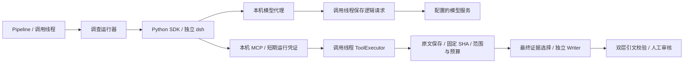

# DeepSeek Harness 调查底座接入与验收

日期：2026-10-31（Asia/Shanghai）；分支：`codex/deepseek-harness-upgrade`；基线：`3af8ea8` + 工作区。本文记录实际接入；此前的[选型](agent-runtime-survey-2026-10-30.md)和[代码规模估算](deepseek-harness-effort-assessment-2026-10-31.md)保留为研究记录。

## 1. 当前交付边界

已实现可切换的调查运行器、只读工具的本机 MCP 桥接、模型代理请求落库与轮次阻断、独立会话目录、退出清理和失败后保留基础证据。后续[搜索与影响策略升级](repository-search-impact-strategy.md)使 DSH 提供六工具，默认 builtin 仍为原三工具。最终选材、Writer、原文引文校验、审核发布、RAG 和业务状态仍由现有 Pipeline 负责。

默认 `REVIEW_INVESTIGATION_RUNNER=builtin`，原路径不需要安装Harness；显式deepseek且开启工具才使用新运行器。无新公开API/业务表或旧会话迁移。当前本机显式deepseek，API/Worker/Listener为926f61c12dca，调查/摘要/Writer使用百炼DeepSeek1017及1M配置，见[最新部署](validation/long-context-live-2026-11-01.md)；此前隔离与f6镜像阶段按原范围保留。



## 2. 模块与数据契约

- [investigation_runner.py](../backend/src/repo_maintainer/investigation_runner.py)：调查端口、单次执行上下文和原有两轮循环；旧循环的请求回放与结果语义继续保留。
- [deepseek_runner.py](../backend/src/repo_maintainer/deepseek_runner.py)：真实 SDK 启停、事件分发和最终证据回交。
- [retrospective_mcp.py](../backend/src/repo_maintainer/retrospective_mcp.py)：每次调查独立绑定 `127.0.0.1` 随机端口；MCP 与模型转发都校验短期 Bearer 和 Host。工具和数据库写入仍在 Pipeline 调用线程执行，共享原源码归档、符号索引、缓存和累计预算，不因 MCP 另起一套索引。
- [retrospective_harness_state.py](../backend/src/repo_maintainer/retrospective_harness_state.py)：固定发布版本、profile 裁剪和子进程环境隔离。
- [retrospective_harness_trace.py](../backend/src/repo_maintainer/retrospective_harness_trace.py)：原生事件、用量和 bridge call ID / Harness call ID 映射。

事故、仓库/SHA、飞书窗口和历史查询过滤由原 Python 工具执行器绑定；模型参数不能扩大范围。原三工具保留参数校验、正文预算、缓存、原文先存后返回，以及历史类比不转为 Evidence 的语义。DSH 新增找文件、单行字面量搜索和按行读取；导航先返回静态线索，读取并保存后才成为可引用原文，共用归档、索引与区域限额。

最终 Writer 只读取重新选中的证据窗口；不把 Harness 自由回答或完整会话当作原始证据。搜索升级后新 AI 版本统一标为 `v5-impact-hypotheses`，单列已观测/报告范围、覆盖缺口与未验证候选；原 `v4-deepseek-harness`/`v3-standard-tools` 历史标签保留；驳回重生继续沿用已有持久化证据，不重新开启调查。

## 3. 依赖与配置

可选依赖组 `backend[harness]` 固定 `deepseek-harness-sdk==0.2.1rc2`（同时安装同版 runtime）及 `mcp==2.3.0`。选择 DeepSeek 时校验这三个包的版本；缺失或版本不符会阻止配置就绪。普通 SDK 启动不需要系统 Node.js。

| 配置 | 默认 | 含义 |
| --- | --- | --- |
| `REVIEW_INVESTIGATION_RUNNER` | `builtin` | `builtin` 或 `deepseek`；未知值报错 |
| `INSTALL_HARNESS` | `0` | Docker build arg；设为 1 才将可选依赖装入镜像 |
| `REVIEW_HARNESS_MODEL/API_KEY/BASE_URL` | 空 | 分别回退既有 `OPENAI_MODEL/API_KEY/BASE_URL`；不改变 Writer/Embedding |
| `REVIEW_HARNESS_API` | `openai-completions` | 另支持配置 `openai-responses`；本次真实运行时测试使用前者，后者尚未真实联调 |
| `REVIEW_HARNESS_ROOT` | `runtime/harness` | 本地运行目录；Compose 固定为 `/app/runtime/harness` 并挂载独立命名卷 |
| `REVIEW_HARNESS_TIMEOUT_SECONDS` | `600` | 1–3,600秒调查期限，握手最多10秒，退出有界等待 |
| `REVIEW_HARNESS_MODEL_TIMEOUT_SECONDS` | `120` | 1–600秒HTTP等待，另受剩余调查期限限制 |
| `REVIEW_HARNESS_MAX_ROUNDS` | `40` | 1–256次探索请求准入，摘要另默认4次 |
| `REVIEW_HARNESS_MAX_CALLS` | `80` | 1–512次工具执行，builtin仍4次 |
| `REVIEW_HARNESS_TOOL_OUTPUT_CHARS` | `600000` | 1,000–4,000,000字符，含导航，单条默认12,000 |
| `REVIEW_HARNESS_MAX_OUTPUT_TOKENS` | `4096` | 128–65,536，缺失时补上限，超额拒绝 |
| `REVIEW_HARNESS_CONTEXT_TOKENS` | `1000000` | 已核验路由的容量声明，不等于整体精确Token硬限额；小窗口模型须同步调预算 |

OPENAI_ENABLE_THINKING留空不加扩展，0/1添加兼容参数。当前Writer600,000/单条60,000字符，DSH初始160,000/单条24,000/64条；builtin仍两轮/四次/8,000。新增初始、单条、字节等配置及实际DeepSeek1017模型/迁移见[完整参数](long-context-model-upgrade.md)。旧显式值优先，新默认尚无真实事故质量/费用消融。

模型代理只转发固定模型、六工具集合与指定协议路径；单次逻辑请求准备前后默认最多16,000,000字节，可配REVIEW_HARNESS_REQUEST_MAX_BYTES。调用线程先保存实际正文至generation_contexts再发上游，落库失败阻断；快照不含鉴权头，不等于完整HTTP抓包。

原生压缩后续已按[专项契约](harness-native-compaction.md)接入，新增五个 REVIEW_HARNESS_COMPACTION_* 配置，默认开启、0 可关闭；仅 Chat Completions，Responses 路径须显式关闭压缩。

Harness 只获得一次性本机凭证，上游模型密钥由 Python 代理持有。运行时 profile 关闭 shell、图片/文件读取、切目录、会话日志上送、插件清单上送、共享资源工具和通用模型重试；只提供六种领域工具（原三工具及三个固定快照搜索/读取工具）。本期是只读能力暴露，不宣称实现了额外 OS 沙箱。

## 4. 部署、回退与持久化

本地可在隔离环境安装 `pip install -e 'backend[dev,harness]'`，设置环境后按既有方式启动 API/Worker。优先使用 Linux 容器；本机 Windows 的固定版原生运行时实测启动时报 `node-addon-require-builtin-win32-x64-msvc` 绑定缺失，不能据此宣称 Windows 端到端可用。

Linux Compose 显式启用时，在 `.env` 设置：

```dotenv
INSTALL_HARNESS=1
REVIEW_INVESTIGATION_RUNNER=deepseek
```

然后按实际部署流程构建 API 镜像并更新 API/Worker；例如 `docker compose build api`、`docker compose up -d api worker`。若同时运行飞书 Listener，按既有流程核对其镜像一致性。本次没有执行这些服务更新命令。

回退设置 `REVIEW_INVESTIGATION_RUNNER=builtin` 并重建相关容器的环境即可，不需要删除会话或迁移数据库；也可以用 `REVIEW_TOOLS_ENABLED=0` 关闭调查。已有调查记录不因此消失。

每次调查在根目录下生成独立 run ID、home、空 workspace、脱敏 profile 和 Harness 原生日志。API 与 Worker 共用 `harness_data` 命名卷，独立 run ID 避免并发覆盖。`generation_contexts` 保存 `harness_run`、`harness_profile`、`harness_event`、`harness_call_mapping` 以及既有请求/执行/选择/摘要记录。

Celery 仍负责投递，事故执行锁仍由现有存储负责。当前重试仍是新调查；保存原生日志不表示实现了跨重启续跑、工具状态恢复或恰好一次执行。目录保留和定期清理策略尚未自动化，不应无限积累会话。

## 5. 验证证据和限制

本次在独立 Linux 测试镜像和专用内网 PostgreSQL 验证，GitHub/飞书/Writer/Embedding 为 Mock，模型服务为本机 SSE fixture：

- 真实 `0.2.1rc2` 运行时与 `mcp==2.3.0` 通信，完成源码补取、证据回交、Writer 和双层引文校验。
- 内存与真实 PostgreSQL 两种存储分别验证正常往返、轮次阻断、供应商 503、越界工具参数，共 8 个真实运行时用例；同一源码归档只打开一次。
- 验证逻辑请求在上游收到请求前已保存；第三次请求不会发往供应商；工具名称、模型、输出上限、鉴权和请求体大小越界被拒绝。
- 验证落库失败继续抛错、SDK 启动失败保留基础材料、期限到达后关闭 SDK 并回收运行线程，原循环与飞书入口回归保持。
- 本文最后的验证记录区分代码测试、真实模型和已部署状态。第一轮外部模型探针曾因自动审批拒绝而未执行；用户随后明确批准，已完成第 7 节记录的百炼合成两轮补证。该结果不替代真实事故质量评估。

核心测试入口：[运行器测试](../backend/tests/test_deepseek_runner.py)、[真实 SDK/MCP 集成测试](../backend/tests/test_deepseek_harness_integration.py)、[旧循环契约](../backend/tests/test_retrospective_tool_loop.py)。真实运行时用例需 `RUN_HARNESS_INTEGRATION=1`；PG 用例还需指向隔离库的 `TEST_CONTEXT_DATABASE_URL`。未配置时跳过不能算作通过。

仍未实现：整体精确 Token 预算、摘要语义保真验证、人工补材料会话 API/页面、跨重启继续执行、多 Agent、跨仓库/监控取证及发布幂等窗口修复。同步历史连接器执行中仍沿用其原超时，调查期限不保证硬中断正在执行的同步上游请求。模型用量保存提供商已报告部分，不保证失败或被终止请求的费用可完整计量。

## 6. 最终核对记录

- 相关回归 **165 项通过，无 skip**，包含 8 项真实 Harness/MCP（内存与独立 PG）用例及已有飞书/源码/锁/生成测试。两条警告来自官方飞书 SDK 的既有弃用调用。
- 默认和显式 deepseek 两组 Compose 配置解析通过；22 个 Markdown 文档的 267 个本地链接均可解析，`git diff --check` 通过。
- 使用正式 `backend/Dockerfile`、`INSTALL_HARNESS=1` 构建独立 `insight-review-harness-candidate:0.2.1rc2` 成功（镜像 `cbc396753a10`）；校验固定依赖与源码 wheel 打包成功，默认启动未导入可选 SDK。构建使用公开 PyPI，默认镜像源的 rc 包同步情况未另验收。
- 最后一次仅补充模型错误类型标记后，重跑新运行器相关用例 **31 项通过**。
- 首轮核对时原服务保持原镜像与原配置；当时真实模型探针未执行，所用模型/SSE、GitHub/飞书、Writer 和 Embedding 均为测试 fixture。用户授权后的验证见下节。


## 7. 用户授权后的百炼合成验证（2026-10-31）

用户明确批准使用既有百炼凭据后，在 Linux 候选镜像运行一次合成调查。仅将指定模型、百炼地址、必要密钥和思考选项通过 stdin 交给测试容器，没有挂载完整 `.env`。没有读取真实群聊、业务仓库或生产数据库，没有调用最终 Writer、发布或更新已有服务。

| 项目 | 实测结果 |
| --- | --- |
| 完成时刻 | 2026-10-31 17:22:25，北京时间 |
| 路由 | `dashscope.aliyuncs.com` / `qwen3.7-flash` / Chat Completions |
| 运行时 | SDK/runtime `0.2.1rc2`，MCP `2.3.0`；调用时镜像 `cbc396753a10` |
| 实际请求 | 2 次，每次最多 700 输出 Token；未增加额外云端请求 |
| 工具执行 | `search_feishu_context` 一次，返回 ok |
| 证据缺口 | `SYNTHETIC_RECOVERY_MARKER` 位于初始 1,000 字片段之外，模型通过工具取回包含恢复时间的原文 |
| 结束 | `no_tool_calls`，正常结束；模型按材料给出 12:05 恢复并保留原因未知 |
| 请求快照 / 事件 | 两份供应商逻辑请求快照，20 条运行时事件 |
| 提供商报告用量 | 输入 4,801、输出 798、合计 5,599 Token；这是两次请求的累计值 |
| 调查耗时 | 12.084 秒，单次合成测试结果，不是延迟基准 |
| 凭据检查 | 保存的请求/轨迹中未出现上游 API 密钥 |

脱敏结果、请求快照哈希与原始轨迹哈希见[验证证据 JSON](validation/deepseek-harness-bailian-2026-10-31.json)。这是单案例、单模型、单路由的调查兼容性验证；`openai-responses`、真实事故审核质量、最终 Writer 闭环、外部数据源权限和生产部署未因此获得验收。

核对真实轨迹时发现旧映射读取 `message.callId`，但固定版 SDK 的结果字段是 `message.toolCallId`，原映射记录了空值。已修正字段并拒绝保存缺失 ID 的伪映射；增加 3 个字段回归用例，并加强真实 SDK/MCP 用例要求映射 ID 必须对应实际 tool/call。用同一份真实事件离线回放确认修复，不新增百炼调用；修复后相关测试 **34 项通过，无 skip**（含真实运行时及隔离 PG）。原探针记录与修复后的离线映射在证据 JSON 中分开标注。

修复后的正式 Dockerfile 候选镜像已重建为 `9463af97d908`，其已安装 Python 包也通过同一真实事件的离线回放。270 个本地链接核对通过，`git diff --check` 通过。测试容器和专用数据库/内网已清理；既有 API、Worker、Listener 等服务保持原运行状态。

## 8. 搜索与影响范围策略升级（2026-10-31）

后续按[搜索与影响策略](repository-search-impact-strategy.md)增加三个固定快照工具，DSH 共六工具；默认探索额度由 2/4/8,000/30 秒调整为 6 次模型请求/12 次工具/12,000 返回字符/60 秒。builtin 仍使用原三工具和原额度；旧显式配置继续优先。导航不是 Evidence，源码不能证明事故实际传播；影响输出、审核与 Wiki 单列观测/报告、覆盖缺口及带验证方式的未验证候选。新 AI 提示版本 v5-impact-hypotheses，知识新切片 v4-impact-coverage；旧文档默认 unknown，无表迁移或旧知识自动重建。

本轮 198 项相关回归通过、无 skip（两条既有飞书 SDK 弃用警告），包含 10 项真实 Linux SDK/MCP 的本机 SSE 模型、内存与独立 PostgreSQL 用例。新增四轮搜索场景完成五次工具执行，候选保持 unverified 且结果进入待审核；模型决策由 fixture 指定。前端 TypeScript/Vite 构建通过，有既有大 chunk 提示。此次没有新云端模型调用、服务更新或发布镜像构建；第 6/7 节旧镜像与百炼记录不作为当前新工具的发布/真实模型验收。

## 9. DSH 原生会话压缩（2026-11-01）

按[原生压缩契约](harness-native-compaction.md)启用 compaction-basic，由 DSH 管理上下文压力、历史选区、摘要和 checkpoint，业务侧只附加来源索引约束、实际请求/接受拒绝记录、硬预算和原文审核保护。deepseek + Chat Completions 默认开启，REVIEW_HARNESS_COMPACTION_ENABLED=0 关闭；另提供 MAX_REQUESTS=2/MAX_TOKENS=2048/THRESHOLD=0.8/HEADROOM=2048（均以 REVIEW_HARNESS_COMPACTION_ 为前缀）。探索默认 6 次请求不变，摘要另至多 2 次，调查仍 60 秒；Responses 路径必须显式关闭压缩。压缩后缓存窗口可按需重交一次，但字符/工具/区域额度不重置，无额外外部检索。

正式 Dockerfile 构建候选 insight-review-harness-compaction-candidate:0.2.1rc2（e9f1f7dfe489），其已安装包在派生测试镜像 e25d6d50be3a 跑 261 项相关回归全过、无 skip。包含原有 10 项 SDK/MCP 与新增 10 项原生压缩（内存/独立 PG）；另将限额场景改为首次失败后再次触发，2 项验证第二次摘要确实被阻断。6 个安装模块哈希与工作区相符；详见[脱敏验收数据](validation/harness-compaction-2026-11-01.json)。模型为本机 SSE fixture，无新云端调用或运行服务更新；不宣称真实模型摘要语义保真或生产压缩质量已验收。

## 10. 用户要求后的真实模型与实际部署（2026-11-01）

此前隔离阶段结论按原范围保留。现已真实部署 f6d6e16cd93f，API/Worker/Listener 同镜像，显式 deepseek/原生压缩，真实 qwen3.7-flash 压力验收和实际 Nginx/API/Celery/Writer 合成链路通过。实际 API 容器 6 次探索 + 1 次摘要、5 次工具、13 份原文不变；合成事故最终 v1 待审核，知识/发布均 0，三类无效操作均 409。当前审核根地址 http://10.160.226.172，267 项回归与九模块哈希核对通过；详见[真实验收](validation/harness-compaction-live-2026-11-01.md)。

真实验收发现的摘要未缩短/用量漏计已补充原生失败与代理用量追踪；零素材工具回报不可通过改写查询增加来源；Writer 缺引用字段等结构错误在既有生成次数内反馈，不放宽 Schema。AGENTS.md 已将真实模型和部署测试设为后续升级完成条件。真实触发不代表摘要语义无损或生产事故质量，不能以模型口头计划当工具调用，也没有替代人工审批/发布。

## 11. 2026-11-01：1M 模型与预算贯通

现已部署926f61c12dca，调查/摘要/Writer切百炼DeepSeek-V4.1-Flash-1017，1M容量、40探索/80工具/16K摘要，并贯通初始选材、工具、Writer、16MB代理和120秒HTTP等待。275项回归无skip；实际容器12探索/11工具/3,374Token摘要、33原文不变，实际Nginx/API/Celery/Writer长材料待审核。没有业务表或依赖升级，Embedding不变、旧显式配置优先，回滚点已保存。局部96K压力触发压缩不等于测满百万；[完整参数](long-context-model-upgrade.md)、[实测和限制](validation/long-context-live-2026-11-01.md)。
