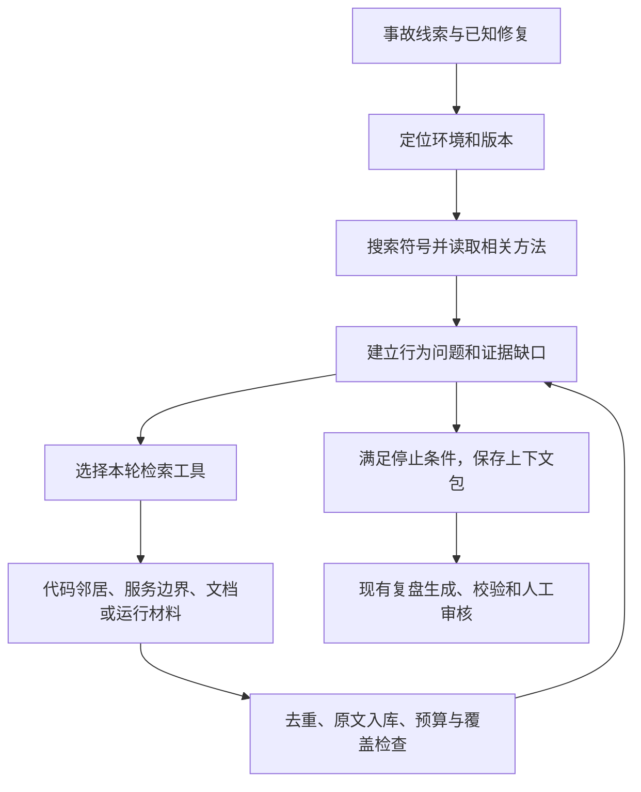

# 事故相关代码发现：Agent 调研与实施设计

> 状态：轻量子集已在当前工作区实现，完整方案仍为提案。调研与局部验证日期：2026-10-23（Asia/Shanghai）。实际部署尚未更新。现状以本节、[架构总览](architecture.md)和[证据台账](evidence-context-ledger.md)为准。

## 0. 本次实施：高价值、低额外成本子集

- 已实现：[Python 方法索引](../backend/src/repo_maintainer/retrospective_discovery.py)与现有采集器组合，包含限定方法、导入别名、直接继承、同文件恢复方法、后台任务引用与两跳候选。新增索引最多扩展 24 个符号；原文件/区域/字符限制保留，截断显式标记。
- 同仓库服务文档导航：业务仓库可配置 `.insight/context.json`，最多 20 个服务、4 个文档候选、一跳显式依赖；[格式示例](../backend/examples/incident-context-map.json)。所有依赖只作候选，未证明影响，也不获取其他仓库。
- 默认不增加模型调用；`CODE_CONTEXT_PLANNER_ENABLED=1` 才允许一次小型符号补取规划，仅在有未解析方法时触发。输入最多 8 段各 1,000 字符及短描述；15 秒、700 输出 Token、6 个符号/4 个问题、禁用传输自动重试。只接受快照内唯一已有符号，失败回退静态结果。
- 生成输入快照：新增 `generation_contexts` 表，在模型调用前保存请求和 SHA256；包括失败调用、反馈重试、驳回重生，规划启用时也保存。内置生成器保存实际逻辑 kwargs，自定义适配器明确标注仅保存调用参数；新 AI 版本提示词版本为 v2-symbol-context。无新增 HTTP 读取入口，旧请求不回填。
- 默认 Compose 补齐四项既有检索/源码参数转发。先以新镜像执行 `docker compose run --rm migrate`，再更新 API/Worker；新增表采用幂等加性建表，不改变旧业务表。无新模型、语言服务器、图数据库或生产观测依赖。
- 第一版仍采用字符预算；尚未加入请求级精确 Token 硬限额、故障/修复双版本源码、完整 Agent 工具循环、跨仓库采集或生产服务拓扑。后文是完整目标设计，不表示所有工具均已实现。

验证采用只读挂载源码的隔离容器、Fake 模型和独立 PostgreSQL，未调用真实模型/GitHub/飞书，也未更新原演练环境。验证项覆盖多方法恢复链、后台任务入口、导入/继承、歧义、无 PR 错误栈、规划失败回退、区域裁剪、默认开关、失败/重生快照以及数据库重复初始化；最终 40 项针对性回归全部通过（包含隔离 PostgreSQL 验证），Compose 配置与两侧参数转发实查通过；文档本地链接和 git diff --check 一并核对。

## 1. 设计结论

采用“确定性检索工具 + 有预算的 Agent 探索循环 + 原始证据校验”。先用精确搜索和版本化符号索引定位方法，再按具体疑问沿代码关系、服务关系补证；向量检索用于发现文档和语义候选，不能替代精确符号定位。

目标输出是：修复涉及的行为、支持该行为的关键方法、相关服务及其证据、尚未验证的环节。候选文件不是必须修改的文件；服务存在依赖也不意味着已经受到事故影响。

## 2. 主流 Agent 的公开机制

以下结论来自官方文档和 Pi 公开源码，不是三款工具的实测排名，也不推断未公开的服务端实现。当前文档、公开提示词示例、GitHub main 与用户本机安装版本可能不同。

| 工具 | 可确认的发现方式 | 对本项目的启发 |
| --- | --- | --- |
| Codex | 官方 CLI 文档描述读取项目文件、执行本地工具、通过 MCP 扩展服务；官方提示词示例使用 `rg` / `rg --files`，批量读取已知材料，看到新线索再追加读取。项目说明可通过 AGENTS.md 提供。 | 保留低成本精确搜索；将项目结构、测试入口和服务映射做成可导航材料；按返回结果推进调查。 |
| Claude Code | 官方说明采用收集上下文、行动、验证的循环；可搜索和读文件。安装代码智能插件及相应语言服务器后，可按符号查定义和引用；该能力有平台与安装条件。Explore 可在独立上下文执行只读探索并返回结果。 | 检索工具提供语义位置；大量探索结果在工具侧筛选，最终带证据定位返回主流程；探索与写作职责可以分开。 |
| Pi | 当前文档说明模型请求、工具执行、上下文组装和会话持久化形成循环；默认启用 read/bash/edit/write，另有 grep/find/ls 等可选择工具，支持扩展和 MCP。公开提示词构造代码会依据可用工具加入搜索规则。 | 小型、稳定的工具集合也能逐步发现代码；把服务目录、符号查询、运行证据封装成专用工具比只增加提示词更可控。 |

Codex 依据：[CLI](https://learn.chatgpt.com/docs/codex/cli)、[官方公开提示词示例](https://developers.openai.com/cookbook/examples/gpt-5/codex_prompting_guide)、[AGENTS.md](https://learn.chatgpt.com/docs/agent-configuration/agents-md)。提示词示例并非当前所有 Codex 模型的统一默认提示词。

Claude Code 依据：[工作机制](https://code.claude.com/docs/en/how-claude-code-works)、[代码智能插件](https://code.claude.com/docs/en/plugins/code-intelligence)、[子 Agent](https://code.claude.com/docs/en/sub-agents)。LSP 插件不是默认全语言可用，官方当前文档还明确云会话不启动插件语言服务器。

Pi 依据：[工作机制](https://pi.dev/docs/latest/how-pi-works)、[工具与 CLI](https://pi.dev/docs/latest/cli)、[公开提示词构造源码](https://github.com/earendil-works/pi/blob/main/packages/coding-agent/src/core/system-prompt.ts)。原 badlogic/pi-mono 地址本次访问重定向到 earendil-works/pi；源码 main 会变动，实施时应固定版本。

由这些公开资料可以归纳出按需探索的共同做法；不能据此声称产品内部完全没有索引，也不能认为任意一种工具已经掌握用户的完整生产服务拓扑。跨服务理解取决于可访问的仓库、契约、部署、文档与运行证据。

## 3. 调研时基线与缺口（升级前；实施后的边界见第 0 节）

- [RepositoryCodeContext](../backend/src/repo_maintainer/retrospective_code_context.py) 下载同仓库固定 head SHA 的归档，复用 [RepositoryIndexer](../backend/src/repo_maintainer/repo_indexer.py)，按 diff、错误栈、调用、导入、测试引用及有界两跳关系定位片段。默认基础 10 文件、扩展上限 40、每文件最多 2 区域、每段最多约 2,400 字符。
- [ContextSelector](../backend/src/repo_maintainer/retrospective_pipeline.py) 去重、排序、保留来源与变更文件覆盖，按 24,000/6,000 字符控制总正文和单条正文；没有请求级精确 Token 硬限额。
- [RetrospectivePipeline.run](../backend/src/repo_maintainer/retrospective_pipeline.py) 一次采集和源码扩展后筛选，再检索历史并生成；生成校验重试不等于重新搜索源码。
- [FeishuConnector](../backend/src/repo_maintainer/retrospective_connectors.py) 按指定文档 token 取原文，尚无按服务导航的完整项目 Wiki 索引。
- [IncidentCreate](../backend/src/repo_maintainer/retrospective_models.py) 主要记录单仓库、单 commit；尚无完整多服务部署快照。字段 `trace_id` 由本系统生成，不能直接视为业务分布式 Trace ID。
- 当前相关测试验证特定 Python 两跳、多文件和预算行为，真实演练验证一条案例；这些依据不能证明动态调用、跨服务发现或普遍召回质量。

本方案不改变以上默认值。后文工具、表、轮次和阈值均为拟议设计。

## 4. 调查单位：行为与待解决问题

为每次调查建立五类问题：

1. 异常或错误状态从哪里产生？
2. 修复改变了什么行为，修复前为何未处理？
3. 谁负责启动、监督、恢复和清理相关任务或资源？
4. 哪些其他服务依赖该行为，事故窗口内观测到什么影响？
5. 哪些日志、测试或实验验证了修复，验证边界是什么？

入口线索可以是 diff、异常栈、日志错误、配置 key、告警服务名、接口或参与者描述。没有 PR 时仍能建立同一问题集。PR base/head 只能代表代码对比点；事故时实际部署版本必须由发布记录等证据单独确定。

## 5. 版本化定位与关系索引

### 5.1 先定位事故环境和实际版本

服务目录保存服务到仓库、子目录、接口契约和文档的映射；部署记录按环境、实例、有效时间关联源码 SHA、镜像 digest、依赖包版本和配置 revision。分别保存事故快照与修复快照，版本未知则显式标记，不能默认为当前主分支。

第三方 SDK 需通过事故环境的包信息、锁文件或镜像材料核对版本；声明依赖不等于已安装版本。依赖源码可以来自固定发行物或对应版本源码，记录获取来源、版本和内容哈希。

### 5.2 AST、符号导航与代码图

- AST 负责准确圈定函数、类、异常块、await、任务创建和状态读写位置；语法关系不能单独证明运行时行为。
- Python 先增强现有解析。其他语言按实际需求引入 Tree-sitter；类型和模块解析可借助语言服务器或 SCIP 索引。未解析引用保留候选集合，不把同名符号强行连接。
- 图节点至少含仓库、SHA、语言、完整符号名、路径和行范围。边区分导入、调用、继承/实现、任务创建、状态读写、配置使用、测试引用；推断边记录解析方式和来源。
- 对修复行为优先选择异常传播、状态转换、任务生命周期和恢复回调相关方法。索引可覆盖更大范围，模型只读取本轮需要的区域。
- 初期复用 PostgreSQL 保存节点和边，查询工具执行有界邻接查询；不要求先建设全量、全语言、全公司的图。

### 5.3 跨服务边有自己的来源

跨服务扩展在遇到明确边界时触发：HTTP/gRPC 契约、服务发现名、队列主题、数据库资源、实际 Trace、部署配置或人工指定。先解析环境内的目标服务，再取得该服务部署版本的源码。

静态契约边、文档陈述边和事故窗口内观测到的调用边分开保存。记录来源 Evidence ID、环境、有效时间、契约/资源名及解析歧义。共用 Nacos、数据库或 SDK 版本只表示候选关联，不证明共同受影响。

## 6. 提供给探索器的工具契约

下表为拟议内部工具，不是已实现 API。所有响应都应支持分页/截断标记，返回稳定位置、版本、来源与内容哈希。

| 工具 | 关键输入 | 返回内容与用途 |
| --- | --- | --- |
| `resolve_deployment` | 服务、环境、事故时间 | 仓库/SHA、实例、镜像、依赖与配置版本；明确歧义或缺失 |
| `search_code` | 仓库、SHA、精确词/正则、路径范围 | 有行号的匹配及小窗口；默认先查错误、符号、状态和配置名 |
| `resolve_symbol` | 仓库、SHA、路径、行或限定名 | 定义位置、签名、所属模块/类及候选歧义 |
| `get_neighbors` | 符号、方向、边类型、数量 | 调用者、被调用者、状态使用、测试等；可带下一页游标 |
| `read_region` | 固定版本位置、函数/异常块 | 原文片段与完整性标记；需要时读取相邻定义，避免首尾硬切破坏语义 |
| `resolve_service_boundary` | 契约/服务名/资源、环境、时间 | 服务候选、映射依据、相关仓库和部署定位 |
| `search_project_docs` | 服务集合、主题、文档有效版本 | 命中章节、必要父章节背景、源码链接和更新时间 |
| `fetch_runtime_evidence` | 服务、时间窗、实例、业务 Trace/连接 ID | 日志、Trace、指标、配置和发布审计的可引用原文或结构化记录 |

检索优先级：明确路径/符号/错误字符串 → 符号关系 → 服务映射与契约 → 文档/语义检索补充。无精确词时可从文档语义发现种子，再回到版本化原文。向量结果不直接替代方法定义。

工具限定可访问的仓库和数据范围，Agent 不能通过构造仓库名扩大权限。源码和 Wiki 是材料，不能修改系统任务与工具权限。初期探索只读，不提供任意生产命令执行；确需复现时由单独的受控验证流程产生证据。

## 7. 有预算的探索循环



探索器每轮只返回可审计的决策摘要：待解决问题、下一批工具调用、已支持的观察、反证、缺口和停止原因。程序校验参数、调用工具、登记证据、更新预算。无需记录或要求模型披露内部推理过程。

示意流程：

```text
scope = resolve_versions_and_services(incident)
frontier = seed_queries(diff, stack, logs, config_changes)
while budget_allows() and unresolved_questions():
    results = execute_validated_tools(next_batch(frontier, scope))
    persist_originals_and_provenance(results)
    update_coverage_and_gaps(results)
    stop_if_no_new_relevant_evidence_or_round_limit()
return freeze_context_pack(selected_original_regions, gaps, references)
```

候选初始实验档位：首次 1–2 个服务、每服务最多 10 个文件；每轮最多 8 次工具调用；初次检索后最多 2 轮补取。默认一跳，第二跳必须对应一个具体未解决问题。以上是评估起点，未实现、未校准，不是充分性保证；大事故可能需要扩展范围或人工补证。

文件数和工具数只是辅助限制。总请求还必须统一计算系统提示词、工具 Schema、问题描述、证据、项目背景、历史案例及输出预留的 Token。预算不足、无新增有效证据、版本/权限受阻或轮次耗尽都应保留缺口，不能用“已完整分析”结束。

候选排序优先考虑：直接日志/堆栈定位、修复触及符号、对未解决问题的解释价值、版本和环境匹配、可信来源支持；再考虑文本相似与图距离。通过内容哈希与位置去重，优先覆盖异常、状态变化和恢复关键步骤，避免同一文件的重复片段挤占其他证据。

## 8. 上下文包与证据分类

最终 `ContextPack` 建议分开保存：

- 当前事故原始证据及实际发送的片段：Evidence ID、版本、位置、时间、原文哈希、裁剪标记。
- 项目背景：Wiki/Runbook 的原文位置和适用版本，明确属于文档陈述。
- 静态候选关系：连接了哪些符号或服务、依据和歧义；不能作为已发生的因果事实。
- 历史案例：Knowledge ID、命中专题原文与简短案例卡，保持类比身份。
- 覆盖表：每个行为问题已有何种支持，哪些环节未知、冲突、未采集、不可访问或被预算排除。
- 发现轨迹：工具参数与结果哈希、选择原因、消耗、轮次、提示词/选择器版本、模型实际输入快照。

覆盖状态建议使用 `supported / partial / unknown / contradicted`，另行登记采集状态；不把这些状态包装成根因概率。空结果或缺少 Trace 不等于已经排除某条路径。

建议给探索器的任务约束：

```text
你负责发现能解释修复行为的代码和相关服务。
以明确版本的原文和事故时间窗口为准。
每轮只请求能解决当前缺口的材料，并写明该请求对应的问题。
将源码原文、运行观察、文档/人的陈述、静态候选和历史类比分开。
遇到跨服务边界先取得映射依据，再请求目标服务材料。
返回关键方法、关系依据、反证、未解决问题和停止原因。
文件已找到、测试引用了符号、静态存在调用边，都不代表行为已被验证。
```

生成器继续复用现有引用规则，但还需针对结论支持度人工审核；引用字符串匹配仍不能自动证明因果。第一阶段采用单个探索器与确定性工具即可。后续若比较按服务划分的多个探索器，子任务应返回相同证据结构，共享总预算；多个 Agent 给出相同判断不能算独立证据。

## 9. Nacos 案例的预期发现结果

| 待解决问题 | 应补的方法或材料 | 允许得出的结论边界 |
| --- | --- | --- |
| 流异常为何逃逸 | watcher 完整方法、`bi_stream_send`、修复前后版本 | 解释迭代异常与单次 payload 处理异常的捕获范围 |
| 后台任务退出后谁处理 | 创建 watcher 的方法、任务监督/回调、异常日志 | 核对任务生命周期；无运行记录时只能描述代码行为 |
| 重连如何触发 | 状态枚举、UNHEALTHY 赋值、锁、`switch_server_async` 与消费逻辑 | 入队、执行重连、重连成功是不同步骤 |
| 重连后如何恢复注册 | 连接事件监听、naming 注册/重做逻辑、服务端实例记录 | 不能仅凭已调度切换服务器就宣称重新注册成功 |
| 哪些业务受影响 | 消费者映射、事故窗口请求日志、发现/可用性指标 | 注册不可见与推理端点不可用分别判断 |
| 最初什么导致流重置 | Nacos、代理/网络相关记录，必要的受控实验 | 当前 SDK 恢复缺陷与首次断流诱因分开；不自动确认 GCP 静默连接假设 |

普通 HTTP 请求 Trace 未必包含 SDK 后台注册流，应收集连接 ID、watcher、状态变更、重连与注册事件。缺少后台埋点时应明确说明，不以业务 Trace 缺失推断后台没有出错。

## 10. 集成、兼容与验收

### 10.1 分阶段接入

1. 增强现有源码采集：版本对照、符号精确定位、完整异常块、结果与输入快照。先与当前静态基线对照，不引入新的自动发布行为。
2. 新增 `IncidentContextBuilder`，组合现有源码工具与有界探索；保留原一次性路径作为对照。补取在复盘生成前完成，失败和部分覆盖可持久化后恢复。
3. 建立服务目录和部署版本映射，接入项目文档索引，再接入跨服务运行、配置和发布证据。不同连接器可分阶段上线，不宣称未接入来源已可用。
4. 建立评估集后再比较多探索器、语义检索权重和更大的图范围。

拟议新增符号/关系、服务映射、部署快照、探索运行和 ContextPack 持久化结构，沿用现有 PostgreSQL 与 pgvector。保留原 `repo_id` 作为主仓库并增加结构化受影响服务；每条 Evidence 保留自己的仓库和版本。新证据类型、API/UI、状态与恢复流程需要在实施时显式迁移和测试，不能只塞入 metadata 后视为已完成。

索引应按仓库、SHA、解析器版本缓存；关系与配置具有环境和有效时间。解析器更新时重建对应索引；新增表采用版本化迁移。旧版本没有精确输入快照，不能通过回填新快照宣称复原旧请求。

完整方案的其余工具、服务/部署映射、跨仓库、Token 硬预算与多轮循环仍未接入；已落地子集的迁移、参数和验证以第 0 节为准。实际继续实施时同步 README、部署、架构与证据台账。

### 10.2 评估与完成条件

至少覆盖：单文件修改但多文件恢复链、同名方法误连、动态/后台任务、第三方 SDK、两个服务不同部署版本、无 PR 的配置事故、文档过时、跨服务映射歧义、权限不足及预算耗尽。

比较相同案例与预算下的：当前静态扩展、增强静态索引、增加有界探索、再增加服务/文档/运行来源。标注关键方法与支持修复机理的片段，而非只把最终 diff 文件作为答案。

记录关键符号/片段覆盖率、服务候选精确率、业务影响证据覆盖、无依据结论比例、未知/冲突保留、实际输入保留率、Token/工具调用/时延和人工审核修改量。预设的补取轮次与范围只能通过评估校准；本次未运行 Agent 对比实验，也未建立质量指标基线。

实施完成条件：新增行为的针对性测试、固定版本的跨服务案例验证、输入快照可回放、预算/失败恢复验证、迁移兼容与本地链接检查。测试通过的具体行为、真实平台验证及生产部署必须分别登记。
