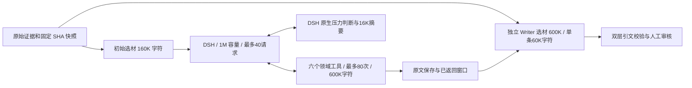

# 长上下文与 DeepSeek 1017 配置

2026-11-01（Asia/Shanghai）；分支 `codex/deepseek-harness-upgrade`，`3af8ea8` + 工作区。当前部署镜像 `926f61c12dca`；调查、原生摘要和独立 Writer 均使用百炼 `deepseek-v4.1-flash-1017`，thinking=false。模型、真实压缩和实际 Nginx/API/Celery 链路已验收，详见[实测记录](validation/long-context-live-2026-11-01.md)。

## 为什么要调整

原来的 32,768 Token、6 次探索和 2,048 Token 摘要是接入阶段的保守工程预算，未经真实事故消融证明最优。原来还有初始证据 8,000 字符、Writer 24,000/单条 6,000 字符、工具正文 12,000 字符及代理 256KB 的限制；只调大容量声明仍会过早截断材料。

官方 [DeepSeek 模型说明](https://api-docs.deepseek.com/quick_start/pricing)标注 V4.1-Flash-1017 的 1M 上下文和 384K 最大输出。直连 DeepSeek 使用 `deepseek-flash`；[百炼调用说明](https://help.aliyun.com/zh/model-studio/deepseek-api)中的准确模型名是 `deepseek-v4.1-flash-1017`，不同提供商不能机械复用模型名。百炼[模型更新说明](https://help.aliyun.com/zh/model-studio/newly-released-models)也标注该版本的 1M/384K。现有百炼凭据及兼容端点已经通过 Chat Completions 和 Responses 函数调用实测；未改为另一个凭据或服务商。

1M 是模型路由允许使用的容量，探索次数、输出、材料选择和超时是独立预算。现在允许按证据缺口使用更大的窗口，材料足够即可停止，不要求填满窗口或用完 40 轮。压缩仍由 DSH 根据压力触发；没有压力就不压缩。研究不支持把 32K 或 24,000 字符当通用安全线，见[研究依据](long-context-budget-evidence.md)。这些新默认值同样不是事故质量最优值的证明。

## 当前默认值与实际部署

以下是 `HarnessSettings`、运行装配、Compose 与本机 `.env` 的有效值；显式旧配置仍优先，不会因更新镜像自动覆盖。

| 项目 / 环境变量 | 之前 | 当前默认 / 部署值 |
| --- | --- | --- |
| 调查 / 摘要 / Writer 模型 | qwen3.7-flash（部署值） | deepseek-v4.1-flash-1017（部署值；模板提供同值，调查默认复用 OPENAI_MODEL） |
| `REVIEW_HARNESS_CONTEXT_TOKENS` | 32,768 | 1,000,000 Token 容量声明 |
| `REVIEW_HARNESS_MAX_ROUNDS` | 6 | 40 次探索模型请求；可配 1–256 |
| `REVIEW_HARNESS_MAX_CALLS` | 12 | 80 次实际工具执行；可配 1–512 |
| `REVIEW_HARNESS_MAX_OUTPUT_TOKENS` | 700 | 4,096；可配 128–65,536 |
| `REVIEW_HARNESS_COMPACTION_MAX_REQUESTS` | 2 | 4 次，另计；可配 1–32 |
| `REVIEW_HARNESS_COMPACTION_MAX_TOKENS` | 2,048 | 16,384；可配 256–131,072 |
| `REVIEW_HARNESS_COMPACTION_THRESHOLD` | 0.8 | 0.8 |
| `REVIEW_HARNESS_COMPACTION_HEADROOM` | 2,048 | 32,768 Token |
| `REVIEW_HARNESS_TIMEOUT_SECONDS` | 60 | 整次调查 600 秒；可配 1–3,600 |
| `REVIEW_HARNESS_MODEL_TIMEOUT_SECONDS` | 固定 15 秒 | 单次 HTTP 等待 120 秒；可配 1–600，另受剩余调查期限限制 |
| `REVIEW_HARNESS_INITIAL_CONTEXT_CHARS` | 固定 8,000 | 160,000 证据字符 |
| `REVIEW_HARNESS_INITIAL_ITEM_CHARS` | 固定 1,000 | 单条 24,000 字符；最多 64 条 |
| `REVIEW_HARNESS_TOOL_OUTPUT_CHARS` | 12,000 | 累计 600,000 字符，含导航条目；可配 1,000–4,000,000 |
| `REVIEW_HARNESS_TOOL_ITEM_CHARS` | 固定 2,400 | 单条证据窗口 12,000；可配 500–120,000；仍受原始区域大小约束 |
| `REVIEW_HARNESS_REQUEST_MAX_BYTES` | 固定 256,000 | 16,000,000 字节；可配 256,000–64,000,000，准备前后均检查 |
| `CONTEXT_BUDGET_CHARS` | 24,000 | 最终 Writer 证据总量 600,000 字符 |
| `CONTEXT_ITEM_MAX_CHARS` | 6,000 | 最终 Writer 单条配置 60,000 字符 |
| `CODE_CONTEXT_MAX_EXPANDED_FILES` | 40 | 运行装配 120；基础文件仍 10，初始静态扩展仍按变更数计算 |
| `CODE_CONTEXT_MAX_REGIONS_PER_FILE` | 固定 2 | 运行装配 4 |
| `CODE_CONTEXT_MAX_SNIPPET_CHARS` | 固定 2,400 | 运行装配 12,000 |
| `OPENAI_TIMEOUT_SECONDS` | 60 | Writer 120 秒；现有显式配置覆盖，Embedding 仍读该变量 |

来源索引最多 48,000 编码字符，摘要响应缓冲最多 16,000,000 字节，超限失败关闭而不丢弃来源。尾部保留比例仍为原生 16%，单次摘要不额外重试；40 次探索加 4 次摘要至多 44 次准入，独立 Writer 另计。摘要输出、探索输出和 headroom 必须能放进声明窗口。

源码区域类的直接构造默认仍为 40 文件 / 2 区域 / 2,400 字符，保留老调用兼容；以上较大值由实际运行装配传入。builtin 回退仍是两轮 / 四次 / 8,000 字符，初始 8,000/12 条及每项 1,000；最终 Writer 选择器使用新的独立预算。历史卡数量与长度、字面量单次扫描和 120 行读取限制未扩大，避免把历史类比或导航当成当前事故原文。

## 组件与证据边界

模型窗口扩大不增加外部读取权限。固定仓库/SHA/群窗口、索引路径检查、静态候选未验证、历史仅供类比、摘要仅作导航和人工审核继续生效。群聊的可信度与影响覆盖完整度分别记录；新增探索不能把静态调用直接写成运行事实。最终 Writer 不把 DSH 摘要当作 Evidence。

## 迁移与限制

没有新依赖、业务表、队列或公开 API；SDK/runtime 仍为 0.2.1rc2，MCP 2.3.0。重建带 Harness 的后端镜像、更新已有 `.env` 的显式预算并重建 API/Worker/Listener 容器。API 地址改变后须 reload Nginx。代码/模板默认运行器仍为 builtin，本机部署显式 deepseek。Embedding 继续使用 qwen3.7-text-embedding-flash，未重建向量库。

更换其他模型时需核对**该提供商路由**的窗口、输出、工具与协议支持，并同步调整 headroom、摘要、初始/工具/Writer 选材与超时；没有自动识别所有模型容量。当前 1M 不适合直接用于小窗口模型。字符预算不是精确 Token 计量，Schema、元数据、审核反馈和历史卡另占空间；代理字节限制及原生估算也不构成整体费用硬限额。

本轮真实压力请求峰值约 77K 输入 Token，成功突破旧 32K、256KB、6 次探索及 2K 摘要限制。为实际触发原生压缩，压力测试将局部容量降至 96K；部署配置保持 1M。**没有执行接近 1M Token 的满窗口请求**，也没有真实事故效果集或质量/成本消融。原生索引正确不证明摘要语义无损，候选传播条件仍须人工核对；跨重启续跑及跨仓库取证仍未实现。
