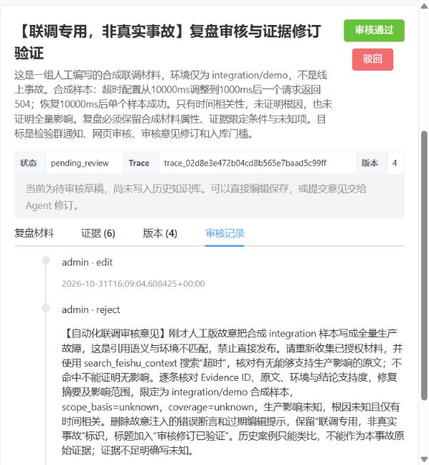

# 审核闭环真实部署与飞书联调（2026-11-01）

基线：`codex/deepseek-harness-upgrade`，`3af8ea8` + 当前工作区。日期按 Asia/Shanghai，数据库/飞书原始时间仍为 UTC/Unix 毫秒。本次由用户明确授权真实部署与飞书联调，并确认审核人与本机处于同一局域网；保留此前所有未提交改动。此前离线验证见[199 项回归记录](review-loop-2026-10-31.md)。

## 部署状态与配置

已构建并更新 API、Worker、前端及飞书 Listener，复用原 PostgreSQL/Redis 持久化卷；迁移命令完成。当前 Compose 另创建 harness_data 卷，但 builtin 路径没有启用 DSH。API、PostgreSQL、Redis 健康，Worker/前端/Listener 运行。`/api/health`、连接器就绪接口及 `/retrospective` 在本机回环与局域网地址均返回 200，用户确认已收到群通知且链接可打开正确事故。

- 审核根地址：`http://10.162.7.238`，已写入本机忽略的 `.env`，API/Worker 使用相同的 REVIEW_PUBLIC_BASE_URL；前端端口 80。
- 后端镜像：`09cfad0a2e56`；前端镜像：`94fb78ab4fa1`。API/Worker 已注册 run_retrospective、revise_retrospective、notify_retrospective_review 三类任务。
- 保持既有 `REVIEW_INVESTIGATION_RUNNER=builtin`、工具开启，未切换可选 DSH；INSTALL_HARNESS=0。模型/向量服务沿用现有百炼配置，Writer 使用 qwen3.7-flash。
- 首轮补证出现 APITimeoutError（15 秒请求预算），草稿及通知仍正常保留。使用已有配置 `OPENAI_ENABLE_THINKING=false` 更新 API/Worker 后，真实修订的补证两轮完成，一次 search_feishu_context 执行返回 empty、没有工具/模型错误。未放宽原 15 秒请求/30 秒调查预算、2 轮/4 次工具或引用/审核门槛。该配置只记录本机实配，不修改环境模板的可选默认。
- 新镜像实际主要依赖：openai 2.54.0、FastAPI 0.162.0、Celery 5.6.3、psycopg 3.3.6、lark-oapi 1.7.5；模型参数和 SDK 兼容性以本次实际返回为依据。

部署前库内 incidents、versions、knowledge_entries 均为 0。已保存 PostgreSQL 自定义格式备份（23,513 字节），位于忽略目录 `backend/runtime/deployment-backups/review-loop-20261031/postgres-before-upgrade.dump`；旧镜像保留 `pre-review-loop-20261031` 标签。旧 API 的 `/app/runtime` 不存在，未声称该路径另有备份。未删除卷或业务数据。

## 真实联调对象与证据属性

事故：`inc_95ad35f47cab456696e2e421fa4d5a32`，标题明确标注“联调专用，非真实事故”；[审核页面](http://10.162.7.238/retrospective?incident_id=inc_95ad35f47cab456696e2e421fa4d5a32)。知识隔离范围为 `validation:review-loop:20261101`。群为既有配置的 img-analysis，没有新增收件群或权限。

手工提交的描述及日志是**人为编写的合成样本**：integration/demo 中 timeout 从 10000ms 改为 1000ms、单次 504、回退后单次 200；不是生产故障或实际运行观测。采集同时继承既有配置的一份飞书文档，重新取证后共保留 6 条 Evidence（manual/ci_log/feishu_doc 各 2 条）；本案例关键结论引用的是合成描述/日志，不把该文档或历史案例当作当前生产事故证据。模型仍通过现有配置的真实服务处理材料。

两个 AI 版本、两个网页编辑版本依次保留，模型调用及工具轨迹存入真实 PostgreSQL 的 generation_contexts。网页测试使用现有 UI 的 admin actor，因此 kind=human 表示**通过人工编辑入口产生的版本**；本次操作由自动化联调完成，不等于真实审核人已经确认事实或批准发布。

## 验证结果

| 项目 | 实际结果与范围 |
| --- | --- |
| 真实生成 | v1 使用真实 qwen3.7-flash，Writer 输入/输出 Token 2527/5286，54,185ms；进入 pending_review。补证超时有软提示，没有伪称工具成功。 |
| 首次飞书通知 | 真实发送到既有群，回读消息 `om_x100b615558e6d0a8b09a502a3037255`，正文含事故 ID、v1、人工审核说明和局域网深链。用户确认收到并可打开。 |
| 网页引用硬校验 | 将引文替换为不存在的 INTEGRATION_TEST_NONEXISTENT_QUOTE_20261101 后点击保存，PATCH 返回 409，版本仍为 1，错误稿未保存。 |
| 网页直接修改 | 在仍未审核的稿件中明确标注并故意注入“全量生产影响”的语义/环境错误，通过页面保存为 v2，供修订测试；没有批准或发布。 |
| 网页意见 → Agent | 页面提交带“自动化联调”标记的审核意见，真实 Celery 异步修订完成；重新采集原授权来源、保存新 Evidence，并执行 search_feishu_context 搜索“超时”。结果 empty 只表示授权材料内未匹配，不能排除实际影响。 |
| 真实修订 | v3 Writer 输入/输出 Token 3617/817，7,167ms；撤回错误生产影响断言、保留根因未知、换用新采集的正确引文，硬错误为空；重新进入 pending_review。 |
| 第二次群通知 | v3 消息 `om_x100b615563a31ca4ce1982624bb71e2` 已由真实飞书 API 回读，使用相同事故深链；通知重试后匹配消息仍为 2 条，没有重生成或重复通知。 |
| 需要人工校对的限制 | v3 仍将合成日志标为 observed，没有完全执行审核意见中的 unknown 要求。已通过页面编辑为 v4：scope_basis/coverage=unknown，并明确材料为人为合成、未独立观测真实系统。说明字符串校验/工具/模型不能替代事实和来源属性审核。 |
| 陈旧版本批准保护 | 使用 v1 ID 请求 approve，返回 409“版本已变化”；没有执行有效版本批准。 |
| 未审核发布保护 | 使用当前 v3 ID 请求 publish，返回 409 Only approved retrospectives can be published；没有调用 Wiki 创建。 |
| 最终数据库状态 | v4，pending_review；6 条原文证据、4 个版本、edit/reject/edit 三条操作、2 个成功通知标记；publications=0，knowledge_entries=0。 |

最终引用硬错误为空，人工版本的引用按真实库内原文校验。以上只证明此合成例子的部署、通知、网页编辑、审核意见修订、版本冲突和入库门槛，不是生产事故质量评估。Listener 本次重新启动且无连接错误日志；未另行声称本次已收到新的真实用户 @启动命令。

## 后续人工步骤与剩余边界

联调草稿保持待审核，**本次没有代替审核人执行通过、发布或知识入库**。审核人可在同一页面核对 v4 后决定通过、驳回或继续修订；只有通过并发布才进入历史知识库。为避免污染案例库，不自动发布此合成联调记录。真实 Wiki 写入/审核后入库仍以此前验证和后续人工作业为准，本次未重复验收。

局域网地址依赖本机 WLAN 当前 IP，换网/IP 变化后需同步修改本机 REVIEW_PUBLIC_BASE_URL 并更新 API/Worker。未配置公网域名、隧道或扩大飞书权限。原有身份/RBAC、事务发件箱、周期补偿、跨重启业务续跑、语义因果校验与整体 Token 硬预算限制继续存在。部署镜像附加隔离回归及最终服务/本地链接核对结果在本记录追加。

## 部署镜像附加回归

使用本次实际部署的 `insight-review-backend:latest`（09cfad0a2e56，含上述实际安装依赖），只读挂载 tests，在独立 internal 网络/临时 pgvector 上运行以下 8 个 unittest 模块：review_loop、execution_api、feishu_task_runtime、tool_loop、feishu_connector、review_model_options、retrospective_pipeline、incident_execution_lock。**90 项测试通过，无 skip（8.596 秒）**；故障注入的预期日志与 SDK 弃用提示不计为失败。测试未使用真实环境凭据、外网或业务数据库，临时容器/网络已删除。

构建时前端 vue-tsc/Vite 通过，原有大 chunk 提示保留。仅修改本机配置与本轮文档，没有新增产品源码或放宽预算/审核校验。

最终核对：六项服务均运行，API/PostgreSQL/Redis healthy，Celery inspect ping 返回 1 node online/pong；API/Worker 的审核根地址与 thinking=false 配置一致。真实库回查 v4 所有引文逐字匹配原文、v1 旧证据仍在，审核意见未成为 Evidence，approve 操作数为 0。本地 Markdown 链接 **314 个全部有效**，git diff --check 通过；临时测试容器/网络已清理。
